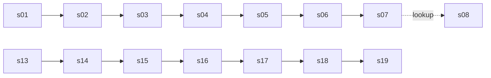

# Key-flow screen map (course lesson 07, step F4)

- Status: owner-accepted F4 recommendations (Q1–Q8, 3 layouts for s01 and s18). Design only; no application code changes.
- Prototype: `.ai/prototypes/discovery/commerceos-key-flow/revision-001/index.html` (gray, neutral, simulated data). Context record: `.ai/prototypes/discovery/commerceos-key-flow/revision-001/README.md`.
- Sources: `.ai/specs/product-brief.md` (Key flows, R01–R10, N01–N06, D01–D11), `.ai/specs/implemented/` (storefront-catalog, cart-and-demo-checkout, orders-dashboard-demo-store, commerce-copilot, customer-accounts, admin-authentication), `.ai/design/POSTEP.md`, `.ai/design/audyt.md`, routes under `packages/app/src/app/`, e2e files under `packages/app/e2e/`.
- Nature of the work: retrofit. The app and its e2e suite already exist. The map shows which states the specs define, which the app implements, and which only unit or integration tests cover. It does not design screens from scratch.

## 1. Question the prototype answers

Can a shopper (guest or signed-in customer) go catalog → cart → demo checkout → confirmation → "My orders", and can the owner go order in admin → Copilot question → decision on a recommendation (save, dismiss, complete)? At each step, is it clear what is demo or fictional? What does a person see on empty data, errors, conflicts, denied access (another customer's order, wrong role) and the Copilot LLM fallback?

Type: role and comprehension (sequence, labels, choices, recovery). Visual appeal is out of scope for this gray step.

## 2. Owner decisions (F4, accepted)

| # | Decision | Source gap | Effect on the prototype |
|---|---|---|---|
| Q1 | One prototype `commerceos-key-flow` for both key flows, with an account switch (guest / customer A / customer B / owner) in the review bar | – | One HTML file; shared screens s01–s07 |
| Q2 | No account-signup nudge on the order confirmation (s07). Show the reference and "Find your order" only | L1 | No CTA to sign up on s07. Reason: N06 forbids attaching past guest orders, so the nudge would promise something the product cannot do |
| Q3 | Copilot empty store (s18): the design-system Empty pattern, one sentence: "Not enough data yet: no paid orders and no traffic in this period." Suggested questions stay visible | L2 | `copilot-empty` state |
| Q4 | No new entry point to Copilot from the dashboard or an order. Only the admin menu | L3 | No CTA in s14 or s16; the menu link is the only route (s17) |
| Q5 | No new state for an interrupted or very long Copilot request. Reuse the 500 message "Copilot is temporarily unavailable." with "Ask" again. Unsaved `new` rows stay hidden | L4 | No timeout banner; s18 shows the 500 state |
| Q6 | One loading pattern: the design-system Skeleton in every route group, including admin (replaces text "Loading…") | L5 | Skeleton in s02, s04, s11, s14, s15, s17 |
| Q7 | 320 px is the width contract (WCAG 1.4.10); 1440 px is the desktop check. 390 px stays as a second check | L6 | Layouts checked at 320 and 1440 |
| Q8 | Every conflict is reachable from the prototype's Test state controls. Only two (last unit sold out at checkout; order status conflict in admin) get e2e in L08. The rest stay on unit and integration tests | L7 | Controls exist for all conflicts; e2e scope is for L08 |
| G12 (L8) | The cart removes a withdrawn product automatically and shows a message (as implemented). The spec table text "remove it" is corrected in the retrofit spec. | L8 | s04 shows the removal message, no blocking |
| 3 versions | s01 (storefront home) and s18 (Copilot answer) each have layouts A, B and C | – | Switch in the review bar; the owner has not yet picked one (see §5) |

Open choices kept for the owner: which layout wins for s01 and s18; the L9 theme-toggle entry in the retrofit spec (not in the prototype's scope beyond the footer).

## 3. Screen list (s01–s19)

Route names are the ones in `packages/app/src/app/`. "Guard" is the server rule the prototype mirrors.

### Shopper (guest or customer)

| ID | Screen | Route | Guard | Simulated states | Storyboard question |
|---|---|---|---|---|---|
| s01 | Storefront home (3 layouts A/B/C) | `/` | none | default, featured empty for category, unknown category → All, loading, error "catalog temporarily unavailable", empty store "No categories yet.", narrow menu | Does the shopper know where to start, and what is demo? |
| s02 | Catalog and search | `/products` | none | list, active category, empty category (drafts only), no results + "Clear search", loading, error, over-limit "Showing 48 of N" | Can the shopper find a product and add it? |
| s03 | Product | `/products/[slug]` | none | default, out of stock (button disabled), not found (draft or unknown), "Adding…", "Added to cart.", quantity over stock, loading, error | Is stock and the add action clear? |
| s04 | Cart | `/cart` | none | empty ("Your cart is empty."), items, "Only N left", withdrawn product removed with message (G12), cookie note, loading, error | Is the cart total and the stock limit clear? |
| s05 | Checkout | `/checkout` | empty cart → s04 | "Buying as a guest" + Sign in; "Buying as <email>" (customer); field errors; double click → one order; 409 prices changed; 409 last unit sold out; cart changed in another tab; session read failure (guest-mode banner, A24); general error | Who is the buyer, and what happens if the price or stock changed? |
| s06 | Demo payment | `/checkout/pay/[reference]` | none (public reference) | demo banner "Demo store — this is a demo payment…", "Confirm demo payment (no charge)", no card fields, already paid → s07, cancelled "This order can no longer be paid.", not found | Is it obvious that nothing is charged? (R03) |
| s07 | Confirmation and order status | `/orders/[reference]` | public reference, customer session for account orders | "Thank you — demo payment received", pending + "Complete demo payment", status after owner change (processing, shipped, cancelled, refunded), not found, loading | Is the reference enough to find the order later? (Q2: no sign-up nudge) |
| s08 | Order lookup (guest) | `/orders/lookup` | rate limit | form, malformed reference, not found, rate limit "Too many lookups. Try again in a minute." | Can a guest find their order? |
| s09 | Customer sign-up | `/account/sign-up` | signed-in → s11 | form with note "demo store… no password reset", "Continue as a guest", duplicate-email generic error, attempt limit, sign-in unavailable, loading | Is the account optional and honest about the demo? (R10) |
| s10 | Customer sign-in | `/account/sign-in` | signed-in → s11; owner session → here | form, wrong password (generic), return to checkout, attempt limit, "Sign-in is unavailable" | Does the sign-in page make the role clear? (R09) |
| s11 | My orders | `/account/orders` | guest → s10; owner → s10 | list (Paid order), empty "You have no orders yet.", limit note "Showing your 50 most recent orders.", loading, error "Your orders are unavailable…", sign out | Does the customer see only their own orders? (R08) |
| s12 | Account order detail | `/account/orders/[id]` | customer; foreign, random or malformed id → "Order not found" | own order (read-only), pending + link to payment, "Order not found" (foreign, random, malformed), API 404 same body | Does another customer's order look the same as a missing one? (R08) |

### Owner

| ID | Screen | Route | Guard | Simulated states | Storyboard question |
|---|---|---|---|---|---|
| s13 | Owner sign-in | `/admin/sign-in` | owner → s14; customer session → here | form, wrong password, attempt limit, customer session redirected here, sign out | Is the owner area separate from the shop? (R09) |
| s14 | Dashboard | `/admin` | owner; else → s13 | 7 days, 30 days, custom range and comparison, invalid range → alert and back to 7 days, "Not enough data", demo-order note, empty store "No orders yet…", loading skeleton, error, 390/320 px | Do the metrics have definitions and a period? (R05, R07) |
| s15 | Orders list | `/admin/orders` | owner | list with Demo / Account / Guest badges, paging "Newer / Older", empty, loading, error, no session → s13 | Can the owner find the order and tell demo from real? (R07) |
| s16 | Order detail (admin) | `/admin/orders/[id]` | owner | transitions from the table below, cancel with checkbox (pending only), "Mark as refunded (record only)", terminal "No further status changes.", demo note "Seeded demo order…", conflict "This order changed to Paid in the meantime", not found, "(deleted product)" | Does the owner see what each button does? (R02, A3/A4) |
| s17 | Copilot question | `/admin/copilot` | owner | banner "Copilot suggests; you decide…", 7 suggested questions, input 500 with counter, waiting "Analysing your store data…", 400, 429 "You asked many questions…", 500 "Copilot is temporarily unavailable.", loading | Can the owner ask a question and know it is advice only? (R02, D09) |
| s18 | Copilot answer (3 layouts A/B/C) | `/admin/copilot` (answer state) | owner | source: AI-generated · model; rule-based insights (AI not configured); AI timed out; daily limit; failed our checks (all four show rule-based insights, R06). Kind: answer with 3 cards and evidence tables; refusal (margin, conversion by source); question outside the list; empty store; 500. Traffic values tagged "Fictional demo data" | Can the owner see the numbers, period, evidence and limits behind each recommendation? (R01, R05, R06, R07) |
| s19 | Recommendation decision and "Your recommendations" | `/admin/copilot` (saved list) | owner | empty "Saved recommendations appear here.", Save, Mark completed (no actions left), Dismiss (removed), not signed in → s13, conflict "changed in another tab" (#67), paging by 20, "(deleted product)" | Can the owner keep, drop or finish a recommendation? (Copilot A14) |

### Layouts for s01 and s18 (3 versions)

- **s01 A:** hero, then featured grid, then category tabs. Entry point is the hero.
- **s01 B:** category tabs first, then the featured grid. No hero.
- **s01 C:** compact list of featured products with category filter at the top.
- **s18 A:** three cards, each with its evidence table below.
- **s18 B:** summary table of all three recommendations first, then the cards.
- **s18 C:** one tab per recommendation; the source banner stays above the tabs.

All layouts show the same content and the same states. They differ only in order and grouping. The prototype default is A. The owner picks one for each screen (§5).

## 4. Flows

### 4a. Purchase → owner → Copilot

1. Shopper: s01 → s02 → s03 (add) → s04 → s05 → s06 (confirm demo payment) → s07 (reference, status).
2. Owner: s13 → s14 → s15 → s16 (sees the paid order) → s17 (question) → s18 (answer) → s19 (save, dismiss or complete).
3. Owner's path to Copilot is only the admin menu (Q4). The prototype does not add a shortcut.

### 4b. Customer account (D11)

- s09 (sign up) or s10 (sign in) → back to checkout (s05, "Buying as <email>") → s06 → s07 → s11 (My orders, now lists the account order) → s12 (own order, read-only).
- Foreign or random id from s12 → "Order not found" (same body as a missing order).
- Owner session on s11 or s12 → s10 (sign in as a customer).
- Customer session on s13 or s14 → s13 (owner sign-in).

## 5. Decisions still open for the owner

1. Layout for s01 (A, B or C).
2. Layout for s18 (A, B or C).
3. Whether the L9 theme toggle is described in the retrofit spec (footer only, or header as well).

## 6. Assumptions (all `[ASSUMPTION]`, listed in the prototype's README with IDs)

- AS-01: an owner session checks out as a guest. The owner is not a customer (R09). The brief does not say this explicitly.
- AS-02: `refunded` is reachable from `paid`, `processing` and `shipped`, as in `packages/core/src/domain/orders/order-status.ts`. The spec names it only as a recorded status.
- AS-03: simulated data only: products are gaming accessories (D10) with invented names and prices in PLN. No real person, store or order.
- AS-04: "now" is fixed at 2026-10-16 12:00 Europe/Warsaw (the spec's example period, "Last 7 days: 9–16 Oct 2026").
- AS-05: the simulated loading delay is a short, fixed local timer. Real latency is not modelled.
- AS-06: layouts A/B/C use the same content and the same state set; a difference in one layout is not evidence about the others.
- AS-07: the Copilot answer content (three recommendations, numbers, dates) is invented for the prototype and is not what the app's tools would return.

## 7. States per screen (summary)

| State | Where it appears |
|---|---|
| Loading | s01, s02, s04, s05, s07, s09, s11, s14, s15, s17 (Skeleton, Q6) |
| Empty | s01 (no categories), s02 (empty category), s04, s11, s14, s15, s18 (empty store, Q3), s19 |
| Error | s01, s02, s04, s05 (general), s06 (cancelled), s11, s14 (error boundary), s17 (500) |
| Success | s05 → s06 → s07, s16 transitions, s19 save and dismiss |
| Conflict | s05 (price, last unit, cart changed), s16 (status changed), s19 (changed in another tab) |
| Denied / not found | s06 (not found), s07 (not found), s08 (rate limit), s12 (foreign id), s13–s19 (no owner session) |

## 8. What the storyboard answers

- Does the shopper know that the payment is a demo (R03) and that the data is fictional (R07)? Checked on s06, s07, s14, s18.
- Does the owner understand what a Copilot number means and where it comes from (R01, R05)? Checked on s18 evidence tables and the metric definitions block on s14.
- Does the fallback show something useful and honest when the LLM is unavailable (R06)? Checked on s18 source banners.
- Does the customer see only their own orders (R08), and does the owner area stay separate from customer sessions (R09)? Checked on s12, s13, s10 with the account switch.
- Can a guest always buy (R10)? Checked on s05 guest mode and s07.

## 9. Not covered

- Real visual design, tokens, components: that is the design-system prototype (a later step, not this PR).
- Real latency, real data, real payments, real email (N02, N06).
- The Copilot's real answers and their quality (A03 is untested; the prototype only shows the presentation).
- Persona or real-user evidence: the walkthrough is a separate step. Synthetic or prototype results are not evidence (Definition of Ready, `SDLC.md`).
