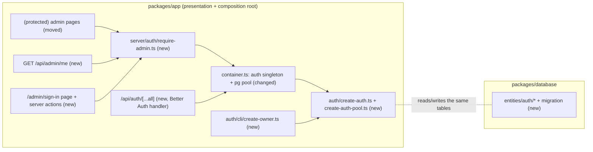

# Admin authentication and the server-side admin guard

- Backlog: E03-S01 ([#19](https://github.com/BOMateuszBialas/techleaders/issues/19)), epic E03 (#10)
- Status: draft, ready for review (Open Questions answered 2026-10-15)
- Design authority: `.ai/specs/product-brief.md`, `.ai/specs/2026-10-13-commerceos-mvp.md` §3, §4, §8

## 📝 TLDR

Today `/admin` is an unauthenticated shell that must not show store data or allow mutations (AGENTS.md), so no admin story (catalog, stock, orders, dashboard, Copilot) can start. **Proposed:** the single store owner signs in with email and password through **Better Auth**, with DB-backed, revocable 8-hour sessions. Every admin page, route handler and server action checks the session **on the server** through one module, `server/auth/require-admin.ts`. Later stories call it and never touch cookies or the library directly.

## 📝 Decisions (answers to the Open Questions, 2026-10-15)

| #   | Question       | Decision                                                                                                                                     |
| --- | -------------- | -------------------------------------------------------------------------------------------------------------------------------------------- |
| Q1  | Auth library   | **Better Auth** (`better-auth@1.7.x`, peer `next ^16`), email + password                                                                    |
| Q2  | Owner account  | Created and updated by a CLI command from `ADMIN_EMAIL` / `ADMIN_PASSWORD`; **no public sign-up**                                           |
| Q3  | Sign-in method | Email + password only (no OAuth)                                                                                                             |
| Q4  | Roles          | One role, `owner`, stored in a column with a check constraint (a later role is an additive migration)                                      |
| Q5  | Session        | 8 h lifetime, sliding renewal; sign-out deletes the session row; cookie `httpOnly`, `sameSite=lax`, `secure` in production                 |

## 📝 Problem Statement

- The admin shell (`packages/app/src/app/admin/layout.tsx`, `page.tsx`) has no authentication. Its comment and AGENTS.md block it from exposing store data or mutations.
- E03-S02/S03, E04 and E05 depend on this story (`.ai/specs/backlog.md`).
- Acceptance criteria (#19):
  - **AC1:** valid credentials reach the admin.
  - **AC2:** without a session, admin pages redirect and admin APIs return 401, decided on the server.
  - **AC3:** invalid credentials give a generic error that does not reveal whether the account exists.
  - **AC4:** sign-out invalidates the session.
- Spec §4/§8 require a maintained auth library with secure session defaults, and forbid hand-rolled password hashing or session security.

## 📝 Proposed Solution

Better Auth owns credentials, hashing (scrypt), session issue and verification, rate limiting and origin checks. CommerceOS owns three things:

1. **Who may sign in**: one owner, created by CLI. Sign-up is disabled.
2. **Where sessions are checked**: the `require-admin` module, used by every admin entry point.
3. **The schema**: Better Auth's tables are MikroORM entities with a migration, so migrations stay the source of truth.

Alternatives rejected (Q1):

- **Auth.js v5:** Credentials sessions are JWT only and cannot be revoked (fails AC4), and hashing would be ours to write.
- **iron-session + argon2:** revocation and rate limiting would be ours to write, which comes too close to "session security from scratch" (spec §4).

Better Auth's own `migrate` CLI is not used; see Data Model.

## 📝 Architecture

**Takeaway:** Better Auth is a singleton in the composition root with its own small `pg` pool. Everything that guards admin access goes through `require-admin.ts`. MikroORM owns the schema, and Better Auth only reads and writes rows. Neither the auth factories nor the CLI import `@commerceos/database`, so the ESLint package-boundary rule (only `container.ts` may import it) holds.

- **`packages/app/src/server/auth/`** (new concept folder):
  - `create-auth-pool.ts`: `createAuthPool(databaseUrl)` returns a `pg.Pool` with `max: 5`. `pg` is already installed through `@mikro-orm/postgresql` 7.2; it becomes an explicit dependency of `@commerceos/app`.
  - `create-auth.ts`: a pure factory `createAuth({ pool, env })` that returns the Better Auth instance. It contains the config below and **no** `server-only` import, so the CLI can reuse it.
  - `require-admin.ts` (`server-only`): the guard API. It gets `auth` from `getAuth()`, a new export of `container.ts` that resolves the singleton from the **root** container, so it needs no request scope. The session itself comes from the request headers on every call.
    - `getCurrentAdmin(): Promise<AdminPrincipal | null>`, where `AdminPrincipal = { id, email, role: "owner" }`. It reads `headers()` and calls `auth.api.getSession`. The returned DTO never includes the raw session or token.
    - `requireAdminPage(): Promise<AdminPrincipal>` redirects to `/admin/sign-in` when there is no admin. Use it in Server Components and page data loaders.
    - `requireAdmin(): Promise<AdminPrincipal>` throws `UnauthorizedError`. Use it in route handlers (through `apiHandler` → 401) and server actions.
    - `adminApiHandler(route, (request, admin, ...args) => …)`: `apiHandler` plus `requireAdmin`, the one wrapper for every future `/api/admin/*` route.
  - `sign-in.action.ts` and `sign-out.action.ts`: server actions. Their input is validated with a Zod schema in `packages/core/src/validators/auth/sign-in.schema.ts`.
  - `upsert-owner.ts`: `upsertOwner({ auth, email, password })` creates the owner, or, when the owner exists, updates its password and deletes its sessions. Unit-tested with a faked `auth`.
  - `cli/create-owner.ts`: a thin entry point. It reads `ADMIN_EMAIL` / `ADMIN_PASSWORD` from **env only** (never argv), validates them, and calls `upsertOwner`. Like `packages/database/src/cli/**`, it needs a live database. **Coverage exclusion requested** (`packages/app/src/server/auth/cli/**`, with the same reason as the DB CLI; integration tests and the e2e setup run it). This needs the user's approval.
- **`packages/app/src/server/container.ts`** gets two singleton registrations, `authPool` (disposer: `pool.end()`) and `auth`, plus the `getAuth()` export. They are singletons because Better Auth is stateless per request. The request's session is read from headers on each call, so no request state lives in a singleton, which strict mode requires.
- **`packages/database`** gets entities in `src/entities/auth/` (`admin-user`, `admin-session`, `admin-account`, `admin-verification`, `admin-rate-limit`), registered in `entities/index.ts`, and one migration.
- **`packages/core`**: only the shared `signInSchema` (email, password 8–128 chars) and the `ADMIN_ROLES = ["owner"]` constant. No port is added, because no use case needs the current admin yet. Later stories pass `actorId: string` into use cases explicitly.
- **Routes:** `app/admin/(protected)/layout.tsx` and `page.tsx`, moved into a route group, so the URLs are unchanged. `app/admin/sign-in/page.tsx` sits outside the group. The protected layout keeps the static shell, and reads the session only inside a `<Suspense>` boundary (Next 16 cache-components guide: no top-level `await` on the session in a layout).
- **No `proxy.ts` in this story.** Each page and action checks the session itself, and a proxy check is only optimistic (Better Auth and Next docs). It can be added later purely to avoid a flash of the shell.

### Better Auth configuration (`create-auth.ts`)

| Setting                                                       | Value                                                                 | Why                                             |
| ------------------------------------------------------------- | --------------------------------------------------------------------- | ----------------------------------------------- |
| `database`                                                    | the injected `pg.Pool`                                                | one adapter, schema owned by MikroORM           |
| `baseURL` / `trustedOrigins`                                  | `APP_URL`                                                             | origin and CSRF check; no new env var for the URL |
| `secret`                                                      | `BETTER_AUTH_SECRET` (new env, min 32 chars, required)                | Better Auth throws in production without it     |
| `emailAndPassword`                                            | `{ enabled: true, disableSignUp: true, minPasswordLength: 8 }`        | Q2, Q3                                          |
| `session`                                                     | `expiresIn: 28_800`, `updateAge: 3_600`, `cookieCache` disabled       | Q5; no cache, so revocation is immediate (AC4)  |
| `advanced.database.generateId`                                | `"uuid"`                                                              | matches the existing `uuid` primary keys        |
| `user` / `session` / `account` / `verification` `modelName` + `fields` | `admin_users`, … with snake_case columns                         | project naming (ENGINEERING_STANDARDS §1)       |
| `user.additionalFields.role`                                  | `{ type: "string", input: false, defaultValue: "owner" }`             | Q4; never settable from a request               |
| `rateLimit`                                                   | `enabled: true`; `customRules["/sign-in/email"] = { window: 60, max: 5 }`; storage `"database"` (table `admin_rate_limits`) | brute-force protection that survives restarts (see Risks) |
| `advanced.ipAddress.ipAddressHeaders`                         | from `AUTH_TRUSTED_IP_HEADER` (optional env); unset → the library default, documented | the rate-limit key must not come from a spoofable header behind an unknown proxy |
| cookies                                                       | library defaults: `httpOnly`, `sameSite=lax`, `Secure` and `__Secure-` prefix in production | `lax` is enough: every mutation is a POST guarded by origin checks (Better Auth `trustedOrigins`, Next server actions) |
| `plugins`                                                     | `[nextCookies()]` (last)                                              | lets server actions set the session cookie      |

## 📝 Data Model

New tables, all created by one MikroORM migration. Table and column names are set through Better Auth `modelName`/`fields`; the exact column set is taken from `npx auth@1.7 generate` output in step 1.2. No personal data beyond the owner's email.

| Table                 | Key columns                                                                                                     | Constraints                                     |
| --------------------- | --------------------------------------------------------------------------------------------------------------- | ----------------------------------------------- |
| `admin_users`         | `id uuid`, `email`, `name`, `email_verified`, `image`, `role`, `created_at`, `updated_at`                      | `unique(email)`, `check (role in ('owner'))`    |
| `admin_sessions`      | `id`, `user_id → admin_users (cascade)`, `token`, `expires_at`, `ip_address`, `user_agent`, timestamps          | `unique(token)`, index `user_id`                |
| `admin_accounts`      | `id`, `user_id → admin_users (cascade)`, `account_id`, `provider_id`, `password` (scrypt hash), timestamps      | index `user_id`; OAuth token columns stay null  |
| `admin_verifications` | `id`, `identifier`, `value`, `expires_at`, timestamps                                                           | required by Better Auth core; unused for now    |
| `admin_rate_limits`   | `id`, `key`, `count`, `last_request`                                                                            | `unique(key)`; rate-limit counters only         |

- The password hash is stored only in `admin_accounts.password`. It never leaves the server: `AdminPrincipal` carries no hash, the entities are not exposed by any route, and the logger redacts `password` keys.
- **Rollback:** the migration's `down` drops the five tables. No existing table changes.

## 📝 API Contracts

All additive (BACKWARD_COMPATIBILITY §2).

- **`/api/auth/*`**: Better Auth's handler (`toNextJsHandler`). Used: `POST /sign-in/email`, `POST /sign-out`, `GET /get-session`. Sign-up returns an error because `disableSignUp` is set. These are library-owned shapes, not part of our `ApiResult` contract.
- **`GET /api/admin/me`**: a guard probe. It is the first route behind `adminApiHandler` and the e2e proof of AC2 until real admin APIs exist; later the admin UI may use it to show who is signed in. It returns `200 { ok: true, data: { id, email, role } }`, or `401 { ok: false, error: { code: "UNAUTHORIZED", … } }` when there is no session.
- **Server actions:**
  - `signIn(prevState, formData)` validates input with `signInSchema` and calls `auth.api.signInEmail`. On success it redirects to `/admin`, or to the `next` path only if `safeAdminPath(next)` accepts it. The rule: after URL-decoding and normalisation it must match `^/admin(/[A-Za-z0-9/_-]*)?$`, contain no `//`, `\` or `..`, and not be `/admin/sign-in`. Anything else → `/admin`. On failure it returns `{ error: "Invalid email or password." }`, always the same message (AC3). A 429 returns `"Too many attempts. Try again in a minute."`.
  - `signOut()` calls `auth.api.signOut`, which deletes the session row (AC4), then redirects to `/admin/sign-in`.
- **Env** (BACKWARD_COMPATIBILITY §4, additive):
  - `BETTER_AUTH_SECRET` is required at runtime only (`getEnv()` stays lazy, so `next build` does not need it).
  - `APP_URL` keeps its `http://localhost:3000` default in development and test, but becomes **required in production**. It is the trusted origin, so a silent localhost default must not reach production. The e2e setup already sets it.
  - `AUTH_TRUSTED_IP_HEADER` is optional (see the config table).
  - `ADMIN_EMAIL` and `ADMIN_PASSWORD` are read **only by the CLI**, not by the app schema. The CLI requires a password of at least 12 characters for the owner, stricter than the library's 8.
  - All of them go into `.env.example` with placeholders.

## 📝 UI/UX

- **`/admin/sign-in`:** a centered card with email and password fields, a "Sign in" button with a pending state, and a generic error shown in a `role="alert"` region. It notes that this is the owner's panel of a demo store. An already signed-in owner is redirected to `/admin`.
- **Admin shell:** shows "Signed in as {email}" and a "Sign out" button, which streams in behind `<Suspense>`. Session-derived UI is never put in a `use cache` scope (no `use cache: private` either, in this story), so nothing about one owner's session can be served to another request. The dashboard copy "Admin authentication is not implemented yet" is removed.
- **Accessibility:** labelled inputs, `autocomplete="email"` and `current-password`, focus moves to the error message, and the keyboard order is: email → password → submit.

## 📝 Edge Cases & Failure Scenarios

| Case                                                     | Behaviour                                                                                         |
| -------------------------------------------------------- | ------------------------------------------------------------------------------------------------- |
| Wrong password, or unknown email                         | Same generic message and status (AC3); logged as `auth.sign_in_failed` without email or password. Step 3 checks that Better Auth hashes a dummy password for an unknown email (no timing gap); if it does not, `signIn` adds the dummy hash itself |
| 6th attempt within 60 s from the same IP                 | 429 → "Too many attempts…"; no credential check performed                                         |
| Session expired (no activity for 8 h)                    | `getSession` returns null → redirect to sign-in (pages) / 401 (API)                              |
| Session row deleted (sign-out in another tab)            | Same as expired; immediate, because the cookie cache is off                                      |
| `next` parameter set to an external or non-admin URL     | Ignored; redirect to `/admin` (open-redirect guard)                                               |
| Server action posted without a session (stale form)      | `requireAdmin()` throws `UnauthorizedError` → the action redirects to sign-in, and no mutation runs |
| DB down during sign-in                                   | Generic "Sign-in is unavailable, try again" message; error logged; no stack trace to the user    |
| `BETTER_AUTH_SECRET` missing in production               | `getEnv()` fails fast with a clear message at the first request                                  |
| CLI run without `ADMIN_EMAIL`/`ADMIN_PASSWORD`, or a password under 12 chars | CLI exits non-zero with a validation message, and nothing is written         |
| CLI run twice                                            | Second run updates the password and deletes the owner's existing sessions (password rotation)    |

## 📝 Risks & Impact Review

- **Owner creation with sign-up disabled is unverified:** whether `auth.api.signUpEmail` bypasses `disableSignUp` on the server is undocumented. Step 4 starts with a spike. The fallback is `(await auth.$context)` → `password.hash` plus `internalAdapter.createUser` / `linkAccount` / `updatePassword`, which still uses the library's hashing. Enabling sign-up, even in the CLI's own instance, is **ruled out**: a wiring bug would expose public sign-up. If neither path works, stop and revisit Q1.
- **Second connection pool:** Better Auth uses its own `pg.Pool` (max 5) next to MikroORM's. That is acceptable for the MVP. Sharing MikroORM's Kysely instance was not chosen, because it couples the auth singleton to ORM internals.
- **Brute force:** the IP limit (5 per minute, stored in the DB) slows a single attacker. There is **no per-account lockout**: with one owner account, a lockout would let anyone lock the owner out (a denial of service). The owner's 12+ character password makes a distributed guess impractical. This is a documented limitation.
- **Library-owned endpoints under `/api/auth/*`:** a Better Auth upgrade can change them. The version is pinned to `1.7.x`, and the e2e sign-in test covers the path we use.
- **Moving admin pages into a route group:** the URLs are unchanged (BACKWARD_COMPATIBILITY §1 is untouched).
- **Product direction:** none changed. This implements #19 within D05 (a small-store owner) and N01 (a single store).

## 📝 Decisions in play

- **D05:** the user is a small-store owner, so one owner account.
- **N01:** single store, no multi-tenant accounts.
- **R02, R04:** unchanged. The guard is the server-side enforcement point that later stories rely on.
- No decision is superseded. Owner: product owner.

## 📋 Phasing

- **Phase 1, the owner signs in and admin access is enforced everywhere (AC1–AC4).** One phase on purpose. A sign-in without the guard would be a half-feature, and AC2 is the core of #19. Each step below still leaves the app working, and until step 6 lands the admin shows nothing but system status (no store data is added in this story).

## 📋 Implementation Plan

### Phase 1: Owner sign-in with server-side enforcement

1. **Env and dependencies.**
   - Add `better-auth@~1.7.10` and `pg` to `@commerceos/app`.
   - Env schema: add `BETTER_AUTH_SECRET` (`min(32)`) and the optional `AUTH_TRUSTED_IP_HEADER`, and make `APP_URL` required when `NODE_ENV=production`. Update `.env.example`.
   - *Test:* `parseEnv` unit tests (missing or short secret, production without `APP_URL`).
2. **Schema.**
   - Run the pinned `npx auth@1.7.10 generate` against a scratch config to get the exact column set.
   - Write the five entities with `defineEntity`: snake_case, `uuid` ids, `check (role in ('owner'))`. Register them, run `npm run db:migration:create`, then review and commit the SQL.
   - *Test:* the existing drift integration test, plus an integration test that the tables and constraints exist.
3. **`createAuthPool`, `createAuth`, and the `authPool`/`auth`/`getAuth()` container wiring.**
   - Spike first: does an unknown email go through a dummy hash? Record the result in the spec.
   - *Unit test:* the factory config (session values, `disableSignUp`, `role.input: false`, the rate-limit rule and storage, the IP header).
   - *Integration tests* (Testcontainers):
     - a correct password creates a session row;
     - a wrong password and an unknown email return an identical status and body;
     - `getSession` with the real cookie returns the user;
     - a session whose `expires_at` is moved into the past is rejected;
     - sign-out deletes the row;
     - the 6th attempt within a minute gets 429.
4. **`upsertOwner` and the `create-owner` CLI.**
   - Spike first (see Risks). Add the `admin:create` script, and call it in the e2e global setup with test credentials from env.
   - *Unit test:* `upsertOwner` with a fake `auth`.
   - *Integration tests:* create; re-run updates the password and revokes sessions; invalid input or a password under 12 chars exits non-zero.
   - Add the requested coverage exclusion for `auth/cli/**` once the user approves it.
5. **`require-admin.ts`:** `getCurrentAdmin`, `requireAdminPage`, `requireAdmin`, `adminApiHandler`.
   - *Unit tests* with a faked `getAuth().api.getSession`: no session → redirect / `UnauthorizedError`; a session → narrow `AdminPrincipal`; `getSession` throws (DB down) → logged, and the generic error is surfaced.
6. **Sign-in page, `signIn`/`signOut` actions, `safeAdminPath`, `/api/auth/[...all]`, and the `admin/(protected)` route group.**
   - Move the layout and dashboard into the group. The dashboard calls `requireAdminPage()` inside its Suspense child, and the layout shows the signed-in badge and sign-out behind `<Suspense>`. Remove the "not implemented yet" copy.
   - The auth route file is a one-line `toNextJsHandler(getAuth())` re-export, unit-tested with a mocked container (no coverage exclusion).
   - *Unit tests:*
     - action error mapping (generic message, 429, DB down);
     - `signOut` calls the API and redirects;
     - a table-driven `safeAdminPath` covering `//evil`, `\`, `/admin/../x`, `/administrator`, encoded forms and `/admin/sign-in`.
   - *E2E:*
     - `/admin` without a session → `/admin/sign-in`;
     - wrong credentials → generic alert;
     - correct credentials → dashboard with "Signed in as";
     - sign out → sign-in page, and `/admin` redirects again.
7. **`GET /api/admin/me`** via `adminApiHandler`.
   - *Unit test:* the handler.
   - *E2E:* 401 without a cookie and 200 with one.
8. **E2E suite.**
   - Rewrite `admin.e2e.test.ts` with a `signInAsOwner()` helper in `e2e/support/`.
   - Keep the system-status and storefront-link checks.
   - Replace "does not expose store data while admin authentication is missing" with the AC2 checks.
9. **Docs.**
   - AGENTS.md: drop the "admin auth is not implemented" rule, make `require-admin.ts` the mandatory guard for every admin page, route and action, and mark the auth library as chosen.
   - README: `npm run admin:create`, the env vars, and the limitations (single owner, IP rate limit, no lockout).
   - BACKWARD_COMPATIBILITY.md: the new endpoints and env vars, and `APP_URL` required in production.
   - `vitest.config.mts`: the approved exclusion.
   - `.ai/lessons.md`: an entry if anything surprised us.
   - Move this spec to `implemented/`.

Every step keeps `npm run test:coverage` at 100%. Logic lives in `.ts` modules next to the pages. The only new coverage exclusion is the CLI entry point, and it needs the user's approval.
