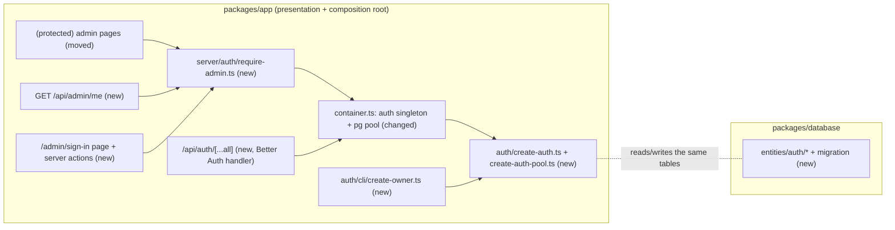

# Admin authentication and the server-side admin guard

- Backlog: E03-S01 ([#19](https://github.com/BOMateuszBialas/techleaders/issues/19)), epic E03 (#10)
- Status: approved by the product owner (2026-10-15). Open Questions answered, cross-model review and grill-me applied, step-1 spike passed with minor deviations only (G11). Ready for implementation (steps 2–10)
- Design authority: `.ai/specs/product-brief.md`, `.ai/specs/2026-10-13-commerceos-mvp.md` §3, §4, §8

## 📝 TLDR

Today `/admin` is an unauthenticated shell that must not show store data or allow mutations (AGENTS.md), so no admin story (catalog, stock, orders, dashboard, Copilot) can start. **Proposed:** the single store owner signs in with email and password through **Better Auth**, with DB-backed, revocable 8-hour sessions. Every admin page, route handler and server action checks the session **on the server** through one module, `server/auth/require-admin.ts`. Later stories call it and never touch cookies or the library directly.

## 📝 Decisions (answers to the Open Questions, 2026-10-15)

| #   | Question       | Decision                                                                                                                                     |
| --- | -------------- | -------------------------------------------------------------------------------------------------------------------------------------------- |
| Q1  | Auth library   | **Better Auth** (`better-auth@1.7.x`, peer `next ^16`), email + password                                                                    |
| Q2  | Owner account  | Created by a CLI command from `ADMIN_EMAIL` / `ADMIN_PASSWORD`, with the password rotated only via `--rotate-password`; **no public sign-up** |
| Q3  | Sign-in method | Email + password only (no OAuth)                                                                                                             |
| Q4  | Roles          | One role, `owner`, stored in a column with a check constraint (a later role is an additive migration)                                      |
| Q5  | Session        | 8 h lifetime, sliding renewal; sign-out deletes the session row; cookie `httpOnly`, `sameSite=lax`, `secure` in production                 |

### Grill-me decisions (product owner, 2026-10-15)

| #   | Topic                    | Decision                                                                                                                                                                   |
| --- | ------------------------ | -------------------------------------------------------------------------------------------------------------------------------------------------------------------------- |
| G1  | Where the demo runs      | Local only for now; hosting is decided in week 5 (MVP spec §11). `AUTH_TRUSTED_IP_HEADER` stays unset, so the global sign-in limit applies; set the header when deploying |
| G2  | Rate-limit numbers       | 5 attempts/min per trusted IP; without a trusted IP, 20/min globally. A one-minute lock-out by a flooder is an accepted cost                                             |
| G3  | Absolute session cap     | None: 8 h of inactivity ends the session, and active use keeps extending it                                                                                               |
| G4  | Seeded owner             | None. `db:seed` creates store data only; no default credentials exist anywhere in the repo; the README documents `admin:create`                                           |
| G5  | Owner `name`             | Fixed `"Store owner"` (Better Auth requires a name); no `ADMIN_NAME` env. The UI shows the email                                                                          |
| G6  | Session IP / user agent  | Kept in `admin_sessions` (library default, the owner's own data, helps spot hijacking). App logs carry only `userId` and an event code: no email, no IP                    |
| G7  | Sign out everywhere      | Not offered. Sign-out ends the current session; `--rotate-password` revokes all sessions                                                                                  |
| G8  | UI language              | English, matching the existing storefront and admin copy                                                                                                                  |
| G9  | E2E credentials          | `owner@e2e.test` plus a random 16+ character password generated per run in the e2e global setup, handed to tests through `inject()`; nothing secret is committed           |
| G10 | `nextCookies()` fallback | If spike item (g) fails, sign-in moves to the client: the form calls `authClient.signIn.email()` (`better-auth/react`) against `/api/auth/sign-in/email`. Zod validation and the generic message stay; server-side checks are unchanged |
| G11 | Spike deviations         | Minor (an option or column name, `updateAge` semantics within Q5): fix the spec, record it in "Spike results", continue. Decision-changing ((b) or (d) failing, or needing our own hashing): stop and ask the product owner |
| G12 | Delivery                 | Spike on a throwaway branch; results are added to this spec's PR (#31), which merges only with them. Steps 2–10 then ship in one implementation PR via `om-auto-implement-spec`, reviewed and CI-green |

## 📝 Problem Statement

- The admin shell (`packages/app/src/app/admin/layout.tsx`, `page.tsx`) has no authentication. Its comment and AGENTS.md block it from exposing store data or mutations.
- E03-S02/S03, E04 and E05 depend on this story (`.ai/specs/backlog.md`).
- Acceptance criteria (#19):
  - **AC1:** valid credentials reach the admin.
  - **AC2:** without a session, admin pages redirect and admin APIs return 401, decided on the server.
  - **AC3:** invalid credentials give a generic error that does not reveal whether the account exists.
  - **AC4:** sign-out invalidates the session.
- Spec §4/§8 require a maintained auth library with secure session defaults, and forbid hand-rolled password hashing or session security.

## 📝 Proposed Solution

Better Auth owns credentials, hashing (scrypt), session issue and verification, rate limiting and origin checks. CommerceOS owns three things:

1. **Who may sign in**: one owner, created by CLI. Sign-up is disabled.
2. **Where sessions are checked**: the `require-admin` module, used by every admin entry point.
3. **The schema**: Better Auth's tables are MikroORM entities with a migration, so migrations stay the source of truth.

Alternatives rejected (Q1):

- **Auth.js v5:** Credentials sessions are JWT only and cannot be revoked (fails AC4), and hashing would be ours to write.
- **iron-session + argon2:** revocation and rate limiting would be ours to write, which comes too close to "session security from scratch" (spec §4).

Better Auth's own `migrate` CLI is not used; see Data Model.

## 📝 Architecture



**Takeaway:** Better Auth is a singleton in the composition root with its own small `pg` pool. Everything that guards admin access goes through `require-admin.ts`. MikroORM owns the schema, and Better Auth only reads and writes rows. Neither the auth factories nor the CLI import `@commerceos/database`, so the ESLint package-boundary rule (only `container.ts` may import it) holds.

- **`packages/app/src/server/auth/`** (new concept folder):
  - `create-auth-pool.ts`: `createAuthPool(databaseUrl)` returns a `pg.Pool` with `max: 5`. `pg` is already installed through `@mikro-orm/postgresql` 7.2; it becomes an explicit dependency of `@commerceos/app`.
  - `create-auth.ts`: a pure factory `createAuth({ pool, env })` that returns the Better Auth instance. It contains the config below and **no** `server-only` import, so the CLI can reuse it.
  - `require-admin.ts` (`server-only`): the guard API. It gets `auth` from `getAuth()`, a new export of `container.ts` that resolves the singleton from the **root** container, so it needs no request scope. The session itself comes from the request headers on every call.
    - `getCurrentAdmin(): Promise<AdminPrincipal | null>`, where `AdminPrincipal = { id, email, role: "owner" }`. It always calls `auth.api.getSession({ headers: await headers() })` with this request's headers passed explicitly. The returned DTO never includes the raw session or token.
    - `requireAdminPage(): Promise<AdminPrincipal>` redirects to `/admin/sign-in` when there is no admin. Use it in Server Components and page data loaders.
    - `requireAdmin(): Promise<AdminPrincipal>` throws `UnauthorizedError`. Use it in route handlers (through `apiHandler` → 401) and server actions.
    - `adminApiHandler(route, (request, admin, ...args) => …)`: `apiHandler` plus `requireAdmin`, the one wrapper for every future `/api/admin/*` route.
  - `sign-in.action.ts` and `sign-out.action.ts`: server actions. Their input is validated with a Zod schema in `packages/core/src/validators/auth/sign-in.schema.ts`.
  - `create-owner.ts`: `createOwner({ auth, email, password, rotate })` handles both cases:
    - **Owner absent:** creates it.
    - **Owner exists, `rotate=false`:** fails with "owner already exists" and writes nothing. A setup command must not silently change credentials.
    - **Owner exists, `rotate=true`:** updates the password and deletes the owner's sessions. This is also the recovery path for a lost password, since there is no reset flow.
  - `cli/run-create-owner.ts`: `runCreateOwner({ env, argv, createAuth, createAuthPool, log, exit })`. It reads the secrets from **env only**, and argv carries only the `--rotate-password` flag. It validates the input, calls `createOwner`, prints no secrets, and closes the pool in `finally`.
  - `cli/create-owner.ts`: a one-line entry point.
  - Both CLI files are unit-tested with injected fakes, so there is **no coverage exclusion**. An integration test also runs the CLI as a subprocess.
- **`packages/app/src/server/container.ts`** gets two singleton registrations, `authPool` (disposer: `pool.end()`) and `auth`, plus the `getAuth()` export. They are singletons because the Better Auth instance holds only config and the pool. Every call gets this request's headers explicitly, and cookies are set on that call's response (or through `nextCookies()` in an action), so no request state lives in a singleton, which strict mode requires. An integration test runs two concurrent requests with different session cookies and checks that each one sees only its own admin.
- **Entry-point inventory (enforced):** today the only admin entry points are the dashboard page and `GET /api/health` (public by contract). A unit test, `admin-guard-inventory.test.ts`, scans `src/app/api/admin/**/route.ts`, `src/app/admin/(protected)/**/page.tsx` and every `*.action.ts` under admin. It fails if any of them does not call `adminApiHandler`, `requireAdminPage` or `requireAdmin`. Later stories cannot forget the guard. The sign-in and sign-out actions are the documented exceptions.
- **`packages/database`** gets entities in `src/entities/auth/` (`admin-user`, `admin-session`, `admin-account`, `admin-verification`, `admin-rate-limit`), registered in `entities/index.ts`, and one migration.
- **`packages/core`**: only the shared `signInSchema` (email, password 8–128 chars) and the `ADMIN_ROLES = ["owner"]` constant. No port is added, because no use case needs the current admin yet. Later stories pass `actorId: string` into use cases explicitly.
- **Routes:** `app/admin/(protected)/layout.tsx` and `page.tsx`, moved into a route group, so the URLs are unchanged. `app/admin/sign-in/page.tsx` sits outside the group.
  - The protected layout's static part (sidebar, nav) prerenders.
  - Session reads happen only in two async components, each rendered inside its own `<Suspense>`: `<AdminSessionBadge />` in the layout and `<AdminDashboard />` in the page. Each starts with `await requireAdminPage()`, so `headers()` is never reached outside a boundary (Next 16 cache-components guide).
  - The sign-in page renders the form statically and checks for an existing session in a `<RedirectIfSignedIn />` child behind `<Suspense>`.
  - A production build plus e2e (`next start`) proves the behaviour; dev mode is not evidence.
- **Error paths:**
  - **Route handlers:** `UnauthorizedError` → 401; anything else, including a failed `getSession`, → generic 500 through `apiHandler`.
  - **Server actions** (no `apiHandler`): no session → `redirect("/admin/sign-in")`. In `signIn`, a library or DB failure → `{ error: "Sign-in is unavailable. Try again." }` and the error is logged.
  - **Pages:** no session → redirect. A failed `getSession` throws to the `admin/(protected)/error.tsx` boundary, which shows a generic message.
  - **Rule:** `redirect()` is never called inside `try/catch`. Errors are mapped first, then `redirect` runs outside the `try`, and a unit test asserts it propagates.
- **No `proxy.ts` in this story.** Each page and action checks the session itself, and a proxy check is only optimistic (Better Auth and Next docs). It can be added later purely to avoid a flash of the shell.

### Better Auth configuration (`create-auth.ts`)

| Setting                                                       | Value                                                                 | Why                                             |
| ------------------------------------------------------------- | --------------------------------------------------------------------- | ----------------------------------------------- |
| `database`                                                    | the injected `pg.Pool`                                                | one adapter, schema owned by MikroORM           |
| `baseURL` / `trustedOrigins`                                  | `APP_URL`                                                             | origin and CSRF check; no new env var for the URL |
| `secret`                                                      | `BETTER_AUTH_SECRET` (new env, min 32 chars, required)                | Better Auth throws in production without it     |
| `emailAndPassword`                                            | `{ enabled: true, disableSignUp: true, minPasswordLength: 8 }`        | Q2, Q3                                          |
| `session`                                                     | `expiresIn: 28_800`, `updateAge: 3_600`, `cookieCache` disabled       | Q5; no cache, so revocation is immediate (AC4)  |
| `advanced.database.generateId`                                | `"uuid"`                                                              | matches the existing `uuid` primary keys        |
| `user` / `session` / `account` / `verification` `modelName` + `fields` | `admin_users`, … with snake_case columns                         | project naming (ENGINEERING_STANDARDS §1)       |
| `user.additionalFields.role`                                  | `{ type: "string", input: false, defaultValue: "owner" }`             | Q4; never settable from a request               |
| `rateLimit`                                                   | `enabled: true`; `customRules["/sign-in/email"] = { window: 60, max: 5 }`; storage `"database"` (table `admin_rate_limits`) | brute-force protection that survives restarts (see Risks) |
| `advanced.ipAddress.ipAddressHeaders`                         | `[AUTH_TRUSTED_IP_HEADER]` when set; **`[]` when unset**. Never the library default (`x-forwarded-for`, which a client can forge when there is no proxy, spike f) | the rate-limit key must not come from a client-controlled header |
| `rateLimit` fallback without a trusted header                 | while `AUTH_TRUSTED_IP_HEADER` is unset (G1: the local demo), the library finds no IP and uses one shared per-path bucket (`no-trusted-ip` key, spike f), so the `/sign-in/email` custom rule is `max: 20` (G2); with the header set it is `max: 5`. Session rows then store no IP (G6 applies once a trusted header exists) | one owner account: a global limit trades a small lock-out risk for no bypass |
| cookies                                                       | library defaults: `better-auth.session_token`, `HttpOnly`, `SameSite=Lax`, `Max-Age=28800`. `Secure` and the `__Secure-` prefix follow the **`APP_URL` protocol** (https), not `NODE_ENV` (spike b) | `lax` is enough: every mutation is a POST guarded by origin checks (Better Auth `trustedOrigins`, Next server actions) |
| `plugins`                                                     | `[nextCookies()]` (last)                                              | lets server actions set the session cookie (spike g) |
| `logger`                                                      | routes Better Auth's own log lines through `server/logger.ts`         | no direct `console.*` output (AGENTS.md); its warnings name no email |

## 📝 Data Model

New tables, all created by one MikroORM migration. Table and column names are set through Better Auth `modelName`/`fields`. The exact column set, types, defaults and indexes are **not assumed**: they are taken from the pinned `npx auth@1.7.10 generate` output in step 1, and the step-1 gate proves sign-in, session lookup and sign-out against that schema before any entity is written. The table below is the expected shape. No personal data beyond the owner's email.

| Table                 | Key columns                                                                                                     | Constraints                                     |
| --------------------- | --------------------------------------------------------------------------------------------------------------- | ----------------------------------------------- |
| `admin_users`         | `id uuid`, `email`, `name`, `email_verified`, `image`, `role`, `created_at`, `updated_at`                      | `unique(email)`, `check (role in ('owner'))`    |
| `admin_sessions`      | `id`, `user_id → admin_users (cascade)`, `token`, `expires_at`, `ip_address`, `user_agent`, timestamps          | `unique(token)`, index `user_id`                |
| `admin_accounts`      | `id`, `user_id → admin_users (cascade)`, `account_id`, `provider_id`, `password` (scrypt hash), timestamps      | index `user_id`; OAuth token columns stay null  |
| `admin_verifications` | `id`, `identifier`, `value`, `expires_at`, timestamps                                                           | required by Better Auth core; unused for now    |
| `admin_rate_limits`   | `id`, `key`, `count`, `last_request`                                                                            | `unique(key)`; rate-limit counters only         |

- The password hash is stored only in `admin_accounts.password`. It never leaves the server: `AdminPrincipal` carries no hash, the entities are not exposed by any route, and the logger redacts `password` keys.
- **Rollback:** the migration's `down` drops the five tables. No existing table changes.

## 📝 API Contracts

All additive (BACKWARD_COMPATIBILITY §2).

- **`/api/auth/*`**: Better Auth's handler (`toNextJsHandler`). Used: `POST /sign-in/email`, `POST /sign-out`, `GET /get-session`. Sign-up returns an error because `disableSignUp` is set. These are library-owned shapes, not part of our `ApiResult` contract.
- **`GET /api/admin/me`**: a guard probe. It is the first route behind `adminApiHandler` and the e2e proof of AC2 until real admin APIs exist; later the admin UI may use it to show who is signed in. It returns `200 { ok: true, data: { id, email, role } }`, or `401 { ok: false, error: { code: "UNAUTHORIZED", … } }` when there is no session.
- **Server actions:**
  - `signIn(prevState, formData)` validates input with `signInSchema` and calls `auth.api.signInEmail`. On success it always redirects to `/admin`. There is no `next`/return-to parameter, because no acceptance criterion needs deep-link return; that removes the open-redirect surface entirely. On failure it returns `{ error: "Invalid email or password." }`, always the same message (AC3). A 429 returns `"Too many attempts. Try again in a minute."`.
  - `signOut()` calls `auth.api.signOut`, which deletes the session row (AC4), then redirects to `/admin/sign-in`.
- **Env** (BACKWARD_COMPATIBILITY §4, additive):
  - `BETTER_AUTH_SECRET` is required at runtime only (`getEnv()` stays lazy, so `next build` does not need it).
  - `APP_URL` keeps its `http://localhost:3000` default in development and test, but becomes **required in production**. It is the trusted origin, so a silent localhost default must not reach production. The e2e setup already sets it.
  - `AUTH_TRUSTED_IP_HEADER` is optional (see the config table).
  - `ADMIN_EMAIL` and `ADMIN_PASSWORD` are read **only by the CLI**, not by the app schema. The CLI requires a password of at least 12 characters for the owner, stricter than the library's 8.
  - All of them go into `.env.example` with placeholders.

## 📝 UI/UX

- **`/admin/sign-in`:** a centered card with email and password fields, a "Sign in" button with a pending state, and a generic error shown in a `role="alert"` region. It notes that this is the owner's panel of a demo store. An already signed-in owner is redirected to `/admin`.
- **Admin shell:** shows "Signed in as {email}" and a "Sign out" button, which streams in behind `<Suspense>`. Session-derived UI is never put in a `use cache` scope (no `use cache: private` either, in this story), so nothing about one owner's session can be served to another request. The dashboard copy "Admin authentication is not implemented yet" is removed.
- **Accessibility:** labelled inputs, `autocomplete="email"` and `current-password`, focus moves to the error message, and the keyboard order is: email → password → submit.

## 📝 Edge Cases & Failure Scenarios

| Case                                                     | Behaviour                                                                                         |
| -------------------------------------------------------- | ------------------------------------------------------------------------------------------------- |
| Wrong password, or unknown email                         | Same generic message, status and body (AC3, tested); logged as `auth.sign_in_failed` without email or password. Timing: the library already hashes for an unknown email (spike e: about 55 ms either way), so no extra code is needed. No statistical timing test: the guarantee is "same message and response" |
| 6th attempt within 60 s from the same IP                 | 429 → "Too many attempts…"; no credential check performed                                         |
| Session expired (no activity for 8 h)                    | `getSession` returns null → redirect to sign-in (pages) / 401 (API)                              |
| Session row deleted (sign-out in another tab)            | Same as expired; immediate, because the cookie cache is off                                      |
| Server action posted without a session (stale form)      | `requireAdmin()` runs as the action's first statement → redirect to sign-in, and no mutation runs (tested by invoking the action directly) |
| Sign-in POST from another origin                         | Rejected by Better Auth's origin check / Next's server-action origin check (integration test with a foreign `Origin`) |
| `X-Forwarded-For` spoofed by the client                  | Not used as the rate-limit key unless `AUTH_TRUSTED_IP_HEADER` names it (integration test) |
| DB down during sign-in                                   | Generic "Sign-in is unavailable. Try again." message; error logged; no stack trace to the user. The rate-limit store is in the same DB, so it fails closed together with sign-in |
| `BETTER_AUTH_SECRET` missing in production               | `getEnv()` fails fast with a clear message at the first request                                  |
| CLI run without `ADMIN_EMAIL`/`ADMIN_PASSWORD`, or a password under 12 chars | CLI exits non-zero with a validation message, and nothing is written         |
| CLI run when the owner exists                            | Fails with "owner already exists", and nothing changes. `--rotate-password` updates the password and deletes the owner's sessions (also the recovery path for a lost password) |

## 📝 Risks & Impact Review

- **Owner creation uses `$context.internalAdapter` (verified, spike d).** Server-side `signUpEmail` is blocked by `disableSignUp`. The working path is `password.hash` plus `createUser(user, { method: "admin" })` + `linkAccount`, and rotation is `updatePassword` + `deleteUserSessions`. All of these use the library's hashing. These are internal-adapter APIs and can move between minor versions, so the version stays pinned and the CLI integration test guards them. Enabling sign-up, even in the CLI's own instance, is **ruled out**.
- **Second connection pool:** Better Auth uses its own `pg.Pool` (max 5) next to MikroORM's. That is acceptable for the MVP. Sharing MikroORM's Kysely instance was not chosen, because it couples the auth singleton to ORM internals.
- **Brute force:** the IP limit (5 per minute, stored in the DB) slows a single attacker. There is **no per-account lockout**: with one owner account, a lockout would let anyone lock the owner out (a denial of service). The owner's 12+ character password makes a distributed guess impractical. This is a documented limitation.
- **Library-owned endpoints under `/api/auth/*`:** a Better Auth upgrade can change them. The version is pinned to `~1.7.10`, and the e2e sign-in test covers the path we use.
- **Schema drift on a Better Auth upgrade:** the library's `migrate` CLI is never run against any database. An upgrade PR re-runs the pinned `generate` and diffs its output against the entities. Any difference becomes a new MikroORM migration, reviewed like any other, and the step-1 integration tests must pass on the new version.
- **Moving admin pages into a route group:** the URLs are unchanged (BACKWARD_COMPATIBILITY §1 is untouched).
- **Product direction:** none changed. This implements #19 within D05 (a small-store owner) and N01 (a single store).

## 📝 Decisions in play

- **D05:** the user is a small-store owner, so one owner account.
- **N01:** single store, no multi-tenant accounts.
- **R02, R04:** unchanged. The guard is the server-side enforcement point that later stories rely on.
- No decision is superseded. Owner: product owner.

## 📋 Phasing

- **Phase 1, the owner signs in and admin access is enforced everywhere (AC1–AC4).** One phase on purpose. A sign-in without the guard would be a half-feature, and AC2 is the core of #19. Each step below still leaves the app working, and until step 7 lands the admin shows nothing but system status (no store data is added in this story).

## 📋 Implementation Plan

### Phase 1: Owner sign-in with server-side enforcement

1. **Spike with an exit gate (throwaway branch, nothing merged).** Install the pinned `better-auth@1.7.10`, compile against its types, run the pinned `npx auth@1.7.10 generate` with our `modelName`/`fields`/`generateId` config, apply the SQL to a Testcontainers PostgreSQL, and prove each item:
   - (a) the config options in the table compile with the names used here (`disableSignUp`, `customRules`, `ipAddressHeaders`, `nextCookies`, `toNextJsHandler`);
   - (b) sign-in, `getSession` with the cookie, and sign-out work against the generated schema;
   - (c) renewal: a session used after `updateAge` gets a later `expires_at`, and an expired one is rejected;
   - (d) owner creation with sign-up disabled (`signUpEmail` on the server, or `$context` + `internalAdapter`);
   - (e) whether an unknown email runs a dummy hash;
   - (f) which header the rate limiter keys on, and what it does when none is present;
   - (g) `signInEmail` called inside a Next 16 server action sets the cookie through `nextCookies()`.

   Record every answer in this spec's "Spike results" section and handle any deviation per G11: minor ones are fixed in the spec, decision-changing ones go back to the product owner. If (g) fails, apply G10 (client-side sign-in).
2. **Env and dependencies.**
   - Add `better-auth@~1.7.10` and `pg` to `@commerceos/app`, and `@types/pg` as a dev dependency.
   - Env schema: add `BETTER_AUTH_SECRET` (`min(32)`) and the optional `AUTH_TRUSTED_IP_HEADER`, and make `APP_URL` required when `NODE_ENV=production`. Update `.env.example`.
   - *Test:* `parseEnv` unit tests (missing or short secret, production without `APP_URL`).
3. **Schema.**
   - Write the five entities with `defineEntity` to match the step-1 `generate` output exactly (snake_case, `uuid` ids, `check (role in ('owner'))`). Register them, run `npm run db:migration:create`, review the SQL against the generated SQL column by column, and commit.
   - *Test:* the existing drift integration test, plus an integration test that the tables and constraints exist.
4. **`createAuthPool`, `createAuth`, and the `authPool`/`auth`/`getAuth()` container wiring.**
   - *Unit test:* the factory config (session values, `disableSignUp`, `role.input: false`, the rate-limit rule and storage, the IP header and the global fallback).
   - *Integration tests* (Testcontainers):
     - a correct password creates a session row;
     - a wrong password and an unknown email return an identical status and body;
     - `getSession` with the real cookie returns the user;
     - renewal after `updateAge`;
     - an expired session is rejected;
     - sign-out deletes the row;
     - the 6th attempt within a minute gets 429;
     - a spoofed `X-Forwarded-For` does not reset the limit;
     - a foreign `Origin` is rejected;
     - two concurrent requests with different cookies each see their own session.
5. **`createOwner` and the CLI.** Add the `admin:create` script. The e2e global setup calls it with `owner@e2e.test` and a random password generated per run, and hands both to the tests through `inject()` (G9). The owner `name` is the fixed `"Store owner"` (G5).
   - *Unit tests:* `createOwner` (absent → create; exists → refuse; exists + rotate → update and revoke), and `runCreateOwner` with injected fakes (missing env, password under 12 chars, exit codes, pool closed, no secret in logs).
   - *Integration test:* the CLI as a subprocess against Testcontainers.
6. **`require-admin.ts` and the inventory test:** `getCurrentAdmin`, `requireAdminPage`, `requireAdmin`, `adminApiHandler`, plus `admin-guard-inventory.test.ts`.
   - *Unit tests* with a faked `getAuth().api.getSession`:
     - headers are passed explicitly;
     - no session → redirect / `UnauthorizedError`;
     - a session → narrow `AdminPrincipal`;
     - `getSession` throws → the error propagates (to a 500 or `error.tsx`).
7. **Sign-in page, `signIn`/`signOut` actions, `/api/auth/[...all]`, and the `admin/(protected)` route group** (with `AdminSessionBadge`, `AdminDashboard`, `RedirectIfSignedIn` and `error.tsx`).
   - Move the layout and dashboard into the group and remove the "not implemented yet" copy.
   - The auth route file is a one-line `toNextJsHandler(getAuth())` re-export, unit-tested with a mocked container.
   - *Unit tests:*
     - action error mapping (generic message, 429, DB down);
     - `redirect` propagates and is never swallowed;
     - `signOut` calls the API and redirects.
   - *E2E:*
     - `/admin` without a session → `/admin/sign-in`;
     - wrong credentials → generic alert;
     - correct credentials → dashboard with "Signed in as";
     - sign out → sign-in page, and `/admin` redirects again.
8. **`GET /api/admin/me`** via `adminApiHandler`.
   - *Unit test:* the handler.
   - *E2E:* 401 without a cookie and 200 with one.
9. **E2E suite.**
   - Rewrite `admin.e2e.test.ts` with a `signInAsOwner()` helper in `e2e/support/` that uses the injected credentials.
   - Keep the system-status and storefront-link checks.
   - Replace "does not expose store data while admin authentication is missing" with the AC2 checks.
10. **Docs.**
    - AGENTS.md: drop the "admin auth is not implemented" rule, make `require-admin.ts` the mandatory guard for every admin page, route and action (enforced by the inventory test), and mark the auth library as chosen.
    - README: `npm run admin:create` and `--rotate-password`, the env vars, and the limitations (single owner, rate limit, no lockout, no password-reset email).
    - BACKWARD_COMPATIBILITY.md: the new endpoints and env vars, and `APP_URL` required in production.
    - `.ai/lessons.md`: an entry if anything surprised us.
    - Move this spec to `implemented/`.

Every step keeps `npm run test:coverage` at 100% with **no new coverage exclusion**. Logic lives in `.ts` modules next to the pages, and the CLI is unit-tested through injected dependencies.

## 📝 Spike results

`better-auth@1.7.10` (core `1.7.10`), PostgreSQL 17 (Testcontainers), Next 16.4 production build, 2026-10-15. Evidence lives on the local throwaway branch `spike/better-auth`: `packages/app/spike/spike.mts` and `results.json`, plus a server-action page and e2e test. Nothing was merged.

| Item | Result | Spec impact |
| --- | --- | --- |
| (a) Types | All options in the config table compile under `strict`. `nextCookies` and `toNextJsHandler` are exported from `better-auth/next-js`. `pg` needs `@types/pg` (dev dependency) | add `@types/pg` |
| (b) Session cycle | Sign-in 200 sets `better-auth.session_token` (HttpOnly, Lax, Max-Age 28800); `getSession` with the cookie returns the user with `role: "owner"`; sign-out 200 deletes the row and the cookie no longer works | none |
| (c) Renewal / expiry | A session older than `updateAge` is extended to now + 8 h on `getSession`. A row whose `expires_at` has passed returns `null` | none |
| (d) Owner creation | `auth.api.signUpEmail` → `EMAIL_PASSWORD_SIGN_UP_DISABLED` (public `POST /sign-up/email` → 400). `internalAdapter.createUser(user, { method: "admin" })` + `linkAccount` + `password.hash` works; `role` defaults to `owner`. Rotation: `updatePassword` + `deleteUserSessions` (new password 200, old 401) | Risks updated |
| (e) Unknown-email timing | Wrong password and unknown email both about 53–59 ms (dummy hash present). Both return 401 `{"message":"Invalid email or password","code":"INVALID_EMAIL_OR_PASSWORD"}`, byte-identical | no own dummy hash |
| (f) IP / rate limit | The default header is `x-forwarded-for` (one value trusted, no proxy check). With `ipAddressHeaders: []` in production the key is `no-trusted-ip` + path: a different spoofed XFF on every request still hit 429 after 5. Foreign `Origin` → 403 `INVALID_ORIGIN`. A `/sign-up/email` attempt also counts in its own bucket | config table: `[]` by default, max 20 / 5 |
| (g) `nextCookies()` in a server action | In a production build, a server action calling `auth.api.signInEmail({ headers: await headers() })` then `redirect()` sets the cookie, and the next request's `getSession` sees the owner (e2e passed). G10 is not needed | none |

Generated schema (`getMigrations(...).compileMigrations()`), to be mirrored by the MikroORM entities in step 3:

```sql
create table "admin_users" ("id" uuid default pg_catalog.gen_random_uuid() not null primary key, "name" text not null, "email" text not null unique, "email_verified" boolean not null, "image" text, "created_at" timestamptz default CURRENT_TIMESTAMP not null, "updated_at" timestamptz default CURRENT_TIMESTAMP not null, "role" text not null);
create table "admin_sessions" ("id" uuid default pg_catalog.gen_random_uuid() not null primary key, "expires_at" timestamptz not null, "token" text not null unique, "created_at" timestamptz default CURRENT_TIMESTAMP not null, "updated_at" timestamptz not null, "ip_address" text, "user_agent" text, "user_id" uuid not null references "admin_users" ("id") on delete cascade);
create table "admin_accounts" ("id" uuid default pg_catalog.gen_random_uuid() not null primary key, "account_id" text not null, "provider_id" text not null, "user_id" uuid not null references "admin_users" ("id") on delete cascade, "access_token" text, "refresh_token" text, "id_token" text, "access_token_expires_at" timestamptz, "refresh_token_expires_at" timestamptz, "scope" text, "password" text, "created_at" timestamptz default CURRENT_TIMESTAMP not null, "updated_at" timestamptz not null);
create table "admin_verifications" ("id" uuid default pg_catalog.gen_random_uuid() not null primary key, "identifier" text not null, "value" text not null, "expires_at" timestamptz not null, "created_at" timestamptz default CURRENT_TIMESTAMP not null, "updated_at" timestamptz default CURRENT_TIMESTAMP not null);
create table "admin_rate_limits" ("id" uuid default pg_catalog.gen_random_uuid() not null primary key, "key" text not null unique, "count" integer not null, "last_request" bigint not null);
create index "admin_sessions_user_id_idx" on "admin_sessions" ("user_id");
create index "admin_accounts_user_id_idx" on "admin_accounts" ("user_id");
create index "admin_verifications_identifier_idx" on "admin_verifications" ("identifier");
```

Our additions on top: `check (role in ('owner'))` on `admin_users.role`. `rateLimit` accepts `modelName`/`fields` like the other models.

Other observations:
- **Lazy init:** Better Auth checks the schema when the instance initialises, and logs "Database schema mismatch" if tables are missing. It did so during `next build` when a module built the instance at import. The container's lazy `getAuth()` must stay request-time only, and must never be called while prerendering.
- **Logging:** the library logs `Invalid password` / `User not found` warnings without the email. These go through the `logger` option (config table).

**Deviations:** all minor per G11 (the IP-header default, `Secure` following the `APP_URL` protocol, the `createUser` signature, `deleteUserSessions`, `@types/pg`, the `logger` option). None changes a decision.

## 📝 Review log

- **2026-10-15, internal fresh-context review (Claude Sonnet):** applied the package-boundary fix for the CLI and pool, the DB-stored rate limit, `APP_URL` required in production, the 12-char owner password, and ruled out the sign-up fallback.
- **2026-10-15, cross-model review (GPT, Gemini):**
  - **Applied:** the spike gate for library assumptions; no coverage exclusion; the `next` redirect removed; the CLI refuses to overwrite without `--rotate-password`; the trusted IP header with a global-limit fallback; the guard inventory test; separate error paths and the redirect rule; explicit `headers` passing; named Suspense components; the concurrency, origin and spoofing tests; the schema-upgrade procedure.
  - **Declined:**
    - "Move MikroORM entities out of `app`": they are already in `packages/database`, and `app` does not import them.
    - "Drop `/api/admin/me`": it is the only way to prove AC2 for APIs until real admin APIs exist.
    - "Share MikroORM's pool": it would couple auth to ORM internals, for a saving of 5 connections.
- **2026-10-15, grill-me (product owner):** 12 decisions, G1–G12 in the Decisions section. All of them followed the recommended answer; none changed the architecture. They fix the rate-limit numbers and their local-demo fallback, rule out seeded credentials, set the e2e credentials, add the client-side fallback for `nextCookies()`, the rule for spike deviations, and the delivery order.
- **2026-10-15, step-1 spike:** passed (a)–(g); see "Spike results". Minor deviations were applied to the config table, Edge Cases and Risks. Spec approved by the product owner.
