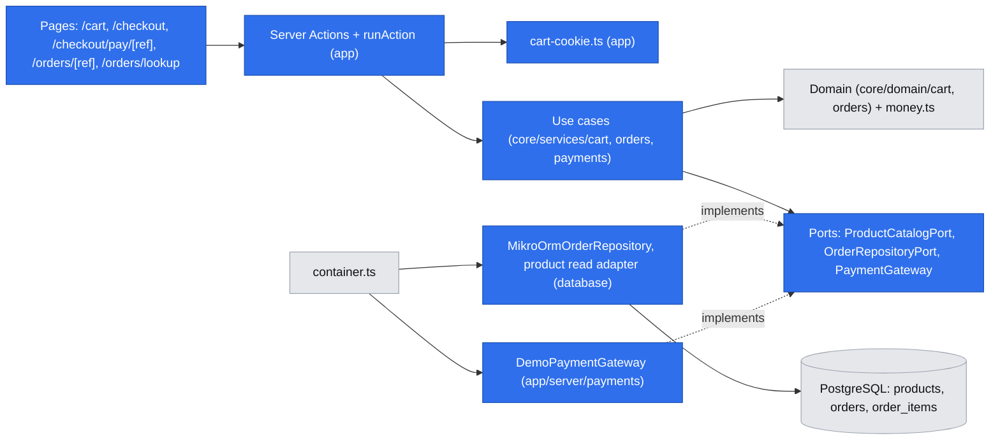
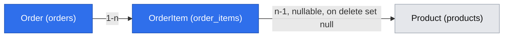

# Cart and demo checkout

- Backlog: epic E02 ([#9](https://github.com/BOMateuszBialas/techleaders/issues/9)): E02-S01 ([#16](https://github.com/BOMateuszBialas/techleaders/issues/16)) cart, E02-S02 ([#17](https://github.com/BOMateuszBialas/techleaders/issues/17)) checkout, E02-S02-T01 ([#29](https://github.com/BOMateuszBialas/techleaders/issues/29)) orders migration, E02-S03 ([#18](https://github.com/BOMateuszBialas/techleaders/issues/18)) demo payment, confirmation and lookup
- Status: draft, written autonomously (`om-spec-writing --autonomous`) on 2026-10-15; cross-model review and grill-me applied (2026-10-15). The defaults in "Resolved assumptions" need product-owner review before implementation; the ⚠ items (A5, A8, A15) were answered by the product owner on 2026-10-15: A5 and A8 confirmed, A15 changed to an order-lookup rate limit.
- Design authority: `.ai/specs/product-brief.md` (D03, R03, R04, R07, N02), `.ai/specs/2026-10-13-commerceos-mvp.md` §3, §5, §7, §8, AGENTS.md "Database conventions" and "Security and validation"
- Depends on: E01-S01 (#14), which provides the published-product pages that host the "Add to cart" button and (expected) a product read port

## 📝 TLDR

Today a shopper can see the storefront shell only: there is no cart, no order table and no way to buy. **Proposed (future behaviour):** a shopper keeps a cart in an `httpOnly` cookie that holds only product ids and quantities, checks out with name, email and shipping address, and gets an order that the server prices from the catalog and pays for through a **clearly labelled demo payment** behind a `PaymentGateway` port. Stock is decremented with an atomic conditional `UPDATE` inside the order transaction, so the last unit can be sold only once, and a duplicate submit returns the same order instead of creating a second one. The shopper sees a confirmation page and can look the order up later by a non-guessable reference.

## 📝 Resolved assumptions (autonomous defaults)

Each was an Open Question; the answer is the most reversible option with the smallest new surface. The items that change product behaviour or security posture (A5, A8, A15) were decided by the product owner on 2026-10-15.

| #   | Question                                                         | Default chosen                                                                                                                                                                                                                                                          | Rationale                                                                                                                                                         |
| --- | ---------------------------------------------------------------- | ----------------------------------------------------------------------------------------------------------------------------------------------------------------------------------------------------------------------------------------------------------------------- | ----------------------------------------------------------------------------------------------------------------------------------------------------------------- |
| A1  | One spec or several? (scope cohesion)                            | **One phased spec**, as requested. The scope-cohesion rule says this bundle **should be two specs**: (1) cart (#16) and (2) orders + checkout + demo payment (#29, #17, #18). Delivery follows that split: Phase 1 is one PR; Phases 2 and 3 ship together in a second PR, because Phase 2 alone would create orders that can be neither paid nor cancelled | The caller asked for one document. Phases map to stories, so splitting the file later is mechanical                       |
| A2  | Where does the cart live?                                        | **`httpOnly` cookie** (`commerceos_cart`) with `{ v: 1, lines: [{ p: productId, q: quantity }] }`, base64url JSON, no prices, not signed. Attributes: `HttpOnly`, `SameSite=Lax`, `Path=/`, `Secure` when `APP_URL` is https. A value over 4 KB, an unknown `v`, or anything failing the Zod shape is treated as an empty cart (and the cookie is cleared) **before** any database access. No cart table                                                                                                               | No schema, no anonymous-session store, readable in Server Components. Every value is re-validated server-side, so tampering gains nothing (R04). Reversible: a DB cart can replace it behind the same use cases |
| A3  | Is stock reserved while an item sits in the cart?                | **No reservation.** Add/update checks stock for feedback only; the authoritative check is the conditional decrement at order placement                                                                                                                                | MVP spec §5 allows this if documented; reservations need expiry jobs                                                                                               |
| A4  | When is stock decremented: at order placement or at payment?     | **At order placement** (status `pending_payment`), in the same transaction as the order insert                                                                                                                                                                         | Required by #17 AC4. Consequence in A5                                                                                                                             |
| A5  | What happens to stock held by an order that is never paid?       | **Nothing automatic in this spec.** The stock stays decremented until the owner cancels the order in E04-S01 (#22), whose cancel transition must restore stock (recorded as a dependency for #22). No expiry job | Avoids a scheduler. **Confirmed by the product owner (2026-10-15).**: abandoned or spammed checkouts can hold stock (see Risks). Alternative: a lazy expiry (cancel `pending_payment` orders older than N minutes on the next checkout) |
| A6  | How does "the shopper sees the current price before confirming" work? | The cart and checkout pages always render **server prices** (the cookie has none). The checkout form posts the total it showed (`expectedTotalMinor`); the server recomputes inside the transaction and, if it differs, rolls back and shows the new prices. The client value is used **only** as a staleness check, never as a price | Meets #17 AC5 without trusting client money                                                                                                                         |
| A7  | Idempotent submission                                            | Checkout form carries an `idempotencyKey` (UUID v4 generated **on the server when the checkout page renders**, sent as a hidden field, so the form also works without JavaScript) and a `cartFingerprint` (sorted `productId:quantity` list it rendered). `orders.idempotency_key` is unique; a repeat returns the existing order, **including when the repeat fails on stock or price because the first submit already took the stock**. Payment confirmation is a conditional update, and `authorize()` receives the order id as its idempotency key | DB-enforced; survives double clicks, retries and two tabs                                                                                                          |
| A8  | Order reference format and lookup                                | `public_reference` = `CO-` + 20 Crockford base32 characters from Web Crypto (**100 bits**), shown grouped (`CO-7K3MQ-9XZ2A-H4TPC-W8R1N`). Lookup by reference alone; the page shows status, items and totals only, **no name, email or address**                     | Non-guessable without a rate limiter; no PII leaks if a reference is shared. **Confirmed by the product owner (2026-10-15).**: lookup by reference *plus email* would be stronger but adds friction; this spec treats the reference as a bearer secret |
| A9  | Payment flow                                                     | Separate step: place order → `/checkout/pay/[reference]` with a demo banner and one button "Confirm demo payment (no charge)" → `DemoPaymentGateway` → order `paid`. No card fields. No `PAYMENT_PROVIDER` env variable (one adapter only)                          | D03, R03, N02; no new config surface                                                                                                                                |
| A10 | Order status model                                               | One `status` column with the full MVP workflow values (`pending_payment`, `paid`, `processing`, `shipped`, `cancelled`, `refunded`) in a check constraint, plus `paid_at` as the payment fact. This spec only writes `pending_payment` and `paid`                     | E04 needs no migration for statuses; "paid orders" for metrics = `paid_at is not null` and status not `cancelled`/`refunded` (E04/E05 define the metric)              |
| A11 | Shipping cost and tax                                            | `shipping_minor` column fixed at 0; no tax                                                                                                                                                                                                                              | N02; keeps the MVP §7 column for later                                                                                                                              |
| A12 | Mutations: Server Actions or Route Handlers?                     | **Server Actions** for cart, checkout and payment (cookies can only be set in Server Functions or Route Handlers). No new `/api/*` endpoints                                                                                                                            | No new public HTTP contract (BACKWARD_COMPATIBILITY §2). Needs a small `runAction` helper, the action twin of `apiHandler`                                          |
| A13 | Where does the demo payment adapter live?                        | `packages/app/src/server/payments/demo-payment-gateway.ts`, registered in the container; port in `packages/core/src/ports/payment-gateway.port.ts`                                                                                                                    | It needs neither the DB nor an LLM; `core` has no `adapters/` layer and adding one is a convention change. Move it if a real gateway package appears                 |
| A14 | Cart limits                                                      | ≤ 20 distinct lines, quantity 1–99 per line and ≤ current stock, one currency per cart                                                                                                                                                                                  | Bounded cookie size (~1.5 KB) and bounded order totals                                                                                                              |
| A15 | Rate limiting of checkout and lookup | **Decided by the product owner (2026-10-15): order lookup is rate-limited, checkout is not.** Every read of an order by reference (`/orders/[reference]` and the `lookupOrder` action) counts against a fixed one-minute window: **30 per client IP** when `AUTH_TRUSTED_IP_HEADER` is set (renamed in docs to "trusted client-IP header"; same rule as admin sign-in), otherwise **120 per minute shared by all clients**, never keyed on a forgeable header. Over the limit → the page shows "Too many lookups. Try again in a minute." (HTTP 200, `noindex`) without querying the order. Implemented as a small `RateLimiterPort` in `core` with a PostgreSQL adapter (`rate_limit_buckets`, atomic `insert … on conflict … do update … returning count`). Checkout stays unlimited; stock drain by unpaid orders remains the A5 limitation | **Confirmed by the product owner (2026-10-15).** |
| A16 | UI language                                                      | English, matching the existing storefront and admin (admin-auth spec G8)                                                                                                                                                                                                | Consistency                                                                                                                                                         |

## 📝 Grill-me decisions (product owner, 2026-10-15)

These confirm the defaults above and supersede any conflicting text elsewhere in this spec.

| #   | Topic | Decision |
| --- | ----- | -------- |
| G1  | Delivery | Two PRs: Phase 1 cart (#16); Phases 2 and 3 together (#29, #17, #18) (A1 confirmed) |
| G2  | Stock and the cart | No reservation; stock is decremented at order placement in the same transaction (A3, A4 confirmed) |
| G3  | Price changed before "Place order" | No order is created. The checkout re-renders with the new prices and a message, and the shopper submits again (A6 confirmed) |
| G4  | Demo payment | A separate `/checkout/pay/[reference]` page with a clear DEMO banner and one "Confirm demo payment (no charge)" button; no card fields (A9 confirmed) |
| G5  | Shipping and tax | Shipping 0 shown as "Shipping: free (demo store)"; no tax line (A11 confirmed) |
| G6  | Customer data | Guest checkout only. Fields: name, email, address line 1, optional line 2, city, postal code. **Country fixed to Poland (`PL`)**: shown as text, not a select. The column keeps the ISO code, so a list can come later |
| G7  | Confirmation | **No email** (no mail provider; claiming one was sent would be fake functionality). The confirmation page shows the order reference with "Save this reference to check your order" and a link to `/orders/lookup` |
| G8  | Where items are added | The product page with a quantity input (1–99, at most the stock), **plus a quick "Add to cart" (quantity 1) on product cards** in the listing and the home slider. Out-of-stock products show a disabled button labelled "Out of stock" |
| G9  | After adding | Stay on the same page with an "Added to cart" status message. The header shows a **cart icon with the item count** (the slot reserved by the storefront spec, G13). No slide-out cart drawer |
| G10 | Cart lifetime | Cookie `Max-Age` 30 days, renewed on every cart change; cleared after an order is placed |
| G11 | Ownership of the card button and header count | Built **in this spec's Phase 1 PR**. The storefront spec ships only the empty slots, never a disabled placeholder |
| G12 | A cart product that is no longer available (unpublished) | On the next cart or checkout render the line is removed automatically, with "{name} is no longer available and was removed from your cart." |
| G13 | Cart quantity above the current stock | The quantity is lowered to the stock, with "Only N left; we updated the quantity." At 0 stock, G12 applies (the line is removed with its message). The transaction check at placement stays authoritative |

## 📝 Problem Statement

- The storefront has no purchase path. MVP spec §2 demo story step 1–2 ("adds an in-stock item to the cart, and completes a test checkout. An order is created…") cannot run, and E04 (orders, dashboard) and E05 (Copilot over paid orders) have no data source except seeds.
- Acceptance criteria to satisfy:
  - **#16** add in-stock product → cart shows qty 1 and a total; change/remove updates totals; quantity above stock is refused with a clear message; out-of-stock product cannot be added.
  - **#17** server recomputes prices and ignores client prices/totals; stock 1 + two concurrent checkouts → exactly one order; invalid input → field errors and no order; order + stock decrement in one transaction with name/price snapshots; changed price is shown before confirming.
  - **#29** `Order` and `OrderItem` entities with snapshots, `check (total >= 0)`, unique order reference, FK indexes; generated, reviewed migration; drift test passes.
  - **#18** UI says plainly it is a demo payment and no money is charged; payment marks the order paid and shows a confirmation with reference, items, totals; lookup by reference shows status and a guessed reference reveals nothing; no card field, no card data stored.
- Rules: R03 (never imply a real payment, no card data), R04 (server-side price and stock validation, no overselling), N02, R07, D03.

## 📝 Proposed Solution

Three layers of trust:

1. **Cart (untrusted, convenience only).** The cookie stores `productId` + `quantity`. Every page render and every action reloads the products and recomputes prices, availability and totals. A forged cookie can at worst reference a product that does not exist, which renders as "no longer available".
2. **Order placement (authoritative).** One transaction, products touched in `id` order: for each line run `UPDATE products SET stock_quantity = stock_quantity - :q, updated_at = now() WHERE id = :id AND status = 'published' AND stock_quantity >= :q RETURNING name, sku, price_minor, currency`. Zero rows → `InsufficientStockError` and rollback. The returned row is the price snapshot, read under the row lock that the update holds, so price and stock come from the same instant. A pure `core` function builds the order draft (totals, currency, limits) and compares the total with `expectedTotalMinor`; a mismatch throws `PriceChangedError` and rolls back. Then the order and its items are inserted.
3. **Payment (demo, explicit).** `ConfirmDemoPaymentUseCase` calls `PaymentGateway.authorize()`; the only adapter, `DemoPaymentGateway`, charges nothing and returns a `DEMO-PAY-<uuid>` reference. A conditional update `… WHERE status = 'pending_payment'` marks the order paid.

### Alternatives considered

| Option                                         | Why it lost                                                                                                                                                       |
| ---------------------------------------------- | ----------------------------------------------------------------------------------------------------------------------------------------------------------------- |
| DB cart table + cart-id cookie (Medusa, Saleor) | New tables, anonymous-row cleanup, more PII surface; buys cross-device carts, which the demo does not need                                                        |
| `localStorage` cart                            | Server Components cannot read it, so the cart page would be a client fetch waterfall; still needs server validation                                               |
| `SELECT … FOR UPDATE` then `UPDATE`            | Correct, but two round trips per line and an easy place to forget the lock; the conditional update is one statement and cannot oversell even without the lock    |
| Optimistic version column on products          | Retries on every concurrent sale of popular items; the conditional decrement does not conflict unless stock really runs out                                       |
| Stripe Checkout test mode                      | Not chosen (AGENTS.md stack table); needs credentials and webhooks (P1). The port keeps it a drop-in later                                                         |
| Decrement at payment, not at placement         | Contradicts #17 AC4 and opens a window where two paid orders exist for one unit                                                                                   |

### Market check

- **Medusa / Saleor** keep carts server-side and use *reservations* with expiry. We skip both (A2, A3) and accept the documented limitation; the port boundaries leave room for them.
- **Shopify** order-status pages are reached through an unguessable URL token, and lookup forms ask for order number + email. We copy the unguessable token; email matching was considered and declined in A8 (confirmed).
- All three snapshot line items and treat the client cart as advisory, which this spec does too.

## 📝 Architecture



Takeaway: all money and stock rules sit in `core`; the only code that touches SQL is the database adapter; the app layer only parses input, owns the cookie and renders.

### Modules (new unless noted)

| Package    | Path                                                                  | Content                                                                                                                                                                                                 |
| ---------- | --------------------------------------------------------------------- | ------------------------------------------------------------------------------------------------------------------------------------------------------------------------------------------------------- |
| `core`     | `domain/cart/cart.ts`                                                 | `CartLine`, `CART_LIMITS`, `addLine`, `setLineQuantity`, `removeLine` (pure, merge by product id), `priceCart(lines, products)` → lines with `status: "ok" \| "unavailable" \| "exceedsStock"`, subtotal, `canCheckout` |
| `core`     | `domain/orders/order.ts`                                              | `ORDER_STATUSES`, `PAYMENT_PROVIDERS = ["demo"]`, `buildOrderDraft(reservedLines, expectedTotalMinor)` (snapshots, line totals, subtotal, total ≤ `INT4_MAX`, single currency, price-change check)          |
| `core`     | `domain/orders/order-reference.ts`                                    | `generateOrderReference(randomBytes)`, `isOrderReference(value)`, `normalizeOrderReference(input)` (upper-case, strip spaces, accept missing dashes)                                                       |
| `core`     | `errors/` (extend) or `domain/orders/order-errors.ts`                 | `InsufficientStockError extends ConflictError` (carries `productIds`), `PriceChangedError extends ConflictError`, `OrderNotPayableError extends ConflictError`                                             |
| `core`     | `validators/cart/cart-line.schema.ts`, `validators/orders/checkout.schema.ts`, `validators/orders/order-reference.schema.ts` | Zod input schemas shared by forms and actions                                                                                                                                                       |
| `core`     | `ports/product-catalog.port.ts`                                       | `findPurchasableByIds(ids)` returning `{ id, name, slug, priceMinor, currency, stockQuantity, status }`. **The draft E01-S01 spec (`2026-10-15-storefront-catalog.md`) introduces `CatalogReadPort` / `DatabaseCatalogRepository` (`catalogRepository`); if it lands as written, add `findPurchasableByIds` there instead of adding this port**           |
| `core`     | `ports/order-repository.port.ts`                                      | `placeOrder(input, buildDraft)`, `findByReference(ref)`, `findByIdempotencyKey(key)`, `markPaid(orderId, payment)`                                                                                       |
| `core`     | `ports/payment-gateway.port.ts`                                       | `PaymentGateway { provider: "demo"; isLive: false; authorize({ idempotencyKey, orderReference, amount }): Promise<{ providerReference }> }`                                                                              |
| `core`     | `services/cart/get-cart.use-case.ts`, `add-to-cart.use-case.ts`, `update-cart-line.use-case.ts`, `remove-cart-line.use-case.ts` | Take and return plain `CartLine[]`; the app persists them in the cookie                                                                                                                    |
| `core`     | `services/orders/place-order.use-case.ts`, `get-order-by-reference.use-case.ts` | Placement with idempotency; read model without PII                                                                                                                                             |
| `core`     | `services/payments/confirm-demo-payment.use-case.ts`                  | Idempotent payment confirmation                                                                                                                                                                         |
| `database` | `entities/orders/order.entity.ts`, `entities/orders/order-item.entity.ts`, migration | See Data Model                                                                                                                                                                             |
| `database` | `adapters/mikro-orm-order-repository.ts`, `adapters/mikro-orm-product-catalog.ts` | Transaction, conditional decrement, unique-violation handling                                                                                                                                |
| `app`      | `server/http/run-action.ts`                                           | `runAction(name, fn)` → `ActionResult<T>` (= `ApiResult<T>`), reusing `toClientErrorResponse`'s mapping logic (extract the mapping to a shared `toClientError(error)` that both use)                      |
| `app`      | `server/cart/cart-cookie.ts`                                          | `readCartCookie()`, `writeCartCookie(lines)`, `clearCartCookie()`; Zod-parsed, invalid → empty cart + `logger.warn` without the value                                                                       |
| `app`      | `server/payments/demo-payment-gateway.ts`                             | The demo adapter (A13)                                                                                                                                                                                   |
| `app`      | `app/cart/`, `app/checkout/`, `app/checkout/pay/[reference]/`, `app/orders/[reference]/`, `app/orders/lookup/` | Pages, colocated `actions.ts` and `.ts` view-model helpers (unit-covered); `components/cart/` for `AddToCartButton`, `CartBadge`                                         |
| `app`      | `server/container.ts` (existing)                                      | Register `productCatalog`, `orderRepository` (scoped, need `em`), `paymentGateway` (singleton), the use cases (scoped)                                                                                     |

`core` must obtain randomness without Node imports: `generateOrderReference` takes `randomBytes: (n: number) => Uint8Array`; the app passes `(n) => crypto.getRandomValues(new Uint8Array(n))` (Web Crypto, Node ≥ 22). Tests pass a deterministic function.

### Transaction design (`MikroOrmOrderRepository.placeOrder`)

```text
placeOrder({ idempotencyKey, customer, lines, expectedTotalMinor }, buildDraft):
  em.transactional(async (tx) => {
    reserved = []
    for line of sortBy(lines, productId):                       -- fixed lock order, no deadlocks
      row = tx.execute(CONDITIONAL_DECREMENT, [line.quantity, line.productId])
      if row is empty: collect productId as short
    if any short: throw InsufficientStockError(shortIds)       -- rollback restores earlier decrements
    draft = buildDraft(reserved)                                -- core: totals, snapshots, PriceChangedError
    insert order (status pending_payment, public_reference, idempotency_key, …) + items
    flush
  })
  on UniqueConstraintViolation(public_reference): re-run the WHOLE transaction once (decrements included)
                                                  with a new reference                -- 2^-100, but handled
  on any other failure (unique idempotency_key, InsufficientStockError, PriceChangedError):
      existing = findByIdempotencyKey(key)     -- after rollback, on a fresh read
      if existing: return existing             -- the first submit of this form won
      else rethrow
```

Why the post-failure lookup matters: two submits with the same key and stock = 1. B waits on A's row lock; after A commits, B's conditional decrement finds 0 rows and throws `InsufficientStockError` before it ever reaches the unique index. Without the lookup the shopper who double-clicked would see "sold out" for an order they actually placed.

- Isolation: default `READ COMMITTED` is enough; the row lock taken by `UPDATE` serialises concurrent decrements, and the second statement re-evaluates `stock_quantity >= :q` against the committed value.
- The use case first checks `findByIdempotencyKey` (fast path, no stock touched). The unique constraint covers the race between two identical submits.
- On idempotent replay the use case returns the existing order **only if the stored `request_fingerprint` matches** (a SHA-256 of the `cartFingerprint` plus the normalised customer fields). A reused key with a different cart or customer is a `ConflictError` ("This checkout form was already used. Review your cart and submit again."), never another order's data.
- `markPaid`: `UPDATE orders SET status='paid', paid_at=now(), payment_provider=:p, payment_reference=:r, updated_at=now() WHERE id=:id AND status='pending_payment'`. 0 rows → reread: `paid` → success (idempotent); anything else → `OrderNotPayableError`.
- The gateway is called **outside** the DB transaction (a real gateway is a network call), so two concurrent confirmations can both call `authorize()`. It therefore takes `idempotencyKey = order.id`; the demo adapter returns the deterministic `DEMO-PAY-<order id>`, so both calls agree and only one `markPaid` wins. A real gateway must honour the same key (Stripe does). The "no second `authorize`" guarantee holds only for sequential calls. The demo gateway cannot fail; for a real one, "authorized but not marked paid" is reconciled by webhooks (P1).
- Cart drift between render and submit: the action compares the posted `cartFingerprint` with the cookie lines; a mismatch is a `ConflictError` ("Your cart changed in another tab. Review it and submit again."), checked before the transaction.

## 📝 Data Model

New entities in `packages/database/src/entities/orders/`, registered in `entities/index.ts`, one migration `MigrationYYYYMMDDhhmmss_orders` generated with `npm run db:migration:create` and reviewed.

**`rate_limit_buckets`** (A15, Phase 3, its own migration): `key text` (e.g. `order-lookup|<ip>` or `order-lookup|shared`), `window_start timestamptz`, `count int not null check (count >= 0)`; primary key `(key, window_start)`. Rows older than one hour are deleted opportunistically by the same upsert path.

**`orders`**

| Column                                     | Type / constraint                                                                                                      |
| ------------------------------------------ | ---------------------------------------------------------------------------------------------------------------------- |
| `id`                                       | uuid PK `gen_random_uuid()` (internal; never shown to shoppers)                                                        |
| `public_reference`                         | varchar(32) not null **unique**                                                                                        |
| `idempotency_key`                          | uuid not null **unique**                                                                                               |
| `request_fingerprint`                      | text not null: SHA-256 hex of the cart fingerprint plus the customer fields; compared on idempotent replay           |
| `status`                                   | text not null default `pending_payment`, check in (`pending_payment`,`paid`,`processing`,`shipped`,`cancelled`,`refunded`), **index** |
| `customer_name`                            | varchar(200) not null                                                                                                  |
| `customer_email`                           | varchar(320) not null                                                                                                  |
| `shipping_line1` / `shipping_line2`        | varchar(200) not null / null                                                                                           |
| `shipping_city`, `shipping_postal_code`    | varchar(100), varchar(20) not null                                                                                     |
| `shipping_country`                         | char(2) not null, check `~ '^[A-Z]{2}$'`                                                                               |
| `currency`                                 | text not null, check in `SUPPORTED_CURRENCIES`                                                                         |
| `subtotal_minor`, `shipping_minor`, `total_minor` | int not null, each `check (>= 0)`; `shipping_minor` default 0; `check (total_minor = subtotal_minor + shipping_minor)` |
| `payment_provider`                         | text null, check in (`demo`)                                                                                           |
| `payment_reference`                        | varchar(64) null **unique**                                                                                            |
| `paid_at`                                  | timestamptz null; check `status <> 'pending_payment' or paid_at is null`; check `status not in ('paid','processing','shipped','refunded') or paid_at is not null` |
| `created_at`, `updated_at`                 | timestamptz default now(); **index on `created_at`** (E04 list, E05 date ranges)                                       |

**`order_items`**

| Column                  | Type / constraint                                                                            |
| ----------------------- | -------------------------------------------------------------------------------------------- |
| `id`                    | uuid PK                                                                                      |
| `order_id`              | uuid not null FK → `orders` **on delete cascade**, **index**                                 |
| `product_id`            | uuid **null** FK → `products` **on delete set null**, **index** (history survives deletion)  |
| `product_name`          | varchar(200) not null (snapshot)                                                             |
| `product_sku`           | varchar(64) null (snapshot)                                                                  |
| `unit_price_minor`      | int not null `check (>= 0)` (snapshot)                                                       |
| `quantity`              | int not null `check (quantity between 1 and 99)`                                             |
| `line_total_minor`      | int not null `check (line_total_minor = unit_price_minor * quantity)`                        |
| unique                  | (`order_id`, `product_id`): one line per product per order                                    |

Notes:

- Money: integer minor units only; the domain refuses totals above `2_147_483_647` with a `ValidationError` before PostgreSQL would raise an `int` overflow (500).
- Existing `products` is unchanged; its `stock_quantity >= 0` check is the last line of defence behind the conditional update.
- Sensitive data: `customer_name`, `customer_email` and the shipping address are personal data. They are never logged (log `orderId` only; the reference is a bearer secret and is not logged either), never rendered on the public order page, and never sent to the Copilot (E05 tools aggregate). No card data exists anywhere.
- Seeds: none in this spec. Demo orders are E04-S03 (#24) and must use `DEMO-` references or `[DEMO]` names per R07.
- Rollback: the migration's `down()` drops both tables. Committed migrations are never edited (BACKWARD_COMPATIBILITY §5).



## 📝 API Contracts

No new Route Handlers. Server Actions (internal, not a protected contract) return `ActionResult<T>` = the existing `ApiResult<T>` envelope; `ValidationError` field errors drive inline form messages.

| Action (file)                                       | Input (Zod, in `core/validators`)                                                                                         | Success                                                   | Expected failures                                                                                                   |
| --------------------------------------------------- | ------------------------------------------------------------------------------------------------------------------------- | --------------------------------------------------------- | ------------------------------------------------------------------------------------------------------------------- |
| `addToCart` (`components/cart/actions.ts`)          | `{ productId: uuid, quantity: int 1–99 = 1 }`                                                                             | cart cookie written; `{ itemCount }`                      | `NotFoundError` (unknown/draft), `ConflictError` "out of stock" / "only N left", `ValidationError` cart limits       |
| `updateCartLine` (`app/cart/actions.ts`)            | `{ productId: uuid, quantity: int 1–99 }`                                                                                 | cookie written; page re-renders                           | `ValidationError { quantity: ["Only N left in stock."] }`                                                           |
| `removeCartLine` (`app/cart/actions.ts`)            | `{ productId: uuid }`                                                                                                     | cookie written                                            | none (removing an absent line is a no-op)                                                                            |
| `placeOrder` (`app/checkout/actions.ts`)            | `{ idempotencyKey: uuid, customerName 1–200, customerEmail (z.email, ≤ 320), shippingLine1 1–200, shippingLine2 ≤ 200?, shippingCity 1–100, shippingPostalCode 1–20, shippingCountry /^[A-Z]{2}$/, expectedTotalMinor: int ≥ 0, cartFingerprint: string ≤ 1000 }`. Lines come **from the cookie**, never from the form | cart cookie cleared; `redirect("/checkout/pay/<ref>")`    | `ValidationError` (fields; empty or invalid cart), `InsufficientStockError` (409, names the products), `PriceChangedError` (409), `ConflictError` cart changed (fingerprint mismatch) |
| `confirmDemoPayment` (`app/checkout/pay/[reference]/actions.ts`) | `{ reference }` (normalised, format-checked)                                                                  | `redirect("/orders/<ref>?paid=1")`                        | `NotFoundError`, `OrderNotPayableError` (409, e.g. cancelled)                                                        |
| `lookupOrder` (`app/orders/lookup/actions.ts`)      | `{ reference }`                                                                                                           | `redirect("/orders/<normalised ref>")`                    | `ValidationError` "Enter a reference like CO-XXXXX-…" (format only)                                                 |

Read models (Server Components call use cases directly):

- `GetCartUseCase(lines)` → `{ lines: [{ productId, name, slug, unitPriceMinor, quantity, lineTotalMinor, availableStock, status }], subtotalMinor, currency, canCheckout, itemCount }`.
- `GetOrderByReferenceUseCase(ref)` → `{ reference, status, createdAt, paidAt, currency, items: [{ name, unitPriceMinor, quantity, lineTotalMinor }], subtotalMinor, shippingMinor, totalMinor, paymentProvider }`. No customer fields. Unknown reference → `NotFoundError` → `notFound()`.

`runAction` maps the known `AppError` subclasses exactly as `apiHandler` does and returns a generic `INTERNAL_ERROR` for anything else, logged through `logger`. `redirect()`/`notFound()` control-flow errors are rethrown (`unstable_rethrow`), never swallowed.

## 📝 UI/UX

All pages that read cookies or the DB put that work inside `<Suspense>` (cookies are a request-time API; DB pages call `await connection()`), following the Cache Components rule in `.ai/lessons.md`. Data loading lives in a colocated `.ts` helper, rendering outside `try/catch` (lint rule `react-hooks/error-boundaries`).

| Screen                          | States                                                                                                                                                                                                                                                                       |
| ------------------------------- | ---------------------------------------------------------------------------------------------------------------------------------------------------------------------------------------------------------------------------------------------------------------------------- |
| Product page (E01-S01) + `AddToCartButton` | enabled; pending (disabled, "Adding…"); success ("Added to cart", badge updates); out of stock (button disabled, "Out of stock"); error message from the action                                                                                                    |
| Nav `CartBadge`                 | count from the cookie only (no DB), Suspense fallback "Cart"                                                                                                                                                                                                                 |
| `/cart`                         | loading skeleton; empty ("Your cart is empty" + link to catalog); lines with quantity input (1–99), remove, line total, subtotal; per-line warnings "No longer available – remove it" / "Only N left"; "Checkout" disabled until `canCheckout`; note "Prices are confirmed at checkout" |
| `/checkout`                     | empty cart → redirect to `/cart`; form with field-level errors (`aria-invalid`, `aria-describedby`), order summary with server prices; submit pending disables the button (double-click guard on top of A7); 409 price change → banner "Prices changed since you added these items. Review the new total and submit again." with the refreshed summary; 409 stock → banner naming the products, link back to cart |
| `/checkout/pay/[reference]`     | Persistent banner (role `status`, not dismissible): **"Demo store — this is a demo payment. No real money is charged and no card details are collected."** Order summary; button **"Confirm demo payment (no charge)"**; already paid → redirect to order page; cancelled → message, no button; unknown → 404 |
| `/orders/[reference]`           | `?paid=1` → heading "Thank you — demo payment received"; otherwise "Order status". Reference (copy-friendly, monospace), status badge, items, totals, "Paid with: Demo payment (no money charged)". Pending → link "Complete demo payment". Unknown or malformed → the same generic 404 "No order found with this reference" |
| `/orders/lookup`                | single field, format validation, submit → order page                                                                                                                                                                                                                       |

- No `<input>` with `autocomplete="cc-*"`, no card-number, expiry or CVC field exists anywhere (asserted by an e2e test, #18 AC4).
- Order and payment pages set `robots: noindex` and `referrer: no-referrer` metadata (the URL carries the bearer reference).
- Accessibility: form labels, error summaries linked to fields, buttons keep text labels while pending, status announced via `role="status"`.

## 📝 Edge Cases & Failure Scenarios

| Case                                                        | Behaviour                                                                                                                                                         |
| ----------------------------------------------------------- | ----------------------------------------------------------------------------------------------------------------------------------------------------------------- |
| Two shoppers buy the last unit at the same time             | The second conditional `UPDATE` waits for the first row lock, re-reads `stock_quantity = 0`, returns no row → `InsufficientStockError`, rollback, no order. Shopper sees "Sorry, *X* just sold out", e.g. "Sorry, Pulse Ultralight Mouse just sold out" (#17 AC2) |
| Multi-line cart where only line 3 is short                  | Lines 1–2 were decremented in the same transaction; the throw rolls them back. No partial order                                                                    |
| Price changed after adding to cart                          | Cart/checkout already show the new price; if it changes between render and submit, `PriceChangedError`, rollback, refreshed summary (#17 AC5)                     |
| Product unpublished or deleted while in cart                | Cart flags the line "no longer available", excludes it from the total, blocks checkout until removed; placement would fail the `status='published'` condition anyway |
| Double click / browser retry / two tabs submit the same form | Same `idempotencyKey` → the existing order is returned; stock decremented once (unique index plus the post-failure lookup cover the race, also when the duplicate fails on the last unit) |
| Cart edited in another tab after `/checkout` rendered        | `cartFingerprint` mismatch → `ConflictError` "Your cart changed", no order                                                                                    |
| Two tabs with *different* forms (different keys)            | Two orders, both validated against stock; acceptable (they are two real submissions)                                                                               |
| Payment confirmed twice                                     | Conditional update; second call sees `paid` and redirects to the confirmation                                                                                       |
| Pay a cancelled order (after E04)                           | `OrderNotPayableError` (409), no state change                                                                                                                      |
| Tampered cookie (prices, negative qty, 10 000 lines, garbage) | Zod rejects → treated as an empty cart, warning logged without the value; valid-shaped but bogus ids render as unavailable                                         |
| Mixed currencies in one cart                                | `ValidationError` on add ("Your cart can hold one currency"); `buildOrderDraft` re-checks                                                                          |
| Total exceeds `int` range                                   | `ValidationError` before the insert (not a DB 500)                                                                                                                 |
| Guessed / malformed reference                               | Same 404 for both; no timing-relevant difference worth handling (single indexed lookup)                                                                           |
| Lookup flood (enumeration attempt or a busy demo)           | Over the A15 limit the page shows "Too many lookups. Try again in a minute." without querying orders; the limiter fails closed if its table is unreachable (generic error page) |
| Reference collision                                         | Unique violation → the whole transaction is re-run once with a new reference (probability ~2⁻¹⁰⁰)                                                                  |
| DB down                                                     | Pages show the existing generic error state; actions return `INTERNAL_ERROR` "Something went wrong"; no partial writes (transaction)                               |
| Cookies disabled                                            | Add-to-cart appears to succeed but the cart stays empty; the cart page states that cookies are required (detected when the badge count does not change is out of scope; a static note on `/cart` suffices) |
| Abandoned `pending_payment` order                           | Stock stays held (A5, confirmed); visible to the owner in E04 as pending                                                                                                     |

## 📝 Risks & Impact Review

- **Stock held by unpaid orders (A5, confirmed).** Anyone can place many orders without paying and zero out stock: checkout is deliberately not rate-limited (A15). Acceptable for a local portfolio demo; before public hosting add a lazy expiry or a checkout limit.
- **Shared lookup bucket (A15).** Without a trusted client-IP header all visitors share 120 lookups a minute, so a flood can briefly block lookups for everyone. That is the same accepted trade-off as admin sign-in (G2); set the header in any public deployment. E04-S01's cancel transition **must** restore stock in the same transaction (add to #22 when its spec is written).
- **Bearer reference (A8, confirmed).** Anyone holding the URL sees the order's items and status (no PII). Leaks via screenshots, shared links or a hosting provider's access logs (the reference is in the path) are possible; the page shows nothing personal, which bounds the impact. The app's own logger never receives the reference.
- **Schema (hard to reverse).** Two new tables and constraints; the status check already includes E04's values so E04 needs no status migration. Changing the reference format later is additive (old references stay valid if `isOrderReference` accepts both).
- **New public URLs** (`/cart`, `/checkout`, `/checkout/pay/[reference]`, `/orders/[reference]`, `/orders/lookup`) and the cart cookie format become protected surfaces: add them to `BACKWARD_COMPATIBILITY.md` §1 and note the cookie `v: 1` (a future format bumps `v`; unknown versions read as empty).
- **Server Actions instead of API routes.** No public API is added; if a mobile client ever needs checkout, a versioned `/api/checkout` can wrap the same use case.
- **`runAction` is a new shared primitive** (ENGINEERING_STANDARDS lists the client helper and auth helpers as deferred; this is the first real consumer of an action wrapper). Extracting `toClientError` from `apiHandler` touches tested code; behaviour must stay identical (existing tests guard it).
- **Dependency on E01-S01 (#14).** Phase 1's UI needs the product page. The use cases and cart page can be built and tested first; the button lands with or after #14.
- Repository-rule check: money in minor units ✔, `em.transactional` + conditional decrement ✔, snapshots ✔, DTOs not entities ✔, `getEnv()` only ✔ (no new env), no `console.*` ✔, `server-only` on cookie/gateway modules ✔, no new library ✔.

## 📝 Decisions in play

| Id  | How this spec relies on it                                                                                     |
| --- | -------------------------------------------------------------------------------------------------------------- |
| D03 | Demo payments only: `DemoPaymentGateway` is the sole adapter                                                    |
| R03 | Demo banner on the payment step and the confirmation; no card fields; nothing card-related stored              |
| R04 | Server prices and conditional stock decrement; cookie holds no prices                                          |
| N02 | `shipping_minor = 0`, no tax, no refunds (the `refunded` status value exists for E04 as a recorded status only) |
| R07 | Payment provider is displayed as "Demo payment"; seeded orders (E04-S03) must be marked demo                    |

No decision is superseded. Owner: product owner.

## 📋 Phasing

Entry gate: **E01-S01 (#14) is merged** (Phase 1's button and e2e need the product page). Steps 1–4 may start earlier because they have no UI.

1. **Phase 1 — Cart (E02-S01, #16). PR 1.** Shippable alone: shoppers can build a cart; "Checkout" shows "Checkout is coming soon" until PR 2.
2. **Phase 2 — Orders schema and checkout (E02-S02-T01 #29, E02-S02 #17).**
3. **Phase 3 — Demo payment, confirmation, lookup (E02-S03, #18).**

Phases 2 and 3 ship **together as PR 2**: Phase 2 alone would create `pending_payment` orders that can be neither paid nor cancelled, and each would permanently hold stock. Inside PR 2 every step still leaves the app building and tested; the checkout entry point (`/checkout` link enabled on `/cart`) is switched on only in step 11. Each PR: CI green, 100% unit coverage.

## 📋 Implementation Plan

### Phase 1: Cart (#16)

1. **Cart domain and schemas (`core`).** `domain/cart/cart.ts`, `validators/cart/cart-line.schema.ts`. Unit tests: merge on add, limits (20 lines, 1–99), remove absent line, `priceCart` statuses (`ok`, `unavailable`, `exceedsStock`), subtotal via `sumMoney`, mixed currency rejected, `canCheckout`. 100% coverage.
2. **Product catalog port and adapter.** `ports/product-catalog.port.ts` (or extend E01-S01's port) and `database/adapters/mikro-orm-product-catalog.ts` (`findPurchasableByIds`, published only). Unit test with `createUnitTestOrm()` stubs; integration test against Testcontainers (draft excluded, unknown ids ignored).
3. **Cart use cases + container.** `services/cart/*.use-case.ts` with a fake catalog port in unit tests: add in-stock (qty 1), add out-of-stock → `ConflictError`, update above stock → `ValidationError` with the "Only N left" message, remove. Register `productCatalog` (scoped) and the use cases (scoped); extend `container.test.ts`.
4. **`runAction` and the cart cookie (`app`).** Extract `toClientError` from `api-handler.ts` (existing tests unchanged and green), add `server/http/run-action.ts` and `server/cart/cart-cookie.ts` (cookie options: `httpOnly`, `sameSite: "lax"`, `secure` when `APP_URL` is https, `path: "/"`, 30-day `maxAge`). Unit tests: error mapping, rethrow of `redirect`/`notFound`, cookie round-trip, tampered/oversized/unknown-version cookie → empty cart.
5. **Cart UI + e2e.** `AddToCartButton` on the E01-S01 product page, `CartBadge` in the nav (Suspense), `/cart` page with actions and states, view-model helpers in colocated `.ts` files with unit tests. E2E `cart.e2e.test.ts`: add in-stock product (e.g. the seeded `vortex-wireless-mouse`, 249,00 zł) → qty 1 and total; change quantity → total updates; quantity above stock → message; remove → empty state; out-of-stock product (the seeded `titan-mmo-mouse`, stock 0) → button disabled. Update `BACKWARD_COMPATIBILITY.md` (new URLs, cookie) and README. Full gate.

### Phase 2: Orders schema and checkout (#29, #17)

6. **Order entities and migration (#29).** `entities/orders/order.entity.ts`, `order-item.entity.ts`, `ORDER_STATUSES`/`PAYMENT_PROVIDERS` in `core/domain/orders/order.ts`, register in `entities/index.ts`, `npm run db:migration:create`, review SQL against the Data Model table (every check, unique and index). `entities.test.ts` updated; integration test: drift test passes, each check constraint rejects a bad row, `product_id` set null on product delete, cascade on order delete.
7. **Order domain (`core`).** `buildOrderDraft`, `order-reference.ts`, order errors, `validators/orders/checkout.schema.ts`. Unit tests: line totals and subtotal, `PriceChangedError` on mismatch, int-range guard, currency mismatch, reference format/entropy/normalisation with a deterministic `randomBytes`, checkout field errors (missing email, bad postal code, bad country).
8. **Order repository with the transaction (`database`).** Start with a 30-minute spike confirming MikroORM 7's raw execute with `returning` rows inside `em.transactional` and the unique-violation exception class; record the result here. Then `MikroOrmOrderRepository.placeOrder`, `findByReference`, `findByIdempotencyKey`. Unit tests with stubbed EM for the branches (short stock, duplicate key, reference retry). **Integration tests (Testcontainers):** (a) happy path: order + items with snapshots, stock decremented; (b) **stock 1, two concurrent `placeOrder` calls on separate EM forks via `Promise.allSettled` → exactly one fulfilled, one `InsufficientStockError`, stock 0, one order** (#17 AC2); (c) multi-line with one short line → no order, all stock unchanged; (d) same idempotency key twice concurrently, with stock 10 **and with stock 1** → both calls return the same order, one decrement; (e) price changed between cart and placement → `PriceChangedError`, nothing written; (f) draft product → stock error.
9. **`PlaceOrderUseCase` + checkout page + e2e.** Use case unit tests with fake ports (idempotent fast path, empty/invalid cart → `ValidationError`, never reads a client price). `/checkout` page (reachable by URL only; the `/cart` link stays "coming soon" until step 11), `placeOrder` action (lines from cookie, fingerprint check, clears cookie, redirects), `/orders/[reference]` read page showing "Awaiting payment" (`GetOrderByReferenceUseCase`, no PII). E2E `checkout.e2e.test.ts`: invalid form → field errors, no order (stock unchanged); valid checkout → order page with reference and stock decreased on the product page; double click → one order. Lint, typecheck, unit coverage, integration and e2e green.

### Phase 3: Demo payment, confirmation, lookup (#18)

10. **Payment port, demo adapter, confirm use case.** `ports/payment-gateway.port.ts`, `app/server/payments/demo-payment-gateway.ts` (`server-only`, `isLive: false`, `DEMO-PAY-<uuid>`), `ConfirmDemoPaymentUseCase`, `markPaid` in the repository. Unit tests: pending → paid, already paid → idempotent success without a second `authorize` (sequential), `authorize` receives the order id as idempotency key, cancelled → `OrderNotPayableError`, unknown → `NotFoundError`. Integration test: concurrent double confirmation → one `paid_at`, one `payment_reference` (`DEMO-PAY-<order id>`); check constraints hold. Container registration (`paymentGateway` singleton) and test.
11. **Order-lookup rate limit (A15).** `core/ports/rate-limiter.port.ts` (`consume(key, limit, windowSeconds) → { allowed, remaining }`), `database` adapter on `rate_limit_buckets` with its migration, container registration, and a `checkOrderLookupLimit(headers)` helper in `app` that picks the per-IP or shared key exactly like `create-auth.ts` does. Unit tests: key selection (trusted header set / unset, forged `x-forwarded-for` ignored), limit reached → blocked state. Integration test: concurrent `consume` calls never exceed the limit; window rollover resets the count.
12. **Payment page, confirmation, lookup + e2e.** Enable the `/checkout` link on `/cart`. `/checkout/pay/[reference]` with the demo banner, `/orders/[reference]` confirmation state, `/orders/lookup`, metadata (`noindex`, `no-referrer`). Check that `next start` writes no per-request access log containing paths; if a host adds one later, the reference in the path is a known exposure (Risks). E2E `purchase.e2e.test.ts`: browse → add → checkout → payment page shows the demo text → confirm → confirmation shows reference, items, totals and "Demo payment (no money charged)"; lookup with that reference shows "Paid"; lookup with a random well-formed reference and a malformed one → the same "No order found"; the order page and `lookupOrder` call the A15 limiter first; no `cc-*` autocomplete or card-like input anywhere in the flow (#18 AC4).
13. **Docs and close-out.** README (purchase flow, demo payment limitation, stock-hold limitation A5, lookup rate limit and the trusted client-IP header A15), `BACKWARD_COMPATIBILITY.md` (order URLs), `ENGINEERING_STANDARDS.md` "Deferred" list (`runAction` now exists), `.ai/lessons.md` for anything learned, note for #22 (cancel must restock). Move this spec to `.ai/specs/implemented/`. Full gate.

## 📝 Review log

- Fresh-context review (2026-10-15) found: double-submit on the last unit returned "sold out" instead of the order (fixed: post-failure idempotency lookup); Phase 2 alone not safely deployable (fixed: Phases 2+3 in one PR); bundle should be two specs (recorded in A1); concurrent confirms call `authorize` twice (fixed: idempotency key, deterministic demo reference); missing #14 entry gate, ambiguous reference retry, cross-tab cart drift (`cartFingerprint`), unverified MikroORM APIs (spike in step 8), reference in URL vs. access logs (check in step 11). All applied.
- Canonical mechanisms: reuses `money.ts`, `AppError` subclasses, `ApiResult`, `apiHandler`'s mapping (extracted, not duplicated), Awilix scopes, `defineEntity`, Testcontainers and agent-browser. New primitives: `runAction` (justified in Risks), `PaymentGateway` port (required by AGENTS.md "no invented integrations").
- Not verified while writing: MikroORM 7's exact raw-execute API inside `em.transactional` (`tx.execute` with `returning` rows) and its unique-violation exception class name; confirm in step 8 before relying on them. E01-S01's final port name is unknown (step 2 adapts).

## 📝 Cross-model review (GPT, Gemini), 2026-10-15

Each finding was checked against this spec's text before being accepted or declined.

**Applied:**
- The idempotency key is bound to a `request_fingerprint`; a mismatching replay is a `ConflictError` (GPT C1).
- The idempotency key is generated server-side at render, so the form works without JavaScript (Gemini Low).
- The cart cookie gets a 4 KB size cap, strict shape validation before any DB access, and explicit attributes (GPT H8).
- Control-flow rule (GPT M14): **Framework control flow (applies to every page, loader and action in this spec):** `redirect()` and `notFound()` are never called inside a `try` block; error mapping happens first and the control-flow call runs after it. Any `catch` that wraps Next APIs calls `unstable_rethrow(error)` first. A unit test asserts that each redirect propagates.
- Payment versus cancellation race (GPT Q4): `markPaid` is already conditional on `status = 'pending_payment'`. **Requirement for #22:** the cancel transition must be the mirror image, an `UPDATE … WHERE status = 'pending_payment'` that restores stock in the same transaction. A cancelled order can then never become paid, and a paid one never cancelled into restock.

**Declined, with reasons:**
- **"B sees no order and reports sold out" (Gemini C1).** B's conditional decrement waits on the row lock A holds until A commits. Only then does B fail and run the post-failure lookup, which reads A's committed order (Transaction design).
- **Deadlock across multi-item orders (Gemini H).** Lines are already locked in sorted `productId` order.
- **Price snapshot inconsistent with the stock update (GPT H4).** `UPDATE … RETURNING` returns the row as of that update, under the row lock. A concurrent price edit of the same row either committed before (and is returned) or waits. The price shown at checkout is still compared (A6).
- **Abandoned orders drain stock; bearer lookup (GPT C2, C3).** The product owner decided these (A5, A8; 2026-10-15) for the local demo. The Risks section requires an expiry or a checkout limit before public hosting. Order pages already send `Referrer-Policy: no-referrer` and load no third-party resources.
- **Rate-limit table bloat (Gemini M).** Lookup traffic is tiny, and the upsert deletes rows older than an hour. A DB store matches the admin sign-in limiter and survives restarts.
- **"Overbuilt" (GPT M13).** The rate limiter exists because the product owner asked for it (A15). The ports follow AGENTS.md (the database is reached only through ports).
