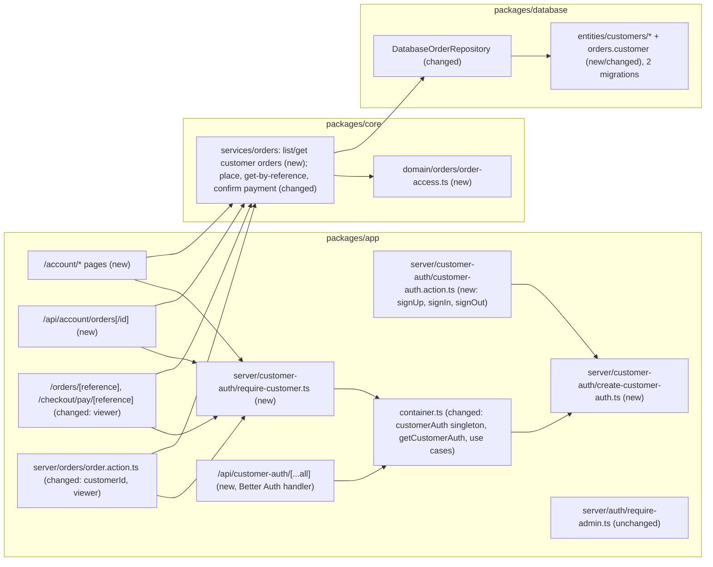
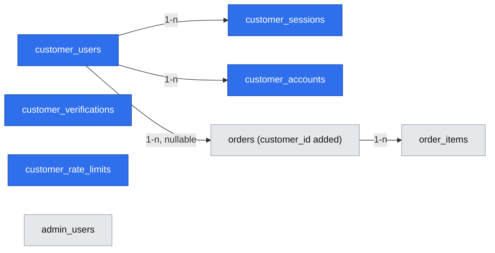

# Customer accounts and "My orders" (E07)

- Backlog: epic E07 #91; stories E07-S01 #92, E07-S02 #93, E07-S03 #94, E07-S04 #95, E07-S05 #96, E07-S06 #97 (filed by `om-backlog` on 2026-10-24, recorded in `.ai/specs/backlog.md`). Refs #91
- Status: **draft**, 2026-10-24. Design decisions P1–P5 answered by the product owner (2026-10-24, recorded in D11). A6 and A9 are defaults that need the product owner's confirmation (⚠). Waiting for: the cross-model review (section "Recenzja innym modelem"), then the Phase 0 spike. Not ready for implementation before both
- Design authority: `.ai/specs/product-brief.md` (D11, R08–R10, N06; also D04, D05, R04, R07), `.ai/specs/research/decisions/D11-customer-accounts.md`, `.ai/specs/implemented/2026-10-15-admin-authentication.md` (Better Auth setup, spike method, G4/G9), `.ai/specs/implemented/2026-10-15-cart-and-demo-checkout.md` (A7 idempotency, A8 bearer reference, A15 lookup limit), AGENTS.md

## 📝 TLDR

Today every shopper checks out as a guest, the only account in the system is the store owner's, and an order is reachable by anyone who holds its secret reference. **Proposed (future behaviour):** a shopper may register a **customer account** (email and password) on a **second Better Auth instance** with its own tables, endpoint path and cookie. An order placed while signed in is attached to that account by the server, and the customer reads their own orders under "My orders". An account order opens only with its owner's customer session, on every path (account pages, the public order and demo payment pages, the payment action and a read-only API); everything else answers "not found". A customer session never reaches the admin, and the owner session is not a customer session. Guest checkout is unchanged. The reason is the course certificate (two roles with per-user isolation, D11), so the design spends its effort on provable isolation, not on account features (N06).

## 📝 Decisions and assumptions

A1–A5 are the product owner's answers (2026-10-24, D11). A6 onward are this spec's defaults: the most reversible option with the smallest new surface. ⚠ marks the ones that need the product owner's explicit confirmation before implementation.

| #   | Topic | Decision | Why |
| --- | ----- | -------- | --- |
| A1  | Auth instance (P1) | **A separate Better Auth instance for customers**: tables `customer_users`, `customer_sessions`, `customer_accounts`, `customer_verifications`, `customer_rate_limits`; `basePath` `/api/customer-auth`; cookie prefix `commerceos-customer` (so the session cookie is `commerceos-customer.session_token`); `role` column with `check (role = 'customer')`, `input: false`, default `customer`. Every library endpoint except `/sign-up/email`, `/sign-in/email`, `/sign-out` and `/get-session` is switched off with `disabledPaths` (no `/update-user`, `/change-email`, `/change-password`, `/list-sessions`, `/revoke-sessions`, password-reset paths), so no request can change `name`, `image`, email or `role` after sign-up. The owner instance (`create-auth.ts`, `admin_*` tables, `disableSignUp: true`) is **not changed**. Implementation starts with a spike (Phase 0) | The owner instance defaults `role` to `owner` and blocks sign-up. Enabling sign-up there would let a form create an owner if any config slipped. Separate tables, path and cookie make R09 true by construction: neither instance can even look up the other's sessions. Cost: a second set of entities and a migration |
| A2  | Account orders on public paths (P2) | An order with a `customer_id` opens on `/orders/[reference]`, on `/checkout/pay/[reference]` and through `confirmDemoPayment` **only when the request carries that customer's session**. Otherwise the result is exactly the "not found" of an unknown reference (same page, same status, same lookup-limit charge). Guest orders (`customer_id is null`) keep the bearer-reference rule (cart spec A8) | "A cannot see B's order" holds on every path, not only under "My orders". A leaked reference of an account order shows nothing |
| A3  | Past guest orders (P3) | **Never attached** to an account, by email or otherwise. An order's `customer_id` is set once, at placement, and never changes | Emails are not verified (A4): claiming by email would let anyone register someone else's address and read their orders |
| A4  | Password reset and email verification (P4) | **None** (N06). `emailVerification` stays off; the README lists "no password reset, no email verification" as a limitation | There is no email service, and a pretend flow would break product principle 6 |
| A5  | What a customer may do (P5) | **Read only**: list and open their own orders. No cancel, no edit, no address book, no account deletion (N06) | Cancel restocks and is one of the three `stock_quantity` writers (AGENTS.md); a second actor for that transition is not needed for the isolation proof |
| A6  | ⚠ Session-signing secret | **Reuse `BETTER_AUTH_SECRET`** for the customer instance; no new env variable. The spike proves (item c) that an owner session token presented under the customer cookie name, and the reverse, resolves to no session | Sessions are looked up by token in each instance's own table, so a shared signing secret cannot turn one role's token into the other's. A new required variable would break every existing `.env` (BACKWARD_COMPATIBILITY §4). Alternative: an optional `CUSTOMER_AUTH_SECRET` falling back to the shared one |
| A7  | Personal data at sign-up | The form asks for **email and password only**. Better Auth's required `name` is the fixed `"Customer"` set by the server (like `OWNER_NAME`, admin-auth G5) | Data minimisation: the account needs no name, and the order keeps its own name snapshot from the checkout form |
| A8  | Session lifetime | The owner's values: 8 h of inactivity (`expiresIn` 28 800 s), sliding renewal after 1 h (`updateAge` 3 600 s), cookie cache off so sign-out is immediate | One tested configuration; a longer shopper session is an additive change later |
| A9  | ⚠ Duplicate email at sign-up | The **sign-up form (action)** shows one generic message for every refusal (duplicate email, rejected password, library error): "We could not create an account with these details. If you already have an account, sign in." Neither the action's response nor our log lines name the cause. **Limitations:** (1) without email verification, "account created" versus "refused" still tells a prober that an address is registered; (2) a direct POST to the library endpoint `/api/customer-auth/sign-up/email` returns Better Auth's own explicit duplicate-user error. The sign-up rate limit (A10) bounds both kinds of probing, and `.ai/security-notes.md` records them. Alternative (not chosen): disable the public sign-up path and let only the action call the handler server-side, which needs a spike check that `disabledPaths` still allows that internal call | The D11 draft asked that registration "does not reveal whether the account exists". That is achievable only with an emailed confirmation step, which A4 rules out. This states the honest limit instead of claiming it |
| A10 | Rate limits | Customer instance, its own table `customer_rate_limits`: `/sign-in/email` and `/sign-up/email` each **5 per minute per trusted client IP**, or **20 per minute shared** when `AUTH_TRUSTED_IP_HEADER` is unset; `ipAddressHeaders` never defaults to `x-forwarded-for`. Same rule and constants as the owner (admin-auth G1/G2) | A flood of customer sign-ins cannot lock the owner out (separate buckets), and the forged-header lesson applies unchanged |
| A11 | URLs | Inside the `(storefront)` group: `/account/sign-in`, `/account/sign-up`, `/account` (redirects to `/account/orders`), `/account/orders`, `/account/orders/<id>` (`<id>` = order uuid, never the public reference). A malformed or foreign id shows the account "not found" page | The uuid in the account URL is meaningless without the session; the bearer reference never needs to appear in account URLs |
| A12 | API | Read-only, additive: `GET /api/account/orders` and `GET /api/account/orders/<id>`, both through `customerApiHandler` (401 without a customer session, 404 for an unknown or foreign id, `ApiResult` envelope, no internal details) | The certificate asks for isolation on page, action **and** API; this is the smallest API that proves it, as `/api/admin/me` did for the owner |
| A13 | List size | The newest **50** orders, newest first; no paging. The page says "Showing your 50 most recent orders" when the cap is hit | A demo account holds a handful of orders; paging is additive later |
| A14 | Where ownership is decided | In two places, both on the server: (1) **SQL** for account reads: `findForCustomer(customerId, orderId)` and `listForCustomer(customerId)` filter `where customer_id = :customerId`; (2) **core** for reads by reference: `GetOrderByReferenceUseCase` and `ConfirmDemoPaymentUseCase` take a **required** `viewer: OrderViewer` (`{ customerId: string \| null }`) and apply `canViewOrder(order, viewer)` from `core/src/domain/orders/order-access.ts`. A foreign order raises the same `NotFoundError` (same message) as an unknown one. The viewer's `customerId` comes only from `getCurrentCustomerId()`, never from a URL, form or body | A required parameter cannot be forgotten by a new caller (the compiler refuses), and the no-oracle rule lives in one tested function |
| A15 | Idempotency across principals | The checkout request fingerprint (cart spec A7) includes the placing principal (`customer:<id>` or `guest`). A form replayed under a different principal is a `form_reused` conflict, never a replay that redirects to another person's reference | Without it, a replayed idempotency key would hand the original order's reference to whoever replays it |
| A16 | Checkout when signed in | The email field is **prefilled** from the account and stays editable; the order keeps today's name, email and address snapshot. `customer_id` comes from the session in the action, never from a form field. A signed-out shopper sees a "Sign in for order history" link (`/account/sign-in?from=checkout`) | R10: an account never changes what checkout validates; the snapshot stays the order's record |
| A17 | Redirect after sign-in or sign-up | `/account/orders`, or `/checkout` when the fixed code `from=checkout` is present; any other value is ignored. No free-form return URL | No open-redirect surface (admin-auth decision on `next`) |
| A18 | Owner's view of account orders | Admin order list and detail show **"Account order"** or **"Guest order"** (a boolean `placedWithAccount` in the admin DTOs). No customer id, account email, session, token or hash appears in any admin DTO or response | The owner sees cause and effect (D05) without a new path into customer credentials |
| A19 | Both roles in one browser | Allowed. The owner cookie and the customer cookie are independent; each area reads only its own. The same email may exist as an owner and as a customer: they are different identities in different tables | Follows from A1; documented so nobody "fixes" it by merging identities |
| A20 | Cart | The cart cookie is not tied to an account and is unchanged by sign-in or sign-out | No new state; the cart spec's cookie contract (BACKWARD_COMPATIBILITY §1) stays |
| A21 | Header | The storefront header shows "Sign in" or "My orders" plus "Sign out", read at request time inside `<Suspense>`; never inside `use cache` | Session-derived UI must never be served to another request (admin-auth UI rule) |
| A22 | Demo and seed data | `db:seed` creates **no** customer account and no credentials (admin-auth G4). `DEMO-` orders stay guest orders (`customer_id` null). e2e customers are created per run with random passwords (G9) | R07; nothing secret in the repo |

## 📝 Problem Statement

- The course's gold certificate requires sign-in, at least two roles with different permissions, no access to other users' data, and an authorization test that shows user A cannot reach B's data or another role's operations (D11).
- Today: one role (`owner`); shoppers are anonymous; `orders` has no link to any account; `/orders/[reference]` serves any holder of the reference (cart spec A8).
- The MVP spec §3 already mentions "order history/lookup for the current demo account", so E07 completes an existing line rather than opening a new product direction. The brief records that this rests on a course requirement, not on shopper evidence (DoR addendum).
- Acceptance criteria (D11 draft, E07-S01…S06), condensed:
  - **AC1 (S01):** a shopper registers, signs in and signs out; the account always has the role `customer`, set by the server, whatever the request body says.
  - **AC2 (S02):** a signed-in order is attached to the session's account; a submitted `customerId` is ignored; a guest order has `customer_id` null and today's flow is unchanged.
  - **AC3 (S03):** "My orders" lists only the customer's orders (newest first, reference, date, status, total in PLN) with a read-only detail; empty, loading and error states; a guest is sent to sign-in.
  - **AC4 (S04):** customer A never sees customer B's order through a page, an action or the API; every attempt answers "not found" (404), never 403, and reveals nothing.
  - **AC5 (S05):** a customer never reaches admin pages, admin APIs or admin actions; the owner session does not open the account area; no request turns a customer into an owner.
  - **AC6 (S06):** README, AGENTS.md and `.ai/security-notes.md` describe the roles, the guard, the limitations and how tests create accounts.

## 📝 Proposed Solution

Better Auth already owns credentials, hashing, sessions, the rate limit and the origin check for the owner. A **second instance** does the same for customers, with nothing shared but the `pg` pool and the signing secret (A6). CommerceOS owns:

1. **The schema:** five `customer_*` tables and `orders.customer_id`, as MikroORM entities and migrations (Better Auth's `migrate` CLI is never run).
2. **One guard module for the account area,** `server/customer-auth/require-customer.ts`, the mirror of `require-admin.ts`. The guard inventory test enforces both and forbids crossing them.
3. **Ownership rules in core and SQL** (A14): the session decides the viewer, the database filters by it, and a foreign order is indistinguishable from a missing one.

Alternatives rejected:

- **One instance with a `role` column** (admin-auth Q4's "additive migration" path): the owner instance would need sign-up enabled, its `role` default would have to change, and every owner check would depend on a role comparison instead of a separate table. One config mistake creates an owner from a public form. Rejected by the product owner (P1).
- **Better Auth's `admin` or `organization` plugin:** adds roles, impersonation and endpoints we would have to lock down; more surface than two plain instances.
- **Hand-rolled customer sessions:** forbidden by the MVP spec §4/§8 (no session security from scratch).

**Market check.** Medusa v2 keeps store customers and admin users as different actor types with separate authentication identities, close to A1. Saleor keeps staff and customers in one user table distinguished by a staff flag, which is the coupling A1 avoids. Shopify's new customer accounts sign in with an emailed one-time code, which needs an email service (out of scope, A4); its order-status page is reached by an unguessable token, as our guest orders are. Nobody in this set attaches past guest orders by an unverified email (A3).

## 📝 Architecture

**Takeaway:** the customer area is a parallel copy of the owner's auth path (factory, guard, actions, handler route), sharing only the container's `authPool`. Ownership checks sit in core and SQL, so every presentation path (page, action, API) inherits them. The admin guard and the owner instance do not change.

- **`packages/app/src/server/customer-auth/`** (new concept folder):
  - `create-customer-auth.ts`: `createCustomerAuthOptions` / `createCustomerAuth({ pool, env, log })`, no `server-only` (same reason as `create-auth.ts`). It reuses `snakeCase`, `summarizeAuthError` and the session and rate-limit constants, exported from `create-auth.ts` (no copy). Config differences from the owner instance: `basePath: "/api/customer-auth"`, `advanced.cookiePrefix: "commerceos-customer"`, `emailAndPassword: { enabled: true, disableSignUp: false, minPasswordLength: 8, maxPasswordLength: 128, autoSignIn: true }`, `customer_*` model names, `user.additionalFields.role = { type: "string", input: false, defaultValue: "customer", required: true }`, rate-limit rules for `/sign-in/email` and `/sign-up/email` (A10), `plugins: [nextCookies()]`.
  - `require-customer.ts` (`server-only`): `getCurrentCustomer(): Promise<CustomerPrincipal | null>` (`{ id, email, role: "customer" }`, never the session or token; `null` unless `isCustomerRole`), `getCurrentCustomerId(): Promise<string | null>` (the viewer for public order paths and checkout; if the customer session lookup throws, it logs `customer_auth.session_error` and **fails closed to a guest viewer** (`null`): account orders then answer "not found", while guest order, payment and checkout pages keep working, so a customer-auth outage never breaks guest checkout (R10)), `requireCustomerPage()` (redirect to `/account/sign-in`), `requireCustomer()` (`UnauthorizedError`), `customerApiHandler(route, handler)` (`connection()` first, then `apiHandler` + `requireCustomer`, exactly like `adminApiHandler`).
  - `customer-sign-in.ts`, `customer-sign-up.ts`: post through `getCustomerAuth().handler(...)` (never `auth.api.*`, which skips the rate limit and origin check; lesson 2026-10-15), forward only `origin`, `user-agent`, `cookie` and the trusted IP header, copy `Set-Cookie` with `parseSetCookieHeader` / `toCookieOptions`, and return a fixed error code (`invalid`, `rate_limited`, `unavailable`, `refused`). The sign-up body is built by the server from the validated email and password plus `name: "Customer"`; no other field is forwarded (AC1). The shared "post to an auth handler and copy the cookie" logic moves into one helper used by the owner and customer paths, so the hardening is not duplicated.
  - `customer-auth.action.ts` (`"use server"`): `signUpCustomer`, `signInCustomer`, `signOutCustomer`. Like `auth.action.ts`, a documented guard exception (they create or end the session).
- **Routes:** `app/api/customer-auth/[...all]/route.ts` (one-line `toNextJsHandler(getCustomerAuth())`), `app/(storefront)/account/{page,sign-in/page,sign-up/page,orders/page,orders/[id]/page}.tsx`, `app/api/account/orders/route.ts`, `app/api/account/orders/[id]/route.ts`. Pages render a static shell; the session is read only inside `<Suspense>` in named async components (`AccountOrders`, `AccountOrderDetail`, `RedirectIfCustomerSignedIn`), each starting with `await requireCustomerPage()`.
- **Changed storefront paths:** `load-order-page.ts` passes `viewer: { customerId: await getCurrentCustomerId() }` to `getOrderByReferenceUseCase`; `placeOrder` passes `customerId` from `getCurrentCustomerId()`; `confirmDemoPayment` passes the same viewer. The not-found pages of both reference routes add one unconditional line: "Orders placed with an account open only while you are signed in to it." (shown for every not-found, so it reveals nothing).
- **`container.ts`:** a `customerAuth` singleton built from the existing `authPool` and env (no request state, so strict mode holds), `getCustomerAuth()` (lazy, request time only, never at import or prerender; lesson 2026-10-15), plus scoped `listCustomerOrdersUseCase` and `getCustomerOrderUseCase`.
- **`packages/core`:** `domain/customers/customer-role.ts` (`CUSTOMER_ROLES = ["customer"]`, `isCustomerRole`), `domain/orders/order-access.ts` (`OrderViewer`, `canViewOrder`), `services/orders/customer-order.dto.ts`, `list-customer-orders.use-case.ts`, `get-customer-order.use-case.ts`; changed `place-order.use-case.ts` (`customerId: string | null` input, A15 fingerprint), `get-order-by-reference.use-case.ts` and `payments/confirm-demo-payment.use-case.ts` (required `viewer`), `admin-order.dto.ts` (`placedWithAccount`). Sign-up input reuses `signInSchema` (email, password 8–128).
- **`packages/database`:** entities in `src/entities/customers/` (five, mirroring the spike's generated schema), `orders.customer` (`manyToOne(CustomerUserSchema).nullable().deleteRule("restrict")`), `DatabaseOrderRepository` (`placeOrder` writes `customer_id`; `listForCustomer`, `findForCustomer`), `DatabaseOrderAdminRepository` (selects `customer_id is not null` as `placedWithAccount`). New adapter methods that read personal data use `sanitizeDatabaseError` (lesson 2026-10-16).
- **Guard inventory (`admin-guard-inventory.test.ts`, extended):**
  - pages, layouts and defaults under `app/(storefront)/account/`, except `sign-in/` and `sign-up/`, must call `requireCustomerPage(`;
  - route handlers under `app/api/account/` must use `customerApiHandler(`;
  - `server/customer-auth/customer-auth.action.ts` joins the sign-in exception list; any other `"use server"` file keeps today's rule;
  - **no crossing:** no file under `app/admin/`, `app/api/admin/` or a `"use server"` admin file imports `require-customer`, and no file under `app/(storefront)/account/` or `app/api/account/` imports `require-admin`;
  - `getCustomerAuth(` is called only in `server/customer-auth/` and the customer auth route; `getAuth(` only in `server/auth/` and the owner auth route;
  - every file that calls `getOrderByReferenceUseCase` or `confirmDemoPaymentUseCase` imports `require-customer` (the viewer comes from the session).
  - Each new rule ships with a fixture proving it fails on an unguarded file.

### Data flow of an account order

1. `placeOrder` (action) reads `customerId = await getCurrentCustomerId()` (null for a guest), validates the form as today, and calls `placeOrderUseCase.execute({ lines, request, customerId })`.
2. The use case folds the principal into the request fingerprint (A15) and passes `customerId` into `PlaceOrderCommand`; `DatabaseOrderRepository.placeOrder` writes it in the same transaction as the stock decrements (no change to the decrement SQL or lock order).
3. The demo payment page and `confirmDemoPayment` call their use cases with the viewer; `canViewOrder` runs right after the lookup, before any status branch (`already_paid`, not payable), the gateway call or `markPaid`, so a foreign viewer gets the unknown-reference `NotFoundError` and learns nothing about the order's state.
4. "My orders" and the API call `listForCustomer` / `findForCustomer` with the session's id.

## 📝 Data Model

All names are **expected**; the exact column set, types, defaults and indexes of the five customer tables come from the pinned `npx auth@1.7.10 generate` output in the spike, as for the owner tables.

| Table | Key columns | Constraints |
| --- | --- | --- |
| `customer_users` | `id uuid`, `email`, `name` (fixed "Customer"), `email_verified` (always false), `image` (null), `role`, timestamps | `unique(email)`, `check (role = 'customer')` |
| `customer_sessions` | `id`, `user_id → customer_users (cascade)`, `token`, `expires_at`, `ip_address`, `user_agent`, timestamps | `unique(token)`, index `user_id` |
| `customer_accounts` | `id`, `user_id → customer_users (cascade)`, `account_id`, `provider_id`, `password` (scrypt hash), OAuth columns (null), timestamps | index `user_id` |
| `customer_verifications` | `id`, `identifier`, `value`, `expires_at`, timestamps | required by Better Auth core; unused (A4) |
| `customer_rate_limits` | `id`, `key`, `count`, `last_request` | `unique(key)` |
| `orders` (changed) | `customer_id uuid null` | FK `→ customer_users(id) on delete restrict`; index `(customer_id, created_at)` |

`customer_verifications` and `customer_rate_limits` have no foreign keys; `admin_users` is drawn to show that **no relation** exists between the two identity sets.

- **Personal data:** a customer's email, password hash (only in `customer_accounts.password`), session IP and user agent. None of it is returned by any route; `CustomerPrincipal` carries id, email and role only; the logger redacts `password`; logs carry `customerId` and an event code, never the email or IP (admin-auth G6).
- **Migrations (two, one per phase):**
  - Phase 1 `customer_auth`: creates the five tables. `down` drops them. No existing table changes.
  - Phase 2 `orders_customer`: adds the nullable `customer_id`, the FK and the index. No backfill: existing orders stay guest orders (A3). `down` drops the index, FK and column.
- **Rollback plan:** Phase 2 rolled back after account orders exist loses the link; those orders become guest orders, reachable again by their reference, so any reference that leaked while A2 hid it opens the order again (a privacy regression for those customers, A8 bearer rule). The PR body must say so explicitly. Once account orders exist outside a test database, fixes go forward only (a new migration), never through `down`. Rolling back Phase 1 requires Phase 2 rolled back first (the FK). Both `down` paths are covered by the migration test (Test plan).

## 📝 API Contracts

All additive (BACKWARD_COMPATIBILITY §1, §2).

- **`/api/customer-auth/*`:** Better Auth's handler for the customer instance. Enabled: `POST /sign-up/email`, `POST /sign-in/email`, `POST /sign-out`, `GET /get-session`; every other library path is disabled (A1) and answers 404. Library-owned shapes, pinned at `~1.7.10`.
- **`GET /api/account/orders`:** `200 ApiResult<{ orders: CustomerOrderSummaryDto[]; capped: boolean }>` where `CustomerOrderSummaryDto = { id, reference, createdAt, status, total: { amountMinor, currency } }`; `401 UNAUTHORIZED` without a customer session (an owner session included).
- **`GET /api/account/orders/<id>`:** `200 ApiResult<CustomerOrderDto>` (the summary plus `items[]` from snapshots, `subtotal`, `shipping`, `paidAt`, and the shipping address and contact snapshot); `400` for a malformed uuid; `404 NOT_FOUND` for an unknown **or foreign** id (identical body); `401` without a customer session.
- **Server actions** (internal shapes, BACKWARD_COMPATIBILITY §1):
  - `signUpCustomer`, `signInCustomer` (`email`, `password`, optional fixed `from=checkout`): on success redirect (A17); on failure a fixed `?error=` code mapped to one message (sign-in: "Invalid email or password."; sign-up: A9; both: "Too many attempts. Try again in a minute.", "Sign-in is unavailable. Try again.").
  - `signOutCustomer`: deletes the session row, redirects to `/`.
  - `placeOrder`, `confirmDemoPayment`: unchanged field names; behaviour per A2, A14, A15.
- **Env:** none new (A6).

## 📝 UI/UX

- **`/account/sign-up`, `/account/sign-in`:** a centred card like `/admin/sign-in`: email, password (`autocomplete="email"`, `new-password` / `current-password`), submit, a generic `role="alert"` error, links between the two pages and "Continue as a guest" back to the store. A note says this is a demo store and there is no password reset. An already signed-in customer is redirected to `/account/orders`. No client component (the owner form's pattern: works without JavaScript, errors as fixed `?error=` codes).
- **`/account/orders`:** heading "My orders", a table (reference, date, status, total in PLN), newest first; each row links to the detail. **Empty:** "You have no orders yet." with a link to the catalog. **Loading:** skeleton in `<Suspense>`. **Error:** "Your orders are unavailable right now. Try again." (generic). **Cap:** A13 note. A "Sign out" button.
- **`/account/orders/<id>`:** reference, date, status, items from snapshots, totals, shipping address; no action buttons (A5). A pending order shows a link to its demo payment page. Unknown or foreign: the account not-found page "Order not found".
- **Header:** A21. **Checkout:** A16.
- Copy in English (admin-auth G8). Mobile: tables wrap per the 2026-10-19 lesson (no hidden columns at 390 px).

## 📝 Edge Cases & Failure Scenarios

| Case | Behaviour |
| --- | --- |
| Sign-up body carries `role: "owner"` (or any extra field) | The action never forwards it; a direct POST to `/api/customer-auth/sign-up/email` with `role` is refused or ignored by `input: false`, and the DB check `role = 'customer'` rejects any other value (integration test for all three layers) |
| Direct POST to `/api/customer-auth/update-user` (e.g. `{ role: "owner", name: "x" }`) or another non-listed library path | 404: the path is disabled (A1); the user row is unchanged (integration test) |
| Customer auth throws while a guest opens a guest order or checks out | `getCurrentCustomerId()` logs and returns `null`; the guest flow works; account orders answer "not found" until it recovers |
| A foreign viewer confirms the payment of an order that is already paid or cancelled | Unknown-reference `NotFoundError`, never `already_paid` or "not payable" (the check runs before any status branch) |
| Customer cookie sent to `/admin/*` or `/api/admin/*` | The owner instance reads only `better-auth.session_token`; no admin → redirect to `/admin/sign-in` / 401 |
| Owner cookie sent to `/account/*` or `/api/account/*` | The customer instance reads only `commerceos-customer.session_token` → redirect to `/account/sign-in` / 401 |
| Owner token copied into the customer cookie name (or the reverse) | No row in the other instance's session table → no session (spike c, integration test) |
| A opens `/account/orders/<id of B>` or the API with it | Same "not found" page / `404` body as a random uuid; no B data; nothing logged with B's id at warn level |
| A opens `/orders/<ref of B>` or `/checkout/pay/<ref of B>` (account order) | The reference not-found page; counts against the lookup limit like any lookup (no free probing) |
| A posts `confirmDemoPayment` with B's reference | `NotFoundError` before `markPaid`; B's order stays `pending_payment` (integration and e2e) |
| A guest opens a guest order by reference | Unchanged (cart spec A8) |
| Customer signs out between placing and paying | The pay page answers "not found" with the unconditional sign-in hint; signing back in opens it again |
| Replayed checkout form under another principal | `form_reused` conflict (A15) |
| Session expires while on "My orders" | Next request redirects to sign-in; API 401 |
| `customer_id` FK target missing (bug or race) | The insert fails inside the order transaction; stock decrements roll back; generic checkout error, sanitized log (lesson 2026-10-16) |
| Sign-up flood or sign-in brute force | 429 after the A10 limit; owner sign-in unaffected (separate bucket) |
| DB down during sign-up or sign-in | "Sign-in is unavailable. Try again."; logged; no stack trace |
| Duplicate email | A9 message; limitation documented |

## 📝 Risks & Impact Review

- **Two Better Auth instances in one process** is not documented as a supported pattern. The spike (Phase 0) proves cookies, base paths, `nextCookies()`, rate-limit tables and lazy init do not collide; a decision-changing failure goes back to the product owner (same rule as admin-auth G11).
- **`risk-high` by SDLC.md:** auth and sessions, data scoping and a schema migration. Each implementation PR carries the integration tests for the denied path and the wrong-scope read, the A↔B isolation test, a migration test up and down with the rollback plan in the PR body, `needs-qa`, no self-QA, and a second person's review.
- **Changed core signatures** (`GetOrderByReferenceUseCase`, `ConfirmDemoPaymentUseCase`, `PlaceOrderUseCase`, `OrderRecord`, `PlaceOrderCommand`): internal package exports (BACKWARD_COMPATIBILITY §3): every consumer is updated in the same PR.
- **Public URL behaviour:** `/orders/<reference>` and `/checkout/pay/<reference>` change only for account orders, which do not exist before this feature, so no existing link breaks.
- **Sign-up enumeration** (A9) and **no password reset** (A4): documented limitations, recorded in `.ai/security-notes.md` and the README.
- **e2e auth budget:** customer sign-ups and sign-ins have their own buckets (A10), but a suite that registers through the UI more than a few times per minute will hit 429. The global setup creates customers A and B once over HTTP and provides their cookies (`useCustomerSession`), the pattern of `ownerSessionCookie` (lessons 2026-10-16/17).
- **Stock writers, money, metrics and Copilot:** unchanged. No new writer of `products.stock_quantity`; the checkout transaction gains one column; metrics ignore `customer_id`; no Copilot tool reads customer tables or `customer_id`.
- **Product direction:** none beyond D11. N01 (single store) holds: customers belong to the one store.

## 📝 Decisions in play

- **D11, R08, R09, R10, N06:** implemented by this spec (owner: product owner).
- **R04:** unchanged; the checkout validation and the conditional stock decrement are not touched.
- **R07:** demo orders stay guest orders; no seeded customer (A22).
- **D04, D05, N01:** portfolio path, one owner, one store.
- Admin-auth Q2/Q4/G4/G9: no public owner sign-up, the owner role untouched, no seeded credentials, per-run e2e passwords.
- Superseded: none.

## 📋 Phasing

- **Phase 0, spike (throwaway branch, nothing merged).** Proves two instances in one process. Results are written into this spec ("Spike results") on the spec PR before it merges.
- **Phase 1, customer accounts and role separation (E07-S01, S05 except the admin label).** Shoppers can register, sign in and out; the account area exists with an empty "My orders" (no order carries `customer_id` yet, so the list is honestly empty); all role-separation tests pass. Ships alone: nothing about orders changes.
- **Phase 2a, ownership rules first (no visible change).** The `orders_customer` migration, `canViewOrder` with the required `viewer` on every reference path (order page, payment page, `confirmDemoPayment`), and the admin "Account order" / "Guest order" label. A no-op for users, because no order has `customer_id` yet; it puts the A2 check in place before any account order can exist (steps 9–10, the 2a parts of 11–12).
- **Phase 2b, account orders and isolation (E07-S02, S03, S04).** Orders attach to accounts; "My orders" and the API show them; the A↔B isolation e2e (the rest of steps 11–12, steps 13–14). Merges only after 2a: ordering, not bundling, keeps a reference from ever opening an account order.
- **Phase 3, documentation and certificate evidence (E07-S06).** Lands with Phase 2's PR or right after it.

## 📋 Implementation Plan

### Phase 0: Spike

1. **Spike with an exit gate.** On a throwaway branch: build both instances from one `pg.Pool` with the A1 config, run the pinned `npx auth@1.7.10 generate` for the customer config, apply the owner and customer SQL to a Testcontainers PostgreSQL, and prove:
   - (a) both configs compile under `strict` (`basePath`, `advanced.cookiePrefix`, `disableSignUp: false`, `maxPasswordLength`, rate-limit `customRules` for sign-up) and initialise without a "schema mismatch" log;
   - (b) customer sign-up through the HTTP handler creates a user with `role = 'customer'` and a session; a body with `role: "owner"` does not produce an owner (record whether it is refused or ignored);
   - (c) cookie isolation: the owner cookie gives no customer session and the reverse; an owner token value under the customer cookie name, and the reverse, gives no session (A6);
   - (d) a Next 16 server action posting to each handler and copying `Set-Cookie` sets the right cookie, and both `nextCookies()` plugins coexist (sign-out of one leaves the other's cookie);
   - (e) rate limits land in their own tables; customer sign-in or sign-up 429s do not affect owner sign-in;
   - (f) the duplicate-email sign-up response (status, body, timing) for A9;
   - (g) the generated customer schema (mirrored by the entities in step 3);
   - (h) `disabledPaths` turns off every library path except the four in API Contracts (`/update-user` with `{ role: "owner" }` → 404, row unchanged), and whether a disabled path can still be called through `handler()` from the server (input for the A9 alternative).

   Record each answer in "Spike results". Minor deviations (an option name) are fixed in the spec; a decision-changing one (cookies or sessions leak between instances, or two instances cannot coexist) stops and goes back to the product owner.

### Phase 1: Customer accounts and role separation

2. **Core:** `CUSTOMER_ROLES` / `isCustomerRole`. *Unit tests.*
3. **Schema:** five `customer_*` entities matching the spike's SQL column by column, registered in `entities/index.ts`; `npm run db:migration:create` (`customer_auth`), reviewed and committed. *Integration:* the drift test; the tables and `check (role = 'customer')` exist (a direct insert of `role = 'owner'` fails); migration up → down → up.
4. **Factory and wiring:** `create-customer-auth.ts`, the shared auth-handler helper extracted from `sign-in.ts`, `customerAuth` + `getCustomerAuth()` in `container.ts`, `app/api/customer-auth/[...all]/route.ts`. *Unit:* the options (base path, cookie prefix, model names, `role` `input: false` and default, sign-up enabled, rate-limit rules and IP header fallback); the route re-export. *Integration (Testcontainers):* sign-up creates a `customer` and a session; `role: "owner"` in the body never yields an owner; sign-in; wrong password and unknown email identical; sign-out deletes the row; with a trusted IP header the 6th sign-in or sign-up per IP within a minute gets 429, and without one the 21st in the shared bucket does (both modes, as in the admin-auth tests); the disabled paths (`/update-user` with `role`, `/change-email`, `/list-sessions`) answer 404 and change nothing; a spoofed `X-Forwarded-For` does not reset it; a foreign `Origin` is refused; two concurrent requests with different customer cookies each see their own customer.
5. **Cross-role integration tests** (`customer-auth.int.test.ts`): `getCurrentAdmin` with only a customer cookie → null; `getCurrentCustomer` with only an owner cookie → null; token swapped between cookie names → null in both directions; owner and customer cookies together → each guard sees only its own principal.
6. **Guard module and inventory:** `require-customer.ts` and the extended `admin-guard-inventory.test.ts` (rules and fixtures listed in Architecture). *Unit:* headers passed explicitly; no session → redirect / `UnauthorizedError`; an owner-shaped or non-customer session → null; `getSession` throws → propagates from `getCurrentCustomer` / `requireCustomer*`, but `getCurrentCustomerId` logs and returns `null` (fail closed to a guest viewer); `customerApiHandler` calls `connection()` outside `apiHandler`.
7. **Actions and pages:** `customer-auth.action.ts`, `customer-sign-in.ts`, `customer-sign-up.ts`, `/account/sign-up`, `/account/sign-in`, `/account` (guard, then redirect), `/account/orders` (in this phase only the guarded shell with the signed-in email, "Sign out" and the empty state "You have no orders yet.", which is true because no order carries `customer_id` before Phase 2; no use case or query yet), the header link (A21), the checkout "Sign in" link (A16). *Unit:* action error mapping (A9 single message, 429, unavailable), redirect never inside `try`, fixed `from` code only, sign-up forwards only email, password and the fixed name; each view in every state. *E2E (`customer-auth.e2e.test.ts`):* register through the UI → "My orders" empty state; sign out → `/account/orders` redirects to sign-in; sign in again; wrong password → generic alert.
8. **Role-separation e2e (`customer-roles.e2e.test.ts`):** with a customer session: `/admin` → `/admin/sign-in`, `GET /api/admin/me` → 401, an admin server action posted with the customer cookie → redirect to sign-in and no change; with the owner session (`useOwnerSession`): `/account/orders` → `/account/sign-in`, `GET /api/account/orders` → 401. The global setup creates customers A and B over HTTP (random passwords per run, `inject()`), provides their cookies, and a `useCustomerSession(browser, "a" | "b")` helper reuses them.

### Phase 2: Account orders and isolation (2a: steps 9, 10 and the viewer and admin-label parts of 11–12; 2b: the rest)

9. **Schema:** `orders.customer` (nullable, `restrict`), index `(customer_id, created_at)`, migration `orders_customer`. *Integration:* drift; FK rejects an unknown customer id; deleting a customer with orders is refused; migration up → down → up with guest orders present.
10. **Core:** `order-access.ts` (`canViewOrder`), `OrderRecord.customerId`, `PlaceOrderCommand.customerId`, A15 fingerprint, required `viewer` on `GetOrderByReferenceUseCase` and `ConfirmDemoPaymentUseCase`, `ListCustomerOrdersUseCase` (cap 50, `capped`), `GetCustomerOrderUseCase`, `CustomerOrderDto` mapping, `placedWithAccount` in admin DTOs. *Unit (in-memory repository fixture):* guest order + any viewer → visible; account order + owning customer → visible; + another customer or a guest viewer → `NotFoundError` with the unknown-reference message; `confirmDemoPayment` by a foreign viewer gives the unknown-reference `NotFoundError` on a pending, an already **paid** and a **cancelled** order alike, and never calls the gateway or `markPaid`; a form replayed by another principal → `form_reused`; the use case never reads a customer id from `request`.
11. **Repository:** `placeOrder` writes `customer_id` inside the existing transaction; `listForCustomer`, `findForCustomer`; admin repository `placedWithAccount`. *Integration (`database-order-repository.int.test.ts`, the isolation test):* two customers with two orders each plus a guest order; `listForCustomer(A)` returns exactly A's two, newest first; `findForCustomer(A, orderOfB)` → null and `findForCustomer(A, randomUuid)` → null (same result); guest orders appear in no list; the stock decrement and snapshot behaviour is unchanged (existing tests pass untouched).
12. **Presentation:** `placeOrder` and `confirmDemoPayment` pass the session principal; `load-order-page.ts` passes the viewer; not-found hint line; `/account/orders` and `/account/orders/<id>` pages; `GET /api/account/orders[/<id>]`; checkout email prefill; admin "Account order" / "Guest order" label. *Unit:* the actions without a session still place guest orders; with a customer session they pass its id and ignore any `customerId` form field; `load-order-page`, `placeOrder` and `confirmDemoPayment` take the viewer from `getCurrentCustomerId()` (asserted with a mocked guard, so a literal `{ customerId: null }` cannot slip in); an inventory rule requires every file that calls `getOrderByReferenceUseCase` or `confirmDemoPaymentUseCase` to import `require-customer`; each route handler (401, 400, 404, 200); views in every state.
13. **Isolation e2e (`customer-isolation.e2e.test.ts`, A↔B):** A and B (setup cookies, separate browser sessions) each buy one product while signed in.
    - **Page:** A opens `/account/orders/<id of B>` → "Order not found", and the page contains neither B's reference nor B's product; A's list shows only A's order.
    - **API:** A's `GET /api/account/orders/<id of B>` → 404 with the same body as a random uuid; A's `GET /api/account/orders` lacks B's order.
    - **Public paths:** A opens `/orders/<ref of B>` and `/checkout/pay/<ref of B>` → not found; a browser without any session too.
    - **Action:** A opens A's own pay page, replaces the hidden `reference` with B's (`evaluate`), submits → not-found error; B's order is still `pending_payment` when B opens it.
    - **Guest regression:** the existing `checkout.e2e` and `purchase.e2e` suites pass unchanged (guest order by reference, demo payment, confirmation).
    - **Owner view:** the owner sees A's order as "Account order" in `/admin/orders`, with no account fields beyond the order's own snapshot.
14. **Purchase e2e extension:** signed-in purchase → pay → confirmation → the order appears in "My orders" with status "Paid".

### Phase 3: Documentation and certificate evidence

15. **Docs:** AGENTS.md (two roles; `require-customer.ts` as the mandatory guard for the account area; the no-crossing inventory rule; the customer instance in the stack table), README (customer accounts, the A4 and A9 limitations, how e2e creates customers), BACKWARD_COMPATIBILITY.md (new URLs, `/api/customer-auth/*`, `/api/account/orders[/<id>]`, the two tables and the column, the A2 behaviour of reference URLs for account orders), `.ai/security-notes.md` (public sign-up, rate limits, enumeration, shared secret A6), `.ai/lessons.md` if anything surprised us. Move this spec to `implemented/`.

Every step keeps `npm run test:coverage` at 100% with **no new coverage exclusion**; page logic lives in colocated `.ts` loaders.

## 🧪 Test plan (authorization summary)

| Proof | Level | Where |
| --- | --- | --- |
| Customer A cannot read B's order by id (repository and use case) | integration | step 11 |
| A cannot read B's order by reference or pay it (core rule) | unit + integration | steps 10, 11 |
| A↔B on page, API, public paths and the payment action | e2e | step 13 |
| A customer session is not an admin session (pages, API, actions) | integration + e2e | steps 5, 8 |
| The owner session is not a customer session | integration + e2e | steps 5, 8 |
| Tokens do not cross cookie names | spike + integration | steps 1, 5 |
| No request yields an owner from sign-up (action, handler, DB check) | unit + integration | steps 3, 4, 7 |
| Every account and admin entry point calls its own guard, and never the other's | unit (inventory) | step 6 |
| Guest checkout unchanged | e2e regression | step 13 |
| Migrations up and down | integration | steps 3, 9 |

## 📝 Spike results

_Filled in after Phase 0._

## Recenzja innym modelem

_Do uzupełnienia po recenzji (ChatGPT lub Gemini, ręcznie). Prompt: `e07-cross-model-review-prompt.md` (scratchpad autora). Dla każdego znaleziska: ważność, treść, decyzja (przyjęte / odrzucone z powodem), zmiana w specu._

| # | Model | Ważność | Znalezisko | Decyzja | Zmiana w specu |
| --- | --- | --- | --- | --- | --- |

## 📝 Review log

- **2026-10-24:** draft written from the D11 drafts and the product owner's answers P1–P5.
- **2026-10-24, fresh-context spec review (Claude, independent agent):** 8 findings, no Critical; all applied: disable every customer-auth library path except the four used (A1, spike h, tests); ownership check before any status branch in the payment use case (paid and cancelled cases tested); A9 limited to the action, the raw-endpoint duplicate error recorded as a limitation; Phase 2 split into 2a (rules, no-op) and 2b (attach and show); `getCurrentCustomerId` fails closed to a guest viewer; unit and inventory checks that public paths pass the session viewer; rate-limit tests in both modes; the rollback note made explicit with a forward-only policy.
