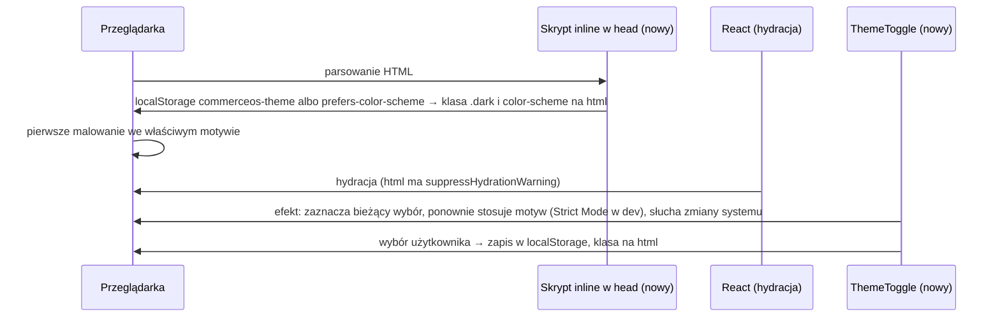

# Design system CommerceOS: tokeny w kodzie, motywy, Storybook i komponenty bazowe

- Źródło: plan kursu, lekcja 06 (fazy 2–3 „PLAN-TYDZIEN-2.md”), prompt Storybooka z lekcji (`storybook-devmentor.txt`, kontekst DevMentora podmieniony na CommerceOS). Brak issue w trackerze; to rozszerzenie zakresu poza spec MVP, więc spec zatwierdza właściciel.
- Status: **zatwierdzony** (2026-10-24): ⚠D1–⚠D5 przyjęte zgodnie z rekomendacjami. Etap 1 zmergowany (#99), etap 2 w toku (partia 1). Implementacja idzie osobnymi PR-ami (sekcja „Fazy”).
- Wejście (zatwierdzone): `.ai/design/audyt.md` (5 decyzji, 11 wartości na sztywno), `.ai/design/referencje.md` (R01–R04, A01, K1–K7), `.ai/design/tokeny.md` (**zatwierdzone 2026-10-24**, rozstrzygnięcia w sekcji 8), skrypt kontrastu `node .ai/design/kontrast/run.mjs`, plan etapów `.ai/design/POSTEP.md`.
- Autorytet projektowy: AGENTS.md („Product principles”, „Testing”, „Packages and boundaries”, „Agent rules”), `ENGINEERING_STANDARDS.md`, `BACKWARD_COMPATIBILITY.md` (zmiany konfiguracji i bramki).
- **Warunek wejścia:** P0 i P1 działają (spełnione: #79, #81, #85, #86 zmergowane); tokeny zatwierdzone (spełnione).

## 📝 TLDR

Aplikacja działa na domyślnym shadcn `base-nova`, czyli na najczęstszym generycznym wyglądzie (audyt). Ten spec zamienia zatwierdzone `tokeny.md` w kod i dokumentację, w trzech PR-ach etapowych, zanim w lekcji 08 zaczniemy retrofit ekranów:

1. **Etap 1 (fundamenty):** tokeny w `globals.css` w trzech warstwach (surowa, znaczeniowa, komponentowa), oba motywy z przełącznikiem (klasa `.dark` na `<html>`, domyślnie ustawienie systemowe, bez mignięcia przed hydracją), krój Archivo przez `next/font`, Storybook 10 (`@storybook/nextjs-vite`) ze stronami Foundations, testy dostępności jako błąd (`a11y: { test: "error" }`), skrypt na wartości spoza tokenów, ikony Tabler zamiast lucide.
2. **Etap 2 (komponenty bazowe):** 7 istniejących prymitywów dopasowanych do tokenów plus brakujące z minimalnego zestawu, partiami po ok. 6, każdy z 13 sekcjami dokumentacji.
3. **Etap 4 (strony, które uczą):** Start here, How to choose, What to avoid i reszta, plus `docs/design-system.md` dla agentów i wiersz w AGENTS.md.

Etap 3 Storybooka (komponenty produktu, wzorce, ekrany) i retrofit ekranów należą do lekcji 08 i dostaną własny spec. Wygląd ekranów zmienia się w etapie 1 tylko przez wartości tokenów (kolory, promień, krój); układ, gęstość i treść zostają.

## 📝 Rozstrzygnięte założenia (domyślne, do nadpisania)

Każde było pytaniem. Wybrałem najbardziej odwracalną opcję z najmniejszą nową powierzchnią. Pozycje oznaczone ⚠ wymagają **Twojej** decyzji przed implementacją etapu, którego dotyczą (AGENTS.md: wykluczenia z coverage i zmiany bramki tylko za zgodą).

| # | Pytanie | Domyślna odpowiedź | Uzasadnienie |
|---|---|---|---|
| A1 | Gdzie żyje design system? | **W `packages/app`**, bez nowego pakietu: tokeny w `src/app/globals.css`, komponenty w `src/components/ui`, konfiguracja Storybooka w `packages/app/.storybook/`, treść Storybooka (MDX, stories, bloki dokumentacji) w **`packages/app/stories/`** | AGENTS.md: nowy pakiet tylko za zgodą, a dziś DS ma jednego konsumenta. shadcn (`components.json`) już generuje do `src/components/ui`. `packages/ui` jak w DevMentorze wróci, gdy pojawi się drugi konsument |
| A2 | Dlaczego stories poza `src/` i poza `.storybook/`? | Katalog `packages/app/stories/` | (1) Coverage obejmuje `packages/*/src/**/*.{ts,tsx}`, więc stories i bloki dokumentacji poza `src/` **nie wymagają żadnego nowego wykluczenia**. (2) Dodatek Vitest Storybooka dopasowuje pliki globem bez plików z kropką, więc story w `.storybook/` nie staje się testem (sprawdzone w etapie 0). Stories importują prawdziwe komponenty przez `@/components/ui/...` (zasada 5 promptu) |
| A3 | Plik tokenów | **`packages/app/src/app/globals.css`**, bez wydzielania | tokeny.md go wybrał; shadcn CLI pisze do niego zmienne. Trzy warstwy jako trzy bloki z komentarzami-źródłami |
| A4 | Mechanizm motywu | Klasa `.dark` na `<html>` (istniejący `@custom-variant dark`). Wybór `light` / `dark` / `system` w `localStorage` (`commerceos-theme`), brak wpisu = system. Skrypt inline w `<head>` ustawia klasę i `color-scheme` przed pierwszym malowaniem; `<html suppressHydrationWarning>` | Przewodnik Next 16 „Preventing flash before hydration” (`node_modules/next/dist/docs/01-app/02-guides/preventing-flash-before-hydration.md`). Ciasteczko czytane w layoucie wyłączyłoby prerender przy `cacheComponents`; `localStorage` w skrypcie nie wymaga serwera |
| A5 | Przełącznik motywu: gdzie i jaki | Grupa trzech przycisków radio „Light / Dark / System” (natywne `<input type="radio">` w `<fieldset>`), w stopce sklepu i na dole menu admina. Logika w `src/lib/theme/` (czyste funkcje, test jednostkowy 100%), komponent bez gałęzi | Radio daje klawiaturę (strzałki) i role za darmo (WAI-ARIA APG „Radio Group”). Wzorzec z `redirect-notice.tsx`: logika w `.ts` z testem, komponent bez rozgałęzień |
| A6 | Krój | **Archivo** przez `next/font/google`, `axes: ["wdth"]`, `subsets: ["latin", "latin-ext"]`, zmienne `--font-sans` i `--font-heading` (display = `wdth` 87, treść = `wdth` 100). Geist Mono zostaje dla SKU i numeru zamówienia (P13) | tokeny.md §8 pkt 3. Font samohostowany w buildzie (bez CDN w przeglądarce), **bez nowej zależności** |
| A7 | Ikony | **Tabler** (`@tabler/icons-react`), `components.json` → `"iconLibrary": "tabler"` (shadcn 4.21 to obsługuje: sprawdzone w `@shadcn/registry`), usunięcie `lucide-react`, reguła ESLint `no-restricted-imports` | tokeny.md §6 i §8 pkt 5 (P11 odrzucona) |
| A8 | Konfiguracja testów Storybooka | **Osobny plik** `packages/app/vitest.storybook.config.mts`, uruchamiany `npm run test:storybook`; główny `vitest.config.mts` bez zmian | Wtyczka `storybookTest` ładuje presety Storybooka przy każdym starcie Vitesta; w głównej konfiguracji spowalniałaby i narażała `npm test` (bramka 100%). Osobny plik zostawia jednostki, integrację i e2e nietknięte |
| A9 | Testy w obu motywach | `test:storybook` (jasny) i `test:storybook:dark` (zmienna `STORYBOOK_THEME=dark` czytana w `preview.tsx` jako wartość domyślna globala `theme`), skrypt `test:storybook:themes` uruchamia oba | Prompt etapu 1 („skrypt w obu motywach”); dekorator ustawia klasę na `<html>`, więc nakładki Base UI w portalu też dostają motyw (zasada 9) |
| A10 | Skrypt wartości spoza tokenów | `npm run check:tokens`: skanuje `packages/app/src`, `packages/app/stories`, `packages/app/.storybook`, pomija `globals.css` i pliki testów; szuka literałów kolorów (hex, `rgb()`, `hsl()`, `oklch()`, `oklab()`, `lab()`, `lch()`, `color-mix()`), klas palety Tailwinda (`bg-amber-100`, `text-white`) i wartości arbitralnych (`p-[13px]`, `text-[0.8rem]`; warianty typu `has-[>svg]:` i `data-[x]:` są dozwolone); kod wyjścia 1 przy znalezisku, każde z plikiem i linią | Prompt etapu 1 pkt 6. Logika w `src/lib/design-tokens/` (test jednostkowy 100%), cienki punkt wejścia w `packages/app/scripts/` |
| A11 | Czy `check:tokens` wchodzi do bramki w etapie 1? | **Nie.** Dziś znajduje 11 znanych wartości z audytu (tokeny.md §1d) plus ilustracje SVG poza zakresem skanu; job `tokens` w CI dopiero po retroficie (lekcja 08) | Plan kursu, faza 5: „job tokens w CI, dopiero gdy aplikacja jest czysta”. Czerwony job od pierwszego dnia blokowałby każdy PR |
| A12 | 11 wartości na sztywno z audytu | **Zostają do retrofitu** (lekcja 08), poza tymi, które zmienia etap 2 w `components/ui` (#10 badge, #11 button) | Etap 1 to fundamenty, nie retrofit. Sprawdziłem: pliki z kolorami palety mają już warianty `dark:` albo własne tło, więc włączony ciemny motyw nie psuje kontrastu |
| A13 | Gęstość (P15) | `data-density="admin"` na layoucie admina; `:root` = gęstość sklepu. Tokeny `--control-h-*` i odstępy relacji w etapie 1, użycie w komponentach od etapu 2 | tokeny.md §3 |
| A14 | Język | Dokumentacja projektu (spec, POSTEP, `docs/design-system.md`) po polsku; UI produktu i treść stron Storybooka po angielsku, jak cały interfejs (K5) | Ustalenie właściciela dla dokumentów `.ai/design/`; Storybook czytają też agenci i interfejs jest angielski |
| A15 | Wersja Storybooka | **Storybook 10.6.3** (`latest`, 2026-10-20) z `@storybook/nextjs-vite` | Etap 0: zgodność sprawdzona instalacją próbną (sekcja „Zgodność Storybooka”) |

## 📝 Otwarte decyzje ⚠ (Twoje)

| # | Decyzja | Rekomendacja | Co się stanie bez decyzji |
|---|---|---|---|
| ⚠D1 | Wykluczenia z coverage dla Storybooka | **Żadnych.** Stories i konfiguracja leżą poza `packages/*/src/**` (A2), więc obecne `include` ich nie obejmuje. Gdybyś wolał stories obok komponentów (`src/components/ui/button.stories.tsx`), trzeba dopisać do `vitest.config.mts` wykluczenie `"**/*.stories.tsx"` z powodem „dokumentacja i testy Storybooka, pokryte projektem `storybook` w trybie przeglądarki”. Tego nie dodaję bez Twojej zgody | Zostaje A2, coverage bez zmian |
| ⚠D2 | Nowe zależności (sekcja „Zależności”) | Zgoda na listę z etapu 1. Każda ma powód; po każdej komendzie CLI sprawdzam `package.json` | Etap 1 nie startuje |
| ⚠D3 | Podbicie Vitesta 5.0.4 → 5.0.5 | **W etapie 1, osobnym commitem**, bo tryb przeglądarki (testy Storybooka) uruchamia serwer Vite, którego dotyczy advisory GHSA-p458-7748-mcp3 (`server.fs.deny` nie chroni `.env` i kluczy). Bez trybu przeglądarki `npm audit` dziś go nie zgłasza, więc to etap 1 wprowadza ryzyko. Alternatywa: osobny PR `chore(deps)` przed etapem 1 (lekcja 2026-10-23: aktualizacji nie mieszamy z funkcją) | Etap 1 dodaje tryb przeglądarki na podatnej wersji |
| ⚠D4 | CI dla Storybooka | Etap 1: **bez zmian w `ci.yml`** i w bramce (`.ai/agentic.config.json`); `lint` i `typecheck` i tak obejmują `.storybook/` i `stories/`. Job `storybook` (build + testy w obu motywach, Playwright Chromium) w etapie 2, gdy pojawią się stories komponentów; job `tokens` po retroficie (A11) | Testy Storybooka uruchamiane tylko lokalnie do etapu 2 |
| ⚠D5 | Obejście błędu Storybooka na Windows | Mała wtyczka Vite w `vitest.storybook.config.mts` (dekoduje ścieżkę pliku story), z komentarzem i linkiem do zgłoszenia; do usunięcia po poprawce w Storybooku. Bez niej testy Storybooka nie działają w katalogu `C:\Users\Użytkownik\…` (CI na Linuksie działa) | Testy Storybooka lokalnie nie uruchomią się na tej maszynie |

## 📝 Problem

- Audyt: aplikacja ma nietknięte tokeny shadcn (`--primary: oklch(0.205 0 0)`, `--radius: 0.625rem`), font Geist, obrys pól 1,26 : 1, pierścień fokusu 1,54 : 1, 11 wartości na sztywno w 11 plikach i martwy blok `.dark` bez przełącznika.
- Nie ma dokumentacji, z której developer albo agent zbuduje ekran bez zgadywania: brak Storybooka, brak „kiedy nie używać”, brak testów dostępności.
- Retrofit ekranów (lekcja 08) i prototyp (lekcja 07) potrzebują gotowych tokenów i komponentów, inaczej każdy ekran wymyśla wygląd od nowa.

## 📝 Rozwiązanie

### Warstwy tokenów w `globals.css` (etap 1)

| Warstwa | Gdzie w pliku | Kto jej używa | Przykład |
|---|---|---|---|
| 1. Surowa (paleta) | `:root`, prefiks `--raw-` (tokeny.md §1a) | **tylko** warstwa 2; nigdy komponent ani klasa | `--raw-red-600: oklch(0.50 0.19 25)` |
| 2. Znaczeniowa | `:root` (jasny) i `.dark` (ciemny); nazwy shadcn plus nowe (tokeny.md §1b–1c); komentarz ze źródłem przy każdym tokenie | komponenty i klasy Tailwinda przez `@theme inline` | `--action: var(--raw-red-600); /* R03.1, K1 */` |
| 3. Komponentowa | tylko tam, gdzie potrzebna: `--control-h-*` (zakres gęstości), `--radius-badge` | komponenty bazowe od etapu 2 | `[data-density="admin"] { --control-h-md: 2rem; }` |

- `@theme inline` mapuje warstwę 2 na klasy (`bg-action`, `text-success`, `border-input`, `shadow-overlay`, `rounded-card`), usuwa `--color-chart-1…5` i `--chart-*` (P12).
- Typografia: 6 nazwanych stylów na kontekst (tokeny.md §4) jako zmienne (`--type-h1-size` itd.) i klasy `@utility` (`type-display`, `type-h1`, `type-h2`, `type-h3`, `type-body`, `type-small`); admin nadpisuje rozmiary w `[data-density="admin"]`.
- Ruch: `--duration-fast|base|slow`, `--ease-out|in` i blok `@media (prefers-reduced-motion: reduce)` (tokeny.md §5).
- Fokus: bazowa warstwa ustawia `outline-ring` bez `/50`; pełna specyfikacja pierścienia (2 px, offset 2 px) wchodzi do komponentów w etapie 2, bo dziś `button`, `input`, `badge` same rysują `ring-ring/50`.
- Każdą zapisaną wartość przeliczam skryptem kontrastu przed commitem (tokeny.md, zasada 19). Wartości są przepisane 1:1 z zatwierdzonej tabeli, więc wynik ma się zgadzać z tokeny.md §2; jeśli jakakolwiek para spadnie poniżej progu, zatrzymuję się i pytam.

### Motyw (etap 1)

Wniosek: serwer zawsze renderuje to samo (prerender i `cacheComponents` bez zmian), a motyw ustawia skrypt przed malowaniem. Bez JavaScriptu strona jest w motywie jasnym, a przełącznik nic nie robi (opis w Edge cases).

### Storybook (etap 1, rozbudowa w etapach 2 i 4)

| Ścieżka | Zawartość |
|---|---|
| `packages/app/.storybook/main.ts` | framework `@storybook/nextjs-vite`, dodatki docs (z `remark-gfm` dla tabel MDX), a11y, vitest; wtyczka `@tailwindcss/vite`; telemetria, checklista startowa i komunikaty o nowej wersji wyłączone (zasada 10) |
| `packages/app/.storybook/manager.ts`, `theme.ts` | nazwa „CommerceOS design system” w interfejsie Storybooka, bez marki bazy |
| `packages/app/.storybook/preview.tsx` | `globals.css`, font Archivo, global `theme` z przełącznikiem w pasku narzędzi (klasa `.dark` na `<html>`), `a11y: { test: "error" }`, kolejność menu |
| `packages/app/stories/foundations/*.mdx` | Colors (role + tabela kontrastu w obu motywach), Typography (role), Spacing and layout (reguła relacji, 320/768/1440, `--measure-prose`), Shape and depth, Motion, Icons, Themes |
| `packages/app/stories/foundations/blocks/*.tsx` | pomocnicze bloki dokumentacji (próbka koloru, tabela tokenów), bez eksportu z aplikacji (zasada 5) |
| `packages/app/stories/foundations/*.stories.tsx` | stories bloków Foundations, żeby a11y sprawdzało je jako testy |
| od etapu 2: `stories/primitives/`, od etapu 4: `stories/design-system/` | strony komponentów (13 sekcji) i strony, które uczą |

Drzewo menu i liczba stories: `.ai/design/POSTEP.md`, sekcja „Drzewo menu Storybooka”.

### Skrypty (etap 1)

| Skrypt (root `package.json`) | Co robi |
|---|---|
| `npm run storybook` | `storybook dev` na porcie 6006, bez telemetrii |
| `npm run build-storybook` | statyczny build do `packages/app/storybook-static/` (w `.gitignore`, `.prettierignore` i `globalIgnores` ESLint) |
| `npm run test:storybook` | stories jako testy Vitest w Chromium (Playwright), a11y jako błąd, motyw jasny |
| `npm run test:storybook:dark` / `test:storybook:themes` | to samo w ciemnym / w obu |
| `npm run check:tokens` | wartości spoza tokenów, kod wyjścia 1 przy znalezisku |

## 📝 Zgodność Storybooka (etap 0, sprawdzone 2026-10-24)

Instalacja próbna w worktree `wt-design` (bez commita), Node 24, Windows 11.

| Element | Wersja w repo | Wymaganie Storybooka 10.6.3 | Wynik |
|---|---|---|---|
| Next.js | 16.4.1 | `@storybook/nextjs-vite` peer `next ^14.1 \|\| ^15 \|\| ^16` | ok |
| React / React DOM | 19.3.0 | `^16.8 … \|\| ^19` | ok |
| Vite (przez Vitest) | 8.3.4 | `^5 \|\| ^6 \|\| ^7 \|\| ^8` | ok |
| Vitest | 5.0.4 | `@storybook/addon-vitest` peer `vitest ^4 \|\| ^5`, `@vitest/browser(-playwright) ^4 \|\| ^5` | ok (`@vitest/browser-playwright@5.0.4` wymaga dokładnie `vitest 5.0.4`; przy podbiciu do 5.0.5 podbijamy razem) |
| Turbopack | aplikacja | Storybook go nie używa: ma własny bundler (Vite 8 z Rolldown) | brak konfliktu; aplikacja nadal buduje się Turbopackiem |
| Tailwind v4 | 4.3.3 (`@tailwindcss/turbopack`) | w Vite potrzebna wtyczka `@tailwindcss/vite@4.3.3` | ok, ten sam `globals.css` |
| Build | – | `storybook build` | **ok** (story z prawdziwym `Button` i tabela MDX z `remark-gfm`); ostrzeżenia Rolldown „module level directive `use client`” z Base UI to szum |
| Testy stories | – | `vitest` z `storybookTest` w Chromium headless | **ok po obejściu** (⚠D5); test z naruszeniem kontrastu kończy się błędem `color-contrast`, czyli `a11y: { test: "error" }` działa |

Znalezione problemy:

1. **Ścieżka z polskim znakiem (Windows).** `@storybook/addon-vitest` porównuje `import.meta.url` ze ścieżką pliku testu funkcją `convertToFilePath`, która dekoduje tylko `%20`. W `C:\Users\Użytkownik\…` (`%C5%BC`) każda story kończy się „No test suite found”. Obejście: wtyczka Vite, która w kodzie story owija wywołanie w `decodeURIComponent` (sprawdzone: 1 test zielony, test z naruszeniem czerwony). Do zgłoszenia w Storybooku; CI na Linuksie problemu nie ma.
2. **Stories w katalogu z kropką nie są testami** (glob bez `dot`). Stąd A2.
3. **`setProjectAnnotations` w pliku setup jest zbędny** od Storybooka 10.3 (dodatek stosuje adnotacje sam) i wyłącza automatyczne ładowanie: nie dodajemy pliku setup.
4. **Advisory Vitesta** GHSA-p458-7748-mcp3 (moderate) dotyczy `vitest` i `@vitest/browser*` ≤ 5.0.4, naprawione w 5.0.5 (⚠D3). `npm audit` po instalacji: 11 (6 moderate, 5 high) wobec 6 (1 moderate, 5 high) przed; wszystkie 5 nowych to łańcuch `@vitest/browser` → `@vitest/browser-playwright` → `vitest` → `@vitest/ui` z tym jednym advisory (naprawia ⚠D3). Sam `vitest` 5.0.4 bez trybu przeglądarki nie jest dziś zgłaszany; 6 wcześniejszych (`body-parser`, `fast-uri`, `undici`, `zod` w `shadcn`) nie zależy od Storybooka.
5. **Playwright Chromium** (Chrome Headless Shell, ok. 118 MiB) trzeba pobrać raz lokalnie (`npx playwright install chromium`) i w CI (`npx playwright install --with-deps chromium`, ⚠D4).

**Werdykt:** Storybook 10.6.3 z `@storybook/nextjs-vite` jest zgodny z Next 16.4.1, React 19.3, Vitest 5 i Tailwind v4; Turbopack nie ma znaczenia, bo Storybook buduje Vite. Rekomendacja: wchodzimy w etap 1 z obejściem ⚠D5 i Vitestem 5.0.5 (⚠D3).

## 📝 Zależności

| Paczka | Gdzie | Etap | Powód |
|---|---|---|---|
| `storybook@10.6.3` | `packages/app` dev | 1 | CLI i rdzeń Storybooka (prompt lekcji 06) |
| `@storybook/nextjs-vite@10.6.3` | dev | 1 | framework dla Next.js na Vite: obsługa `next/font`, `next/link`, `next/image`, wymagany przez dodatek Vitest |
| `@storybook/addon-docs@10.6.3` | dev | 1 | strony MDX i dokumentacja komponentów |
| `@storybook/addon-a11y@10.6.3` | dev | 1 | axe-core, `a11y: { test: "error" }` |
| `@storybook/addon-vitest@10.6.3` | dev | 1 | stories jako testy (interakcje, a11y) |
| `@vitest/browser@5.0.5`, `@vitest/browser-playwright@5.0.5`, `playwright` | dev | 1 | tryb przeglądarki dla testów stories |
| `vite@8.3.4` | dev | 1 | jawny peer frameworka (dziś tylko przechodnio przez Vitest) |
| `@tailwindcss/vite@4.3.3` | dev | 1 | Tailwind v4 w buildzie Vite Storybooka (aplikacja zostaje przy `@tailwindcss/turbopack`) |
| `remark-gfm@4.0.1` | dev | 1 | tabele w MDX (zasada 8 promptu) |
| `@tabler/icons-react` | dependencies | 1 | decyzja właściciela (tokeny.md §6, MIT); zastępuje `lucide-react` |
| `lucide-react` | – | 1 | **usunięta** |
| Archivo (`next/font/google`) | – | 1 | **bez zależności**: `next/font` jest częścią Next.js |
| `vitest`, `@vitest/coverage-v8` 5.0.4 → 5.0.5 | root dev | 1 | ⚠D3 |

Bez `@storybook/addon-themes` (przełącznik motywu to 20 linii w `preview.tsx`), bez `msw` (symulowanie API dopiero przy wzorcach w lekcji 08, spec retrofitu).

## 📝 Migracja ikon na Tabler (tokeny.md §6)

1. `npm install -w @commerceos/app @tabler/icons-react`; `components.json`: `"iconLibrary": "tabler"`.
2. Podmiana w dwóch plikach: `header-search.tsx` `SearchIcon` → `IconSearch`, `cart-link.tsx` `ShoppingCart` → `IconShoppingCart`; znak `☰` w `header-menu.tsx` → `IconMenu2` (test `storefront-shell.test.ts` aktualizowany razem). Rozmiar zgodnie z tokeny.md (20 px w sklepie, 24 px w ramie, 16 px w adminie), kreska 2 px; `aria-hidden` jak dziś.
3. `npm uninstall -w @commerceos/app lucide-react`; grep `lucide` w `packages/` = 0.
4. ESLint: wzorzec `restrict(["lucide-react", "lucide-react/*"], "Icons come from @tabler/icons-react (design system, tokeny.md §6).")` dopisany do **istniejącego** bloku `no-restricted-imports` dla `packages/app/src/**` (lekcja 2026-10-13: osobny blok zastąpiłby opcje) oraz osobny blok dla `packages/app/stories/**` i `.storybook/**`.
5. Strona Foundations „Icons”: biblioteka, rozmiary, kiedy ikona potrzebuje podpisu (sama ikona = `aria-label` na przycisku), zakaz ikon dekoracyjnych.

## 📝 Wpływ na coverage i CI

- **Coverage 100%:** bez zmian progów i bez nowych wykluczeń (⚠D1). Nowy kod w `src/` (logika motywu, skaner tokenów, `ThemeToggle`) ma testy jednostkowe. `src/components/ui/**` jest już wykluczone jako kod generowany przez shadcn; od etapu 2 te komponenty pokrywają też testy Storybooka (interakcje, a11y).
- **Bramka (`.ai/agentic.config.json`, AGENTS.md „Validation”):** w etapie 1 bez zmian. `lint`, `format:check` i `typecheck` obejmują nowe pliki. Nowe skrypty działają lokalnie.
- **CI:** etap 1 bez zmian w `ci.yml`. Etap 2: job `storybook` (⚠D4). Po retroficie: job `tokens` (A11). Każda zmiana `ci.yml` idzie razem z `.ai/agentic.config.json` i AGENTS.md (`BACKWARD_COMPATIBILITY.md`).
- **E2E:** etap 1 zmienia tylko wygląd; istniejące testy e2e muszą zostać zielone. Testy szukają ról i nazw, nie kolorów; nowe przyciski radio motywu mają unikalne nazwy („Light”, „Dark”, „System”).

## 📝 Edge cases i scenariusze błędów

| Przypadek | Zachowanie |
|---|---|
| `localStorage` niedostępny (tryb prywatny, zablokowane dane) | skrypt i przełącznik łapią wyjątek; motyw = system; wybór działa do przeładowania |
| Nieznana wartość w `localStorage` | traktowana jak `system` |
| Zmiana motywu systemu przy wyborze `system` | przełącznik słucha `matchMedia("(prefers-color-scheme: dark)")` i przełącza klasę |
| Bez JavaScriptu | strona w motywie jasnym, przełącznik widoczny, ale bezczynny. Akceptowalne: motyw nie jest funkcją transakcyjną |
| Strict Mode w dev zdejmuje klasę z `<html>` | efekt przełącznika stosuje motyw ponownie (przewodnik Next, „Re-applying attributes in development”) |
| Dwa przełączniki na stronie | nie występują (sklep i admin mają osobne layouty); logika i tak synchronizuje wszystkie grupy `name="theme"` |
| Nakładki Base UI w portalu | motyw na `<html>`, więc portal go dziedziczy (zasada 9) |
| Font niedostępny przy buildzie | `next/font` pobiera Archivo przy `next build`; CI ma sieć. Fallback metryczny generuje `next/font` |
| `check:tokens` na czystym kodzie | kod 0; na dzisiejszym kodzie kod 1 z listą znanych wartości (A11) |

## 📝 Ryzyka

| Ryzyko | Wpływ | Mitygacja |
|---|---|---|
| Zmiana kolorów i kroju na wszystkich ekranach naraz | średni: wizualna regresja niewykryta testami | e2e jako siatka; zrzuty przed/po w PR etapu 1 (agent-browser, 1440 i 390 px, oba motywy) |
| Ciemny motyw odsłoni miejsca bez tokenów | niski: pliki z paletą mają warianty `dark:` albo własne tło (A12) | lista w POSTEP; retrofit w lekcji 08 |
| Storybook w przyszłości niezgodny z kolejnym Next/Vitest | średni | wersje przypięte dokładnie; `test:storybook` przed każdą aktualizacją |
| Obejście ⚠D5 przestanie działać po aktualizacji Storybooka | niski | wtyczka zamienia tylko dokładny fragment kodu; jeśli go nie znajdzie, nic nie robi, a testy na Windows znów pokażą „No test suite found” |
| Ponad 170 nowych paczek w `node_modules` (dev) | niski: tylko narzędzia dev, nic nie trafia do buildu Next | `npm audit` w PR, wersje przypięte |

## 📝 Decyzje w grze

- Product principles AGENTS.md: 2 (prawdziwe dane: przykłady w Storybooku z seeda gamingowego, bez lorem ipsum i zmyślonych ocen), 4 (prosto: bez nowego pakietu), 6 (jawne ograniczenia: demo zawsze oznaczone tokenem `--demo`).
- Brief: D10 (sklep z akcesoriami gamingowymi) jako źródło przykładów.
- tokeny.md §7 (20 zasad) i §8 (rozstrzygnięcia właściciela) są kontraktem tego specu; ich zmiana wymaga ponownego zatwierdzenia i przeliczenia kontrastu.

## 📋 Fazy (kolejność PR-ów)

| PR | Etap | Zawartość | Kto merguje |
|---|---|---|---|
| 1 | design | `audyt.md`, `referencje.md`, `tokeny.md`, `kontrast/`, ten spec, `POSTEP.md` (design-only) | właściciel |
| 2 | **etap 1** | tokeny w kodzie, motywy i przełącznik, Archivo, Storybook + Foundations, `check:tokens`, Tabler, Vitest 5.0.5 | właściciel, po zatwierdzeniu specu |
| 3–5 | etap 2 | komponenty bazowe partiami po ok. 6 (lista w POSTEP), 13 sekcji dokumentacji, macierz stanów, testy interakcji; job `storybook` w CI | właściciel |
| 6 | etap 4 | strony, które uczą (Start here, Components, How to choose, Usage and accessibility, Content, What to avoid, What is missing, Contributing, strony epików), `docs/design-system.md`, wiersz w AGENTS.md „Task routing” | właściciel |
| później | etap 3 + retrofit | lekcja 08, osobny spec: komponenty produktu, wzorce, ekrany, 11 wartości na sztywno, job `tokens` | – |

Etap 5 promptu (sprawdzenie i raport, przygotowanie testu agentem) zamyka etap 4.

## 📋 Plan implementacji etapu 1

1. Podbicie `vitest` i `@vitest/coverage-v8` do 5.0.5 (osobny commit, ⚠D3); `npm test` zielony.
2. Tokeny w `globals.css` (3 warstwy, oba motywy, typografia, ruch, gęstość, bez `--chart-*`); kontrast przeliczony skryptem dla zapisanych wartości.
3. Archivo przez `next/font` w `src/app/fonts.ts` (używany przez layout i Storybook).
4. Motyw: `src/lib/theme/` (czyste funkcje + skrypt inline), `ThemeToggle` w stopce sklepu i menu admina, `data-density="admin"`; testy jednostkowe.
5. Tabler: instalacja, podmiana 3 miejsc, usunięcie `lucide-react`, reguła ESLint, `components.json`.
6. Storybook: zależności, `.storybook/`, `vitest.storybook.config.mts` (z obejściem ⚠D5), skrypty, ignorowanie `storybook-static`.
7. Foundations: 7 stron MDX z blokami renderującymi prawdziwe zmienne CSS, tabela kontrastu w obu motywach.
8. `check:tokens`: skaner w `src/lib/design-tokens/` z testami, punkt wejścia w `packages/app/scripts/`.
9. Pełna bramka z AGENTS.md „Validation” plus `build-storybook`, `test:storybook:themes`, `check:tokens` (oczekiwany kod 1 ze znaną listą); zrzuty przed/po; log w `.ai/runs/`.
