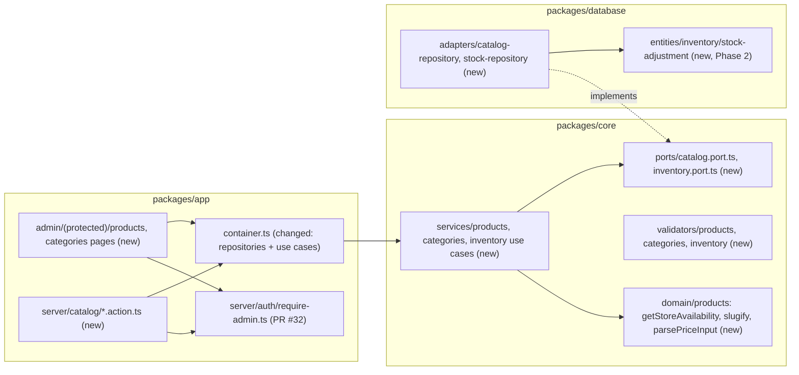
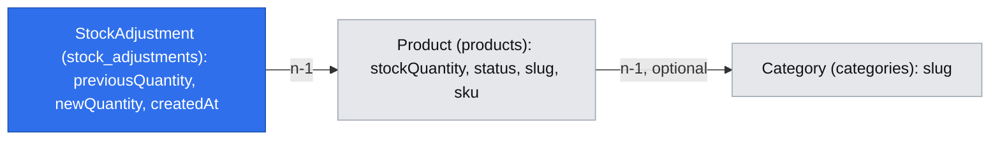

# Admin catalog management and manual stock adjustment

- Backlog: E03-S02 ([#20](https://github.com/BOMateuszBialas/techleaders/issues/20)) and E03-S03 ([#21](https://github.com/BOMateuszBialas/techleaders/issues/21)), epic E03 (#10)
- Depends on: E03-S01 (#19), spec `.ai/specs/implemented/2026-10-15-admin-authentication.md`, implemented in PR #32, merged 2026-10-15 (`server/auth/require-admin.ts`, `app/admin/(protected)/`, `server/auth/admin-guard-inventory.test.ts`)
- Status: draft, written in autonomous mode (2026-10-15); cross-model review and grill-me applied (2026-10-15). The defaults in "Resolved assumptions" need the product owner's review. The two items that gated a phase, A4 (no product deletion) and A7 (shared availability rule; the storefront check of #21 waits for E01-S01), were confirmed by the product owner on 2026-10-15. Implemented: Phase 1a in PR #39, Phase 1b in PR #40 and Phase 2 in its own PR (2026-10-16, see the three "Implementation notes" sections); moved to `implemented/`
- Design authority: `.ai/specs/product-brief.md` (D05, R04, R05), `.ai/specs/2026-10-13-commerceos-mvp.md` §3, §5, §8

## 📝 TLDR

Today the store owner cannot change the catalog at all: products and categories exist only through the seeder, and `/admin` shows system status only. **Proposed (future behaviour):** signed-in admin pages where the owner creates and edits products and categories, publishes or unpublishes a product, and sets its stock. Each screen says what the change does in the store: visible or hidden, buyable or out of stock, which URL changes, why a category cannot be deleted. Every stock change is recorded with its time and its old and new values. Phase 1 delivers #20, Phase 2 delivers #21, and each phase ships on its own.

## 📝 Resolved assumptions (autonomous defaults)

| #   | Question | Default chosen | Why |
| --- | -------- | -------------- | --- |
| A1  | One spec or two? (#20 and #21 can ship independently) | One spec with three PRs: Phase 1a (categories and the shared action layer) and 1b (products) for #20, and Phase 2 for #21 | The caller asked for one spec. The stories share pages, use-case conventions and error mapping, so they are designed once and delivered separately |
| A2  | Mutation transport: server actions or new `/api/admin/*` route handlers? | **Server actions only.** Pages read through use cases in Server Components. No new HTTP endpoint | No new public API contract (BACKWARD_COMPATIBILITY §2). Forms work without client JS. `adminApiHandler` stays available when a real API consumer appears |
| A3  | Deleting a category that still has products | **Refused** with the product count and names. Empty categories are deleted, race-free: the category row is locked `for update` before the `not exists` delete. The existing FK rule (`on delete set null`) is not changed | AC4 allows "refused". Refusing loses nothing and needs no schema change |
| A4  | Product deletion | **Confirmed by the product owner (2026-10-15).** **Not offered in this story.** Unpublishing is how a product leaves the store | Order items (E02-S02) and the demo traffic rows (D08, `on delete cascade`) will reference products, so a hard delete would quietly erase history. MVP spec §3 says "CRUD", so leaving out the D needs the owner's agreement. Adding it later is additive |
| A5  | Stock edit semantics | Set an **absolute** quantity, with an optimistic check: the form sends the quantity it showed, and the write succeeds only if the stored value still equals it | Issue #21 says "sets a new stock quantity". The check stops an owner from overwriting a checkout decrement they never saw (R04) |
| A6  | What a stock record holds | Product, previous quantity, new quantity, time. **No** reason field, **no** actor column, **no** source column | Covers the AC (time and new value) with the smallest table. With one owner, the actor is implicit. A `reason` or `source` column (for example checkout decrements in E02-S02) is a later additive migration with a default |
| A7  | Where the storefront AC of #21 is verified, given the storefront catalog (E01-S01, #14) does not exist yet | **Confirmed by the product owner (2026-10-15).** Core gets one availability rule, `getStoreAvailability`, which the admin uses now and E01-S01 must use. If E01-S01 has merged when Phase 2 is built, the Phase 2 e2e test checks the storefront product page; otherwise the admin check ships and E01-S01's e2e adds the storefront assertion | The AC cannot be checked end to end against a page that does not exist. One shared rule keeps the admin and storefront definitions the same (R05). The owner decides whether #21 may close before the storefront assertion exists |
| A8  | Price input | The owner types a decimal amount ("249.90" or "249,90"). Core parses the **string** into minor units (no float maths) and stores `priceMinor` | Matches the money rules. Typing grosze would be error-prone for the owner |
| A9  | Currency | Not editable. New products use `PLN`. The admin shows the stored currency | Multi-currency is out of scope (AGENTS.md) |
| A10 | Slug | Optional in the form. Blank means "derive from the name" (core `slugify`). Must match `^[a-z0-9]+(-[a-z0-9]+)*$` | Fewer typing errors. The rule is explicit and tested |
| A11 | SKU normalization | Trimmed and upper-cased; blank means `null` | `demo-mou-001` and `DEMO-MOU-001` must not both pass the unique constraint |
| A12 | Image URL | Optional, `https:` only, at most 2048 characters. Shown as text and a link in the admin, with no image preview (superseded by G6: a preview is shown) | Blocks `javascript:` and `data:` URLs. Image upload is P1 |
| A13 | Admin product list size | No pagination and no cap. Sorted by last change, newest first | The demo catalog has 5 products. Pagination can be added later without breaking anything |
| A14 | Concurrent edits of name, price and other fields; stock in the Phase 1 forms | Last write wins for name, price and the other fields (no version column; one owner). **Stock is never last-write-wins** (changed after cross-model review): in Phase 1b the product form sets stock **only when creating** a product. Changing stock afterwards happens only through Phase 2's conditional adjustment (A5) | A checkout decrement can never be overwritten, regardless of merge order |
| A15 | Client-side form components and the 100% coverage gate | Each form is split into a **view** component (props: `state`, `pending`, field defaults; no hooks) and a thin `"use client"` **wrapper** that only calls `useActionState` and renders the view. Unit tests (`*.test.ts`, using `createElement`, so no JSX and no Vitest config change) render the view for every state with `react-dom/server` `renderToStaticMarkup`, and render the wrapper once for its initial state. No new dependency, no coverage exclusion | A static render cannot drive `useActionState` through pending, error and success, but the view can be rendered in each state directly. If the wrapper still cannot reach 100%, the implementer stops and asks for an exclusion; it is never added silently (AGENTS.md) |
| A16 | Low-stock badge in the admin list | Not in this story | The threshold and its definition belong to the dashboard story (E04-S02, R05) |

## 📝 Grill-me decisions (product owner, 2026-10-15)

These confirm the defaults above and supersede any conflicting text elsewhere in this spec.

| #   | Topic | Decision |
| --- | ----- | -------- |
| G1  | Deleting a category with products | Refused, with "Used by N products" and up to 10 names; an empty category is deleted (A3 confirmed) |
| G2  | Stock edit | An absolute value with the optimistic check (A5 confirmed) |
| G3  | Stock history | Time, previous and new value; no reason field (A6 confirmed; a reason is a later additive column) |
| G4  | Price and currency | Decimal input with comma or dot, parsed into minor units; currency fixed to PLN (A8, A9 confirmed) |
| G5  | Slug | Optional, derived from the name; change warning; no redirects (A10 confirmed) |
| G6  | Image URL | `https:` only, max 2048 characters, **with a preview** (changed from A12): a small image preview in the product form and on the product page, so the owner sees whether the URL works (D05). A broken image shows "Image could not be loaded" |
| G7  | Product list | No pagination, search or filters; sorted by name, with availability and "Featured" badges (A13 confirmed) |
| G8  | Low-stock badge | Not in this spec; the dashboard (E04-S02) and Copilot own "low stock" (A16 confirmed) |
| G9  | SKU | Optional, trimmed, upper-cased, unique (A11 confirmed) |
| G10 | Rendering remote images | A plain `` with `referrerpolicy="no-referrer"`, `loading="lazy"`, explicit width and height, and a descriptive `alt` (the product name). No `next/image` optimisation for remote URLs, and **no `next.config.ts` change** (protected config). Local demo images keep `next/image`. The storefront uses the same rule (storefront spec, G21) |
| G11 | Publish and unpublish | One button that states the outcome before the click; no confirmation dialog (the action is reversible) |
| G12 | After saving | Stay on the product or category page and show the effect, for example "Saved. Shoppers now see this product as Out of stock." No redirect to the list |
| G13 | Category slug change | The same "old links stop working" warning as for products (it changes `/products?category=` and the home tabs) |

## 📝 Problem Statement

- D05 makes store management part of the value: the owner must see cause and effect. Today there is no admin UI for the catalog, and the only way data changes is `db:seed`.
- #20 AC: create and edit a product with validated fields (name, slug, description, price in minor units, SKU, stock, status, image URL, category); publishing or unpublishing states the effect in the store; a duplicate slug or SKU gives a clear field error; deleting a category that has products is refused or its consequence is shown first.
- #21 AC: a new stock quantity is reflected in storefront availability; a negative quantity is refused; every stock change is recorded with its time and new value.
- Existing code that shapes the design:
  - `products.slug`, `products.sku` and `categories.slug` are already unique in the DB, and `stock_quantity` has `check (>= 0)` (migration `Migration20261013000000_initial_catalog`).
  - `products.category_id` is `on delete set null`, so a plain delete would silently un-categorize products. That is the case AC4 is about.
  - `isPurchasable` (published and stock > 0) already lives in `packages/core/src/domain/products/product.ts`.
  - The seeder upserts demo products by slug, including `stockQuantity`, so a re-seed overwrites owner edits to demo products and is not recorded as a stock change (see Edge Cases).

## 📝 Proposed Solution

Admin pages under `app/admin/(protected)/` call use cases in `packages/core` through the request scope. Mutations are server actions in `"use server"` files, and each one calls `requireAdmin()` first. Three things are specific to this feature; the rest is ordinary CRUD:

1. **Effects are computed, not hand-written per page.** `getStoreAvailability(product)` in core returns one of `hidden` (draft), `out_of_stock` (published, stock 0) or `available`. The admin shows it as a badge and as a sentence ("Visible in the store and can be bought", "Visible in the store, shown as out of stock", "Hidden: shoppers cannot see or buy it"). The publish and unpublish buttons say what will happen before the click, and a slug change warns that the product's store URL changes.
2. **Uniqueness is enforced by the database, not by a pre-check.** The repository adapter translates PostgreSQL unique violations on `products_slug_unique`, `products_sku_unique` and `categories_slug_unique` into a `UniqueFieldConflictError` (a `ConflictError` subclass carrying `field`). The form shows it under the field. There is no check-then-write race. The same adapter maps a foreign-key violation on `products_category_id_foreign` (a category deleted meanwhile) to a `ValidationError` on `categoryId`.
3. **Stock changes are atomic and recorded.** One transaction runs a conditional update (`where id = ? and stock_quantity = :expected`) and inserts a `stock_adjustments` row. A mismatch returns a conflict that shows the current value, so a checkout decrement (E02-S02) is never silently overwritten.

**Alternatives rejected:**

- **REST routes plus a client fetch layer:** adds a public contract and a client helper (deferred in ENGINEERING_STANDARDS "Deferred") with no consumer besides these forms.
- **Delete a category and un-categorize its products (the current FK behaviour) after a confirm dialog:** AC4 allows it, but it hides products from category browsing as a side effect the owner has to understand. Refusing is clearer and reversible.
- **Stock as a delta ("+5 / −3"):** the AC says "sets a new quantity", and an absolute value plus the expected-value check gives the same safety with a simpler form.

### Research (market leaders)

- **Shopify** keeps an inventory adjustment history (who, when, reason, quantity before and after) and separates `status` (draft or active) from availability per sales channel. We keep the history and the status/availability split. We skip reasons, locations, channels and the `archived` status (A6, A4).
- **Medusa and Saleor** model stock per warehouse with reservations. Multi-warehouse inventory is out of scope (MVP spec §3), so stock stays one column on the product.
- **WooCommerce** has no stock history in core (it needs plugins). Its "Out of stock" visibility setting is the same idea as our `out_of_stock` state, which we always show rather than hide.
- **Shopify** refuses nothing when a collection is deleted; products just leave it. Our categories are the storefront's main navigation (E01-S01), so we refuse instead (A3).

## 📝 Architecture

**Takeaway:** the same layering as the health check: pages and actions resolve use cases from the request scope, use cases depend on ports, and the database adapters implement them. Only `container.ts` imports `@commerceos/database`, so the ESLint boundary holds.

- **`packages/core`**
  - `domain/products/product.ts` (extended): `getStoreAvailability(product)`, `describeStoreAvailability(state)` (the sentence shown to the owner), `slugify(name)`, `isValidSlug(slug)`, `normalizeSku(raw)`.
  - `domain/money.ts` (extended): `parsePriceInput(text): number` turns `"249.90"` or `"249,90"` into `24990` and `"249"` into `24900` by string parsing. It rejects more than two decimals, signs, exponents and values above `MAX_PRICE_MINOR` (`2_147_483_647`, the `int` column limit). `formatPriceInput(minor)` is the inverse, used to prefill the form.
  - `errors/app-error.ts` (extended, additive): `UniqueFieldConflictError extends ConflictError` with `readonly field: string`. `apiHandler` already maps it to 409 through `instanceof ConflictError`.
  - `validators/products/product-input.schema.ts`: `productInputSchema` (name 1–200, slug optional, description up to 5000, price text → `priceMinor`, SKU up to 64, `categoryId` uuid or empty, `imageUrl` https or empty, `status` on create only). `validators/categories/category-input.schema.ts`: name 1–120, slug optional, description up to 1000. `validators/inventory/set-stock.schema.ts`: `productId`, `expectedQuantity` and `newQuantity`, each an integer with `0 ≤ n ≤ 1_000_000`.
  - `ports/catalog.port.ts`: `ProductRepositoryPort` and `CategoryRepositoryPort` (list, get, create, update, set status, `deleteIfEmpty`). `ports/inventory.port.ts`: `StockRepositoryPort` (`setStock`, `listAdjustments`).
  - Use cases, one per file, each taking `deps: { …Repository }`: `ListProducts`, `GetProduct`, `CreateProduct`, `UpdateProduct`, `SetProductStatus`, `ListCategories` (with product counts), `GetCategory`, `CreateCategory`, `UpdateCategory`, `DeleteCategory`, and in Phase 2 `AdjustStock` and `ListStockAdjustments`. They return DTOs, never entities.
- **`packages/database`**
  - `adapters/catalog-repository.ts` and (Phase 2) `adapters/stock-repository.ts` implement the ports on the scoped `em`. A shared `toUniqueFieldConflict(error)` maps MikroORM's `UniqueConstraintViolationException` by constraint name to the field (`slug` or `sku`); any other error is rethrown.
  - `deleteIfEmpty(id)` runs in one `em.transactional`: `select … from categories where id = ? for update`, then `delete from categories where id = ? and not exists (select 1 from products where category_id = ?)`. A concurrent product insert or update that references the category takes a `key share` lock on that row, which conflicts with `for update`, so the two run one after the other. Under READ COMMITTED the delete statement then sees the committed product, or the insert fails its FK check. The result is `deleted`, `not_found` or `in_use` with the product count, which the use case turns into `NotFoundError` or a `ConflictError`.
  - Error mapping (`toCatalogWriteError(error)`): MikroORM's `UniqueConstraintViolationException` → `UniqueFieldConflictError` by constraint name; `ForeignKeyConstraintViolationException` on `products_category_id_foreign` → `ValidationError({ categoryId })`; `CheckConstraintViolationException` on `products_stock_quantity_check` or `products_price_minor_check` → `ValidationError` on that field. Anything else is rethrown. Step 4 first confirms that MikroORM 7 exposes the PostgreSQL constraint name on these exceptions; if it does not, the mapping reads it from the driver error's `constraint` property.
  - `setStock({ productId, expectedQuantity, newQuantity })` runs inside `em.transactional`: a native conditional update (`update products set stock_quantity = :new, updated_at = now() where id = :id and stock_quantity = :expected`; `updated_at` is set explicitly because a native update skips `onUpdate`), then the insert into `stock_adjustments` with `previous_quantity = expected`. No `returning` is needed. When no row was updated, a plain read tells `stale` (with the current quantity) from `not_found`. It returns `{ kind: "updated", adjustment }`, `{ kind: "stale", currentQuantity }` or `{ kind: "not_found" }`.
- **`packages/app`**
  - `server/catalog/product.action.ts`, `category.action.ts` and (Phase 2) `stock.action.ts`, all `"use server"`. The first statement of the function each export passes to `runAdminAction` is `await requireAdmin()`, written **in the action file itself**: `admin-guard-inventory.test.ts` passes a `"use server"` file only when the file contains the text `requireAdmin(`, so the call cannot be hidden inside the helper.
  - `server/catalog/action-state.ts`: `runAdminAction(name, fn)` returns an `ActionState` (`{ status: "idle" | "success" | "error", message?, fieldErrors? }`). It maps `ValidationError` to field errors, `UniqueFieldConflictError` to the field's message, `ConflictError` and `NotFoundError` to their messages, and `UnauthorizedError` to a redirect to the sign-in page. Anything else becomes a generic message and is logged with the action name. `fn` may also return `{ redirectTo }` (`createProduct`, `createCategory`, `deleteCategory`). Every `redirect()`, both this one and the sign-in redirect, runs after the `try/catch` has finished, never inside it, following the auth spec rule.
  - `app/admin/(protected)/error.tsx` (new; it does not exist yet): a client error boundary with a generic message and a "Try again" button. Coverage includes it (only `page.tsx` and `layout.tsx` are excluded), so it gets a unit test rendering it with `renderToStaticMarkup`.
  - `server/catalog/form-data.ts`: turns `FormData` into the plain object the core schemas parse. It never spreads FormData into a write.
  - `server/catalog/cache-tags.ts`: `CATALOG_CACHE_TAG = "catalog"`. Every successful mutation calls `updateTag(CATALOG_CACHE_TAG)`, so a storefront that caches catalog reads with `cacheTag(CATALOG_CACHE_TAG)` (E01-S01) shows the change on the next request. Admin pages are request-time, and actions call `refresh()` so the current page re-renders.
  - `container.ts`: `productRepository`, `categoryRepository` and `stockRepository` are **scoped** (they hold the request `em`), and so are all the new use cases.
  - Logging: actions log `catalog.product.created`, `catalog.product.status_changed`, `inventory.stock.adjusted` and so on, with ids only (no free text).

## 📝 Data Model

Phase 1 has **no schema change**: the uniqueness, `check` and FK constraints it relies on already exist.

Phase 2 adds one table, `stock_adjustments` (entity `StockAdjustment`, `packages/database/src/entities/inventory/stock-adjustment.entity.ts`, registered in `entities/index.ts`):

| Column | Type | Constraints |
| ------ | ---- | ----------- |
| `id` | `uuid` | primary key, `default gen_random_uuid()` |
| `product_id` | `uuid` | `not null`, FK → `products(id)` `on delete cascade` |
| `previous_quantity` | `int` | `not null`, `check (previous_quantity >= 0)` |
| `new_quantity` | `int` | `not null`, `check (new_quantity >= 0)` |
| `created_at` | `timestamptz` | `not null default now()` |

- Table-level `check (new_quantity <> previous_quantity)`: a no-op is not recorded (the use case returns "unchanged" without writing).
- Index on `(product_id, created_at desc)` for the history list.
- The table-level check and the composite index are declared in the entity (`defineEntity` `checks` and `indexes` options), not only in the migration, or the drift integration test fails.
- The delta is derived (`new − previous`) and not stored.
- No personal data, no free text.
- `on delete cascade` matches the D08 demo traffic tables. No product deletion exists in this story (A4).
- **Migration:** `npm run db:migration:create`, review the SQL, commit. `down` drops the table. No existing table changes, so rollback loses only the history.
- **The initial stock of a new product is not a change** and is not recorded, so `CreateProduct` never writes this table and no adapter writes another port's table. The history starts with the first adjustment and says so: "Changes since the product was created. Initial stock: not recorded."

## 📝 API Contracts

No HTTP endpoint is added or changed. The new contract surface is server actions (POST-only, reachable directly, so every one is guarded and validated) and admin URLs.

| Action | Input (FormData, validated by) | Success | Failure states |
| ------ | ------------------------------ | ------- | -------------- |
| `createProduct` | `productInputSchema` incl. `status`, initial `stockQuantity` | redirect to `/admin/products/{id}` | field errors; slug or SKU taken (field error); unknown category (field error) |
| `updateProduct` | `id` + `productInputSchema` without `status` and stock (stock goes through `adjustStock` from Phase 2; in Phase 1 the edit form still carries stock) | `{ status: "success" }` plus the new availability sentence | as above; `NotFoundError` |
| `setProductStatus` | `id`, `status` (`draft` or `published`) | the new availability sentence | `NotFoundError` |
| `createCategory` / `updateCategory` | `categoryInputSchema` (+ `id`) | redirect to the list / success | field errors; slug taken |
| `deleteCategory` | `id` | redirect to the list with "Category deleted" | `ConflictError`: "N products still use this category. Move them to another category or remove the category from them first."; `NotFoundError` |
| `adjustStock` (Phase 2) | `setStockSchema` | the new quantity and availability sentence, and the new history row | negative or non-integer → field error; stale → "Stock changed to N since this page loaded. Check it and try again." with the form reset to N; `NotFoundError` |

**Admin URLs (new, protected, BACKWARD_COMPATIBILITY §1 applies once merged):** `/admin/products`, `/admin/products/new`, `/admin/products/[id]`, `/admin/categories`, `/admin/categories/new`, `/admin/categories/[id]`.

## 📝 UI/UX

Standard shadcn list and form screens. Add the `table`, `textarea`, `select` and `radio-group` primitives with the shadcn CLI as needed. The unique parts:

- **Availability badge** in the product list and on the product page, driven only by `getStoreAvailability`: `Available`, `Out of stock` and `Hidden`, each with its sentence. The sentence also appears in the success message after any change that affects it (publish, unpublish, stock).
- **Publish and unpublish** on the product page are one button whose label and helper text say the outcome before the click: "Publish: shoppers will see it at /products/{slug}" (adding "and it will show as out of stock" when stock is 0), and "Unpublish: shoppers will no longer see or buy it. Existing orders are not affected." No modal: the text is visible next to the button.
- **Slug change warning** under the slug field on edit, when the product is published or the category has products: "Changing the slug changes the store URL; old links stop working." Redirects are not added.
- **Category delete**: the button sits on the category page. With products in it, the page shows "Used by N products" with up to 10 names linked to their pages, and "and N more". The button is still there, and the server refuses with the same message, so a stale page cannot bypass the rule.
- **Stock panel** (Phase 2) on the product page: the current quantity, a number input (`min=0`, `step=1`), "Set stock", the availability after the change as a preview, and the history (last 20: time in the owner's locale, previous → new, signed delta). Empty history: "No stock changes recorded yet."
- **States:** forms have a pending state (button disabled while `useActionState` is pending), field errors under each input (`aria-describedby`, `aria-invalid`), and a form-level message in a `role="alert"` (errors) or `role="status"` (success) region. Values the owner typed are kept after a failed submit. Lists have empty states with a primary action ("No products yet. Create the first one."). Page-level failures render the new `admin/(protected)/error.tsx` boundary with a generic message.
- **Navigation:** "Products" and "Categories" links are added to the protected layout's sidebar.
- **Demo data:** seeded products keep their `[DEMO]` descriptions and `DEMO-` SKUs. The admin shows them like any other product (R07 is met by the data itself).
- Product descriptions are plain text, rendered as text (never HTML). They will later reach Copilot as untrusted content.

## 📝 Edge Cases & Failure Scenarios

| Case | Behaviour |
| ---- | --------- |
| Duplicate slug or SKU (also two tabs saving at once) | The DB constraint fires, the adapter maps it, the form shows "This slug is already used by another product" under the field, and the input is kept |
| Slug left blank and the derived slug is taken | The same field error, with the derived value filled in so the owner can edit it |
| Name made only of symbols, so the derived slug is empty | Field error "Enter a slug using letters and numbers" |
| Price "12.345", "-1", "1e3", "abc" or above the limit | Field error. Nothing is written |
| `categoryId` of a deleted category | Field error "Choose an existing category" (FK violation mapped, or not found on lookup) |
| `imageUrl` with `javascript:` or `http:` | Field error |
| Category deleted while the owner creates a product in it | The product insert hits the FK and gets the field error above; the delete succeeded first because the category was empty |
| Product assigned to a category in the same instant the category is deleted | The `for update` lock in `deleteIfEmpty` serializes the two. Either the delete is refused (the product is visible to it) or the product write gets "Choose an existing category". The `on delete set null` path is never taken by the admin (integration-tested with two concurrent transactions) |
| Stock set to the same value | "Stock unchanged", nothing recorded |
| Stock changed by checkout (E02-S02) after the page loaded | Stale result: the message shows the current value, nothing is written, and the form is reset to the current value |
| Negative, non-integer or above 1,000,000 stock | Field error from the schema. The DB `check` is a second line of defence, and its violation is mapped to the same field error |
| Action posted without a session (expired, stale tab, direct POST) | `requireAdmin()` throws, `runAdminAction` redirects to `/admin/sign-in`, and no use case runs (unit-tested per action) |
| Product id in the URL that does not exist or is not a uuid | `notFound()` → the admin 404 page |
| DB unavailable | Pages: the error boundary's generic message. Actions: "Something went wrong. Try again." plus a log line with the action name and error. No stack trace or SQL reaches the owner |
| `db:seed` run again | Demo products are upserted by slug and overwrite owner edits to them, including stock, without a `stock_adjustments` row. This is existing dev-only behaviour, documented in the README: seeding is not a store operation |

## 📝 Risks & Impact Review

- **Schema (Phase 2):** one new table, additive (BACKWARD_COMPATIBILITY §5). `down` drops only the history. Per SDLC, Phase 2 carries `risk-high` because it adds a migration.
- **New public URLs:** the six admin URLs become protected surfaces under BACKWARD_COMPATIBILITY §1 once merged. The docs step adds them.
- **Server actions as an endpoint surface:** each export is a POST endpoint. The guard inventory test checks that each `"use server"` file calls `requireAdmin(`, but it cannot see whether **every** export does. Mitigation: one unit test per exported action asserts that without a session the use case is never resolved.
- **Category delete race:** closed by the row lock in `deleteIfEmpty` without a schema change. Changing the FK to `on delete restrict` would add a DB-level guarantee later, as an additive migration.
- **Phase ordering with checkout (A14):** if E02-S02 (#17) is scheduled before Phase 2, the Phase 1 stock field could overwrite a checkout decrement. The rule is that Phase 2 merges first; otherwise the Phase 1 edit form must adopt the expected-value check.
- **Seeder overwrites owner edits** to demo products (existing behaviour). Documented only; changing the seeder to insert-only is a separate decision for E04-S03 (#24).
- **Coverage approach for client forms (A15):** the view and wrapper split is the plan. If a wrapper's branches still cannot be reached, the implementer stops and asks for an exclusion instead of adding one silently.
- **Product direction:** no decision is superseded. A4 (no product delete) narrows MVP spec §3 "CRUD" for this story and needs the product owner's agreement. A7 decides how #21's storefront AC is verified.

## 📝 Decisions in play

- **D05:** cause and effect clear to the owner. This drives the availability sentence, the publish wording, the slug warning, the category refusal and the stock history.
- **R04:** stock cannot be oversold. Stock stays `check (>= 0)`, and manual adjustment never overwrites a concurrent checkout change (A5).
- **R05:** consistent definitions. One `getStoreAvailability` rule for the admin and the storefront.
- **R07:** demo data stays visibly demo data.
- **N04:** no AI involvement here. Copilot does not call any of these actions (R02).
- Superseded: none. A4 needs the product owner's agreement because it narrows MVP spec §3. Owner: product owner.

## 📋 Phasing

- **Phase 1a, E03-S02 (#20) part 1: categories, plus the shared action layer** (`runAdminAction`, error mapping, `error.tsx`, the view/wrapper form pattern). The owner manages categories, and deleting a used category is refused (AC4).
- **Phase 1b, E03-S02 (#20) part 2: products.** Create, edit, publish and unpublish with the stated effect, and duplicate slug/SKU errors (AC1–AC3). No schema change in Phase 1. The product form still carries stock as a plain field, so the catalog is fully manageable. Starts after A4 is confirmed. #20 closes with 1b.
- **Phase 2, E03-S03 (#21): the owner sets stock and sees the effect, with every change recorded.** The `stock_adjustments` migration, `AdjustStock`, the stock panel. The stock field leaves the product edit form, so every change after creation goes through the recorded path. Merges after A7 is confirmed, and before E02-S02 (A14).

Each phase is one PR, CI-green, with the whole gate passing.

## 📋 Implementation Plan

Every step keeps `npm run test:coverage` at 100% with no new coverage exclusion, and leaves the app working. Steps that add a page also add or extend an e2e test.

### Phase 1a: Categories and the shared action layer (E03-S02, #20, part 1)

1. **Core: slug rule, category validator, error.** `slugify` and `isValidSlug` in `domain/products/product.ts` (shared by categories and products), `categoryInputSchema`, `UniqueFieldConflictError`.
   - *Unit tests:* slugify with Polish diacritics, symbols, repeated dashes and an all-symbol name; valid and invalid category input; blank slug → derived; error subclass identity and `field`.
2. **Core: category port and use cases** (`ListCategories` with product counts, `GetCategory`, `CreateCategory`, `UpdateCategory`, `DeleteCategory`).
   - *Unit tests* with an in-memory fake repository: DTO mapping, not found, `DeleteCategory` → `ConflictError` with the count when in use.
3. **Database: category adapter and error mapping.** `catalog-repository.ts` (category half), `toCatalogWriteError`, `deleteIfEmpty`. First confirm where MikroORM 7 exposes the constraint name (see the error mapping in Architecture).
   - *Unit tests* (`createUnitTestOrm()` with stubbed methods): mapping by constraint name, rethrow of unknown errors.
   - *Integration tests:* round-trips; a duplicate category slug → `UniqueFieldConflictError("slug")`; `deleteIfEmpty` refuses a used category and deletes an empty one; a product insert into the category and a delete run in two concurrent transactions never end with an un-categorized product.
4. **Container wiring** for the category repository and use cases (scoped).
   - *Unit test:* `container.test.ts` resolves each new use case from a request scope; strict mode does not throw.
5. **Action layer.** `action-state.ts` (`runAdminAction`, including `redirectTo`), `form-data.ts`, `cache-tags.ts`, and `app/admin/(protected)/error.tsx`.
   - *Unit tests:* each error class → its `ActionState`; an unknown error → generic message and one log call, with no error text in the state; `UnauthorizedError` and `redirectTo` both redirect after the `try/catch` (the test asserts the redirect error propagates); FormData conversion; `error.tsx` rendered with `renderToStaticMarkup`.
6. **Category actions** in `category.action.ts`, each with `await requireAdmin()` written in the file.
   - *Unit tests* per export, with mocked `requireAdmin`, request scope, `updateTag` and `refresh`: no session → no use case resolved; valid input → the use case is called and the cache tag updated; failures map to the documented states.
   - `admin-guard-inventory.test.ts` passes unchanged.
7. **Category pages.** `/admin/categories`, `/new`, `/[id]` with the delete refusal UI, and a "Categories" sidebar link. Form view and wrapper per A15.
   - *Unit tests:* the view rendered for idle, pending, field errors, form error and success; the wrapper rendered once.
   - *E2E* (signed in with the existing `e2e/support/sign-in.ts` helper): create a category; a duplicate slug shows the field error; deleting a seeded category with products is refused with its count; deleting an empty one succeeds; without a session `/admin/categories` redirects to sign-in.
8. **Docs.** BACKWARD_COMPATIBILITY §1 (the category URLs), AGENTS.md (server actions with `runAdminAction` as the admin mutation pattern), `.ai/lessons.md` if anything surprised us.

### Phase 1b: Products (E03-S02, #20, part 2; starts after A4 is confirmed)

9. **Core: product rules and validator.** `getStoreAvailability`, `describeStoreAvailability`, `normalizeSku`; `parsePriceInput`, `formatPriceInput`, `MAX_PRICE_MINOR` in `domain/money.ts`; `productInputSchema`.
   - *Unit tests:* every availability state and its sentence; price parsing (comma and dot, 0–2 decimals, the rejections in Edge Cases, the upper bound, round-trip); SKU normalization; product input per field (blank SKU/category/image → `null`, `https` only).
10. **Core: product port and use cases** (`ListProducts`, `GetProduct`, `CreateProduct`, `UpdateProduct`, `SetProductStatus`).
    - *Unit tests* with fakes: DTO mapping, not found, the status change returning the new availability.
11. **Database: product half of `catalog-repository.ts`.**
    - *Integration tests:* round-trips; a duplicate slug and a duplicate SKU each map to their field; two concurrent creates with the same slug give exactly one success; a deleted category id → `ValidationError` on `categoryId`; a negative stock or price reaching the DB → `ValidationError` on that field; list order by `updated_at`.
12. **Container wiring and product actions** (`product.action.ts`), same test pattern as step 6.
13. **Product pages.** `/admin/products` (list with availability badges), `/new`, `/[id]` (edit form, publish/unpublish with effect text, slug warning), and a "Products" sidebar link. Views and wrappers per A15.
    - *Unit tests:* the form and publish-control views per state, including the out-of-stock wording.
    - *E2E:* create a draft product → "Hidden"; publish → "Available" with the URL sentence; set stock to 0 in the edit form → "Out of stock"; unpublish → "Hidden"; a duplicate SKU shows the field error and keeps the typed values; without a session `/admin/products` redirects to sign-in.
14. **Docs.** README (catalog management, the seed-overwrite caveat), BACKWARD_COMPATIBILITY §1 (the product URLs).

### Phase 2: Manual stock adjustment (E03-S03, #21)

15. **Schema.** The `StockAdjustment` entity (with `checks` and `indexes` declared in the entity), registration, `npm run db:migration:create`, reviewed SQL.
    - *Integration tests:* the existing drift test; the constraints reject a negative quantity and a no-op row.
16. **Core.** `setStockSchema`, `StockRepositoryPort`, `AdjustStock` (unchanged / updated / stale / not found) and `ListStockAdjustments`.
    - *Unit tests* with fakes: every outcome, a negative or non-integer quantity rejected before the port is called, the availability returned after the change.
17. **Adapter.** `stock-repository.ts` with `setStock` (native conditional update setting `updated_at`, then the insert, in one `em.transactional`) and `listAdjustments`.
    - *Integration tests:* a successful set writes both rows and bumps `updated_at`; a forced insert failure rolls back the update; a stale expected value changes nothing and returns the current quantity; two concurrent sets with the same expected value give one `updated` and one `stale`; history order and limit.
18. **Action and stock panel.** `stock.action.ts` (`adjustStock`, guard in the file); the product edit form loses its stock field and `UpdateProduct` stops accepting stock.
    - *Unit tests:* the action (guard, the stale message, the cache update) and the panel view per state, including the empty history.
    - *E2E:* set stock 8 → 0 → the badge shows "Out of stock" and a history row "8 → 0" with its time appears; −1 is refused with a field error; if E01-S01 has merged, the storefront product page shows the product as unavailable (A7).
19. **Docs.** README (stock adjustment, the history, the seed caveat), `.ai/lessons.md` if needed. Move this spec to `.ai/specs/implemented/` once all phases are merged.

## 📝 Cross-spec addition: "Featured on home page" (storefront grill-me G9, G20, 2026-10-15)

- **Dependency:** the storefront spec's Phase 1b adds `products.featured` (boolean, default false) with its migration and seed. This spec does **not** add the column. Its Phase 1b starts after storefront Phase 1b has merged.
- **Phase 1b addition:** the product form gets a checkbox "Featured on home page" with the hint "Shown in the home page slider when the product is published". `CreateProduct` / `UpdateProduct` accept `featured: boolean` (Zod, default false). The product list shows a "Featured" badge.
- **Effect shown to the owner (D05):** after saving, a featured, published product appears in the home slider; a featured draft does not, and the form says so.
- **Tests:** unit tests for the schema and the use case (toggle on and off); e2e: tick "Featured" on a published product → it appears on `/`; untick → it disappears.

## 📝 Cross-model review (GPT, Gemini), 2026-10-15

Each finding was checked against this spec's text before being accepted or declined.

**Applied:**
- **Stock is never last-write-wins** (GPT H5). In Phase 1b the product form sets stock on create only; edits go through the conditional adjustment (A14 updated). The "Phase 2 merges before checkout" ordering rule is no longer needed for safety.
- **Guard ordering is structural** (GPT H6, Gemini C):
  - `runAdminAction(handler)` itself calls `await requireAdmin()` before invoking the handler, so no export can run a mutation first.
  - Action files still contain the `requireAdmin` call the inventory looks for. The inventory rule is extended to accept `runAdminAction(` as the guard.
  - Every exported action gets a unit test invoking it without a session: it redirects to sign-in and the use case is never called.
- **MikroORM constraint names** (Gemini H): the step-3 spike checks where MikroORM 7 exposes the constraint name. It looks at `error.constraint`, then the wrapped driver error's `constraint`, read through a type guard (no `any`), then a match on the message. Integration tests assert the real constraint names against Testcontainers.
- Control-flow rule (GPT M14): **Framework control flow (applies to every page, loader and action in this spec):** `redirect()` and `notFound()` are never called inside a `try` block; error mapping happens first and the control-flow call runs after it. Any `catch` that wraps Next APIs calls `unstable_rethrow(error)` first. A unit test asserts that each redirect propagates.

**Declined, with reasons:**
- **Client wrappers cannot reach 100% coverage (GPT H10, Gemini M).** By design (A15) the wrapper only calls `useActionState` and renders the view, so it has no branches. All branching lives in pure view components, which are rendered in every state. State transitions are covered by e2e.
- **Seeder overwrites owner edits (GPT M11).** This is existing, documented dev-only behaviour. Making the seeder insert-only is a decision for E04-S03 (#24).
- **DI scope ownership (GPT M12).** It follows the existing documented pattern (`createRequestScope` in the loader, disposal in `finally`, scoped EM forks), already used by `load-system-health.ts`.

## 📝 Implementation notes: Phase 1a (PR #39, 2026-10-15)

Phase 1a shipped as specified, with these deviations and results:

- **Spike (step 3):** MikroORM 7's `DriverException` copies the `pg` error's own properties, so `code` (SQLSTATE) and `constraint` are on the thrown exception. `toCatalogWriteError` (`packages/database/src/adapters/catalog-write-error.ts`) reads both structurally (no `instanceof`, no message matching) and maps `23505`/`23503`/`23514` by constraint name. Integration tests assert the real names `categories_slug_unique`, `products_category_id_foreign` and `products_price_minor_check` against PostgreSQL 17. The product constraint names are already in the mapping table (unit-tested); Phase 1b adds their round-trip tests.
- **File layout:** the category adapter is `adapters/database-category-repository.ts` (products follow as `database-product-repository.ts`), not one `catalog-repository.ts`. Use cases are one per file in `core/src/services/categories/`. Core adds `parseInput` (schema → `ValidationError` with field errors) and `isUuid` (a malformed id is "not found" without a query).
- **Action layer:** the server helper is `server/catalog/run-admin-action.ts`; the client-safe `ActionState` type lives in `src/lib/action-state.ts` because the `"use client"` forms import it and cannot import a `server-only` module. The signature is `runAdminAction(name, values, handler)`: `values` are the submitted strings returned on error so the form keeps them (a derived slug replaces a blank one). `runAdminAction` calls `requireAdmin()` itself; action files do not repeat it, and the guard inventory accepts `runAdminAction(` (G-review "Guard ordering is structural").
- **Redirects and messages:** create redirects to the new category's page with `?notice=created` (G12: stay on the record's page), delete to the list with `?notice=deleted`; `notice` takes fixed codes only. Saving shows "Saved. Shoppers find it at /products?category=<slug> and in the home page tabs." (or "; it has no products yet.").
- **Category page:** the up-to-10 product names are plain text in Phase 1a; they become links to `/admin/products/<id>` in Phase 1b, when those pages exist. The "Products" sidebar link also arrives with Phase 1b.
- **Added:** an admin `not-found.tsx` under `admin/(protected)/` (the "admin 404 page" in Edge Cases) and the shadcn `table` and `textarea` primitives. No coverage exclusion was added; the wrappers have no branches, and the views, `error.tsx` and `not-found.tsx` are rendered by unit tests.

## 📝 Implementation notes: Phase 1b (2026-10-16)

Phase 1b shipped as specified, with these resolutions and deviations:

- **Stock on create only (A14 wins).** The cross-model review's rule replaces the older Phasing text ("the product form still carries stock") and step 13's e2e step. `productInputSchema` (edit) has no status and no stock; `createProductInputSchema` adds the initial `status` and `stockQuantity`; the adapter's `update` never writes `stockQuantity`. The edit form shows "Stock: N" read-only. The e2e step "set stock to 0 in the edit form → Out of stock" became "create a published product with stock 0 → Out of stock" (admin badge and storefront page).
- **List order (G7 wins over A13).** `/admin/products` is sorted by name (then slug), with the availability badge and a "Featured" badge; step 11's "list order by `updated_at`" integration test asserts the name order instead.
- **Featured on home page.** A checkbox (value `on`) with the hint "Shown in the home page slider when the product is published." The save message and the product page add "It appears in the home page slider." or, for a draft, "It is featured, but it will not show in the home page slider until it is published." No schema change (`products.featured` came with the storefront Phase 1b, #37).
- **Image URL rule widened for seeded images.** Seeded demo products store local paths (`/demo/products/<name>.svg`), so an `https:`-only rule would have made every seeded product unsavable without clearing its image. `isAllowedImageUrl` accepts `https:` URLs and paths matching `^/demo/[a-z0-9/-]+\.(svg|png|jpe?g|webp)$`; `javascript:`, `data:` and `http:` stay refused. The preview (G6) uses `next/image` for local demo images and a plain `` with `referrerpolicy="no-referrer"`, `loading="lazy"` and explicit dimensions for remote ones (G10). It previews the stored URL, not the one being typed; a failed load shows "Image could not be loaded." (a `useReducer` wrapper; the reducer is exported and unit-tested, so no coverage exclusion).
- **Native `<select>` and checkbox** instead of the shadcn `select`/`radio-group` primitives: they post with the form without client JavaScript and need no new component.
- **Status from a form:** `readFormValues` turns a missing field into `""`, so the create schema treats `""` as "draft"; `setProductStatus` validates its target with `productStatusSchema`.
- **Copy and messages:** publish help "Publish: shoppers will see it at /products/<slug>." (with "and it will show as out of stock" at stock 0), unpublish help as in UI/UX. After a click: "Published. <availability sentence> Shoppers find it at /products/<slug>." or "Unpublished. Hidden: shoppers cannot see or buy it. Existing orders are not affected." Create redirects to the product page with `?notice=created`.
- **Shared slug check:** `slugProblem(slug, maxLength)` in `validators/catalog/slug.schema.ts` is used by the category and product schemas (the slug messages moved there).
- **Category page:** its product names now link to `/admin/products/<id>`, and the sidebar has a "Products" link.
- **Known caveat (documented, not fixed):** `npm run db:seed` resets owner edits to demo products, including stock and `featured` (#24).

## 📝 Implementation notes: Phase 2 (2026-10-16)

Phase 2 shipped as specified, with these resolutions and deviations:

- **Initial stock is not recorded** (Data Model, A6 minimalism). `CreateProduct` never writes `stock_adjustments`; the panel says "Changes since the product was created, newest first (last 20). Initial stock: not recorded." and, before the first change, "No stock changes recorded yet."
- **Schema:** entity `entities/inventory/stock-adjustment.entity.ts`, migration `Migration20261016115407_stock_adjustments` (generated against a throwaway PostgreSQL 17, reviewed; additive, `down` drops only the table). Constraint names: `stock_adjustments_product_id_foreign` (`on delete cascade`), `stock_adjustments_previous_quantity_check`, `stock_adjustments_new_quantity_check`, `stock_adjustments_quantity_changed_check` (`new_quantity <> previous_quantity`), and the index `stock_adjustments_product_id_created_at_index` on `(product_id, created_at desc)`, declared in the entity with `checks` and `indexes[].columns` so the drift test stays empty.
- **Core:** `setStockSchema` (`validators/inventory/set-stock.schema.ts`) and a shared `stockQuantitySchema` (`validators/inventory/stock-quantity.schema.ts`, digits only, 0 to 1,000,000, form text or numbers), which the create-product schema now reuses; `MAX_STOCK_QUANTITY` and `STOCK_QUANTITY_MESSAGE` moved there. `AdjustStockUseCase` validates its own input, so a negative or non-integer quantity never reaches the port. Outcomes: `updated` (with the history row and the product's new availability), `unchanged` (the stored value equals the expected one and the new one: nothing written), `StaleStockError` (a `ConflictError` subclass carrying `currentQuantity`, message "Stock changed to N since this page loaded. Check it and try again."; also for an "unchanged" request whose expected value is out of date) and `NotFoundError`. `ListStockAdjustmentsUseCase` returns the last `STOCK_HISTORY_LIMIT` (20) rows with a derived `delta`.
- **Adapter:** `adapters/database-stock-repository.ts` (1a/1b naming). `setStock` runs the native conditional update (setting `updated_at = now()`) and the insert in one `em.transactional`; with no row updated, a plain read tells `stale` from `not_found`. `toStockWriteError` (in `catalog-write-error.ts`) maps `products_stock_quantity_check` and `stock_adjustments_new_quantity_check` to a field error on `newQuantity`. Integration tests cover the write and the `updated_at` bump, a rollback when the insert fails (the no-op check fires after the update ran), stale, not found, two concurrent sets with the same expected value (one `updated`, one `stale`), the constraints and the cascade.
- **Action and panel:** `server/catalog/stock.action.ts` (`adjustStock`, through `runAdminAction`; events `inventory.stock.adjusted` / `inventory.stock.unchanged`). On a stale refusal the action returns the current quantity as both form values, and the panel shows it as "Current stock" and in the input (the form is reset to N). The product badge at the top of the page is refreshed only after a successful change. The panel form uses `noValidate`, so a value such as -1 reaches the server and its message appears under the field (the `min`/`step` attributes stay for the spinner). The edit form's read-only "Stock: N" line was removed; `UpdateProduct` already never wrote stock (1b).
- **Preview (deviation):** the "availability after the change" is a static sentence by status, not a per-keystroke preview: "After the change: 0 shows it to shoppers as out of stock; 1 or more lets them buy it." for a published product, "It stays hidden from shoppers whatever the quantity, until it is published." for a draft. It states the same rule without client state; the success message then states the actual result ("Stock set to 0 (was 8). Visible in the store, shown as out of stock.").
- **History times:** formatted on the server in the owner's locale (the first supported `Accept-Language` tag, else `en-GB`) and the store's time zone, `Europe/Warsaw`, so the server render is stable; each row is `<time dateTime>` + "previous → new" + the signed delta.
- **A7:** E01-S01 has merged, so the Phase 2 e2e test also checks the storefront product page shows "Out of stock" after 8 → 0.
- **Seed caveat (documented in README, not fixed, #24):** a re-seed sets demo products' stock back to the seed values without a history row and keeps the recorded history, so the last "new" value can differ from the current stock. AGENTS.md now states that `setStock` is the only writer of `products.stock_quantity` besides the seeder.

## 📝 Implementation notes: follow-ups #41 and #43 (2026-10-16)

- **Zero prices (decision, #41):** a **published** product must cost more than 0.00 PLN; a **draft** may be saved at 0.00 while the owner prepares it. The rule is `hasPublishablePrice` (`core/domain/products/product.ts`) and is checked on every path that could produce a published free product: creating with "Published" (field error under Price: "A published product needs a price above 0.00 PLN. Enter a price, or keep it as a draft."), saving a published product at 0.00 (`UpdateProductUseCase`, same field error) and publishing a draft priced at 0.00 (`SetProductStatusUseCase`: "Set a price above 0.00 PLN before publishing."). The price hint says so. Unpublishing is never blocked. The DB check stays `price_minor >= 0` (no migration); the update and publish checks read, then write, so two tabs of the one owner racing a publish against a price change could still leave a published 0.00 product. Accepted for the one-owner MVP; a check constraint `status <> 'published' or price_minor > 0` can close it later. Rows that are already published at 0.00 stay as they are until the owner edits them.
- **Created and deleted notices (#41):** the `?notice=` message renders through `RedirectNotice` (`components/admin/redirect-notice.tsx`), whose effect (`retireRedirectNotice`) drops `notice` from the address bar with `history.replaceState` and hides the message on the next form submit on the page. A `refresh()` after a later save still rendered the old `?notice` (the server action re-rendered the page as first requested), so hiding on submit is what keeps only the newest message on screen; the address change keeps a reload from showing it again. The `notice` codes and URLs are unchanged.
- **Broken hidden stock field (#43):** an error on `expectedQuantity` (a hidden input, only reachable by editing the page) becomes the form message "This form is out of date. Reload the page and try again." in `stock.action.ts`; the posted quantity is dropped, so "Current stock" falls back to the stored value, and a visible field's error stays under its field.
- **Stale stock e2e (#43):** `admin-stock.e2e.test.ts` changes the stock from a second browser that shares the owner's cookies (`BrowserSession.shareCookiesWith`), then submits from the first page and checks the stale message and the reset to the new quantity. The new e2e tests reuse the owner session instead of signing in again, because the sign-in rate limit (20 per minute without a trusted IP header) is shared by the whole e2e run.

