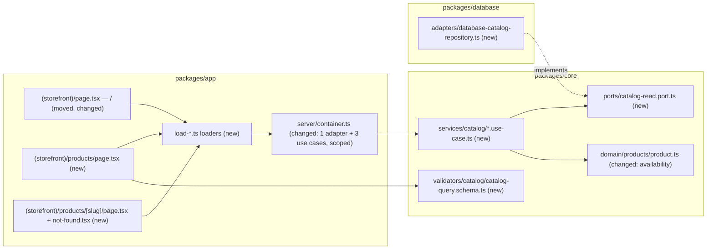

# Storefront catalog: browse by category, product details, search

- Backlog: E01-S01 ([#14](https://github.com/BOMateuszBialas/techleaders/issues/14)) and E01-S02 ([#15](https://github.com/BOMateuszBialas/techleaders/issues/15)), epic E01 (#8)
- Status: **Implemented.** Phase 1 in PR #34, Phase 1b in PR #37, Phase 2 in the E01-S02 PR (2026-10-16, closes #15); written autonomously (`om-spec-writing --autonomous`); cross-model review and grill-me applied (2026-10-15). Open Questions were resolved with defaults; see "Resolved assumptions". The two ⚠ items (Q2, Q4) were confirmed by the product owner on 2026-10-15; the other defaults stand unless review changes them.
- Design authority: `.ai/specs/product-brief.md`, `.ai/specs/2026-10-13-commerceos-mvp.md` §3 (P0 storefront), §5, §9

## 📝 TLDR

Today the storefront (`/`) is a static shell that says "The product catalog is not implemented yet". Product and category tables, the seed catalog and the `Money` helpers exist, but no code reads them for shoppers. **Proposed (future behaviour):** shoppers browse published products at `/products`, narrow them by category (`?category=<slug>`) and by a search term (`?q=<term>`), and open a product page at `/products/<slug>`. Draft products never appear anywhere and their URLs show "not found". The work is phased per story: Phase 1 delivers browse and details (E01-S01), Phase 2 adds search combined with the category filter (E01-S02). It unblocks the cart (E02-S01), which depends on E01-S01.

## Resolved assumptions (autonomous defaults)

| #   | Question                                                                    | Chosen answer                                                                                                                                                                                                                                                                         | Rationale                                                                                                                                                                                                               |
| --- | --------------------------------------------------------------------------- | ------------------------------------------------------------------------------------------------------------------------------------------------------------------------------------------------------------------------------------------------------------------------------------- | ----------------------------------------------------------------------------------------------------------------------------------------------------------------------------------------------------------------------- |
| Q1  | One spec or two?                                                            | One spec, one phase per story                                                                                                                                                                                                                                                         | The caller asked for one spec. S02 reuses S01's listing page, use case and adapter, so it does not ship independently of S01 (it can ship after it).                                                                    |
| Q2  | Public URL scheme                                                           | `/` (home), `/products` (listing), `?category=<slug>`, `?q=<term>` (Phase 2), `/products/<slug>` (detail). No `/categories/<slug>` route, no `?page`, no `?sort`. **Confirmed by the product owner (2026-10-15).**                                                                                       | One listing route serves both stories. These URLs become protected public surfaces (`BACKWARD_COMPATIBILITY.md` §1), so renaming them later needs redirects.                                                            |
| Q3  | Caching                                                                     | No `"use cache"`. Data is read at request time inside `<Suspense>` after `await connection()`; only static chrome is prerendered                                                                                                                                                         | The build must not need a database (standards §5), stock must be fresh, and no admin mutation exists yet to invalidate a cache tag. Adding `use cache` + `cacheTag` later is additive.                                    |
| Q4  | Draft or unknown slug: real `404` status or a streamed "not found"?         | `notFound()` inside the Suspense boundary: the not-found UI renders with HTTP **200** and Next adds `noindex`. No `proxy.ts` DB lookup. **Confirmed by the product owner (2026-10-15).**                                                                                                                  | Next 16 fixes the status once streaming starts (`not-found.md`, "Status codes"). A true 404 needs a DB query in Proxy before render. The draft is never shown either way; only the status code differs.                 |
| Q5  | Search semantics                                                            | Case-insensitive substring match (`ILIKE`) of the whole trimmed term against product **name or description**, published only, with `%`, `_` and `\` escaped. No full-text search, no new index or extension                                                                            | Spec §3 accepts simple DB-backed search. No schema change. Demo scale is tens of rows.                                                                                                                                  |
| Q6  | Pagination                                                                  | None. At most 48 products per listing, sorted by name; when more match, the page says "Showing 48 of N. Narrow your search or pick a category"                                                                                                                                         | Smallest scope; avoids a new protected `?page` parameter. Pagination can be added later as an additive parameter.                                                                                                      |
| Q7  | What "availability" shows                                                   | "In stock" or "Out of stock" (from the existing `isPurchasable` rule). Exact quantities are not shown to shoppers. Out-of-stock products stay listed                                                                                                                                   | Meets the acceptance criteria without exposing stock levels; low stock stays an admin and Copilot concept.                                                                                                             |
| Q8  | Product images (the AC asks for an image; the seed has none)                | Seed products get local demo SVGs (`/demo/products/<slug>.svg` under `packages/app/public/`). The page renders `imageUrl` with `next/image` and `unoptimized`; `null` shows a neutral "No image" placeholder. No `next.config.ts` change                                               | Meets the AC with no external host and no protected config change. Remote URLs arrive with admin product editing (E03), which owns URL validation.                                                                       |
| Q9  | Where do the draft product and the empty category for tests come from?      | Test fixtures, not demo data: `seedCatalog` accepts an optional `status` and `imageUrl` per product, and `packages/database/src/testing/catalog-fixtures.ts` holds an `[E2E]` catalog (one draft product, one empty category, one category holding only a draft) seeded by the integration and e2e setups | Keeps the demo store unchanged and reuses the existing repeatable upsert. The demo seed itself stays all-published.                                                                                                    |
| Q10 | How R07 (demo data labelled) applies to the storefront                      | A static banner in the storefront layout: "Demo store. Products and prices are fictional; no real orders or payments." Seed descriptions keep their `[DEMO]` prefix                                                                                                                     | R07 requires demo data to be presented as demo data wherever it appears.                                                                                                                                                |
| Q11 | Unknown or malformed `?category=`                                           | Inline "This category does not exist" state with a link to all products (status 200), not the route's not-found page                                                                                                                                                                  | A query parameter does not identify the page itself; the shopper keeps the search form.                                                                                                                                |
| Q12 | Categories shown in navigation                                              | All categories, sorted by name, including empty ones                                                                                                                                                                                                                                  | AC "an empty category shows an empty state" needs a reachable empty category.                                                                                                                                         |
| Q13 | A public HTTP API (`/api/products`)?                                        | No. Server Components call the use cases directly (standards §4, "Client-side API calls")                                                                                                                                                                                             | No new protected API contract.                                                                                                                                                                                          |
| Q14 | Invalid `?q`                                                                | Whitespace-only means no search; over 100 characters shows a validation message and no query runs; a repeated parameter uses the first value                                                                                                                                          | Validates untrusted input at the boundary with Zod (AGENTS.md) without a 500.                                                                                                                                          |

## 📝 Grill-me decisions (product owner, 2026-10-15)

These supersede any conflicting text elsewhere in this spec.

| #   | Topic | Decision |
| --- | ----- | -------- |
| G1  | Home page `/` | It must look like a normal shop: a **hero**, a **featured-products slider with category tabs**, a **header menu** and a **footer**. Delivered as **Phase 1b** (below). Phase 1's home is a simple category list until 1b lands |
| G2  | Price format | `formatMoney` with `pl-PL` ("54,90 zł"); UI copy stays English |
| G3  | Out of stock | Listed with "Out of stock"; quantities never shown (Q7 confirmed) |
| G4  | Sort | By name only (Q6 confirmed) |
| G5  | Search | Case-insensitive substring; Polish diacritics are not folded (accepted limitation) |
| G6  | Images | Local demo SVGs, "No image" placeholder (Q8 confirmed) |
| G7  | Demo banner | Static banner in the storefront layout (Q10 confirmed) |
| G8  | Delivery | One PR per phase: Phase 1 (#14), Phase 1b (home), Phase 2 (#15) |
| G9  | What "featured" means | A **`featured` boolean on products** (default false), set by the owner in the admin (admin spec, Phase 1b checkbox). The seed marks some demo products featured |
| G10 | Slider mechanics | CSS horizontal scroll with `scroll-snap`; no JavaScript, no carousel library, no arrows |
| G11 | Category tabs | Links `/?category=<slug>` (plus "All" = `/`), rendered on the server. `category` on `/` becomes a protected public parameter, with the same name and slug rules as on `/products` |
| G12 | Hero | Static: headline, one sentence about the demo store, a "Shop all products" button to `/products`, and a local SVG illustration. No rotating slides |
| G13 | Header menu | Logo → `/`, "Shop all", one link per category (all categories; a cap is a later decision), the search box (Phase 2), and a reserved cart slot (E02). On narrow screens a native `
` "☰ Menu" disclosure, no JS. The "Admin" link moves to the footer |
| G14 | Footer | Store name and one-line description, category links, "Owner sign-in" (`/admin`), the demo notice (R07), copyright. **No placeholder pages** (no About/Contact), per AGENTS.md principle 6 |
| G15 | Look and feel | Structure and behaviour now; visual design after lesson 06 (design system). Phase 1b uses plain shadcn/Tailwind defaults |
| G16 | Slider size and order | Up to **12** featured products, sorted by name; the "All" tab spans every category |
| G17 | Category with no featured product | The slider shows "No featured products in this category yet." plus a link to `/products?category=<slug>`; nothing is silently substituted |
| G18 | Featured but draft or out of stock | Drafts never appear; out-of-stock featured products appear with "Out of stock" |
| G19 | Unknown `/?category=` | The slider silently falls back to "All" (no error message on the home page); `/products` keeps Q11's inline message |
| G20 | Order of delivery and column ownership | Storefront Phase 1 → **storefront Phase 1b** (adds the `featured` column, migration and seed) → admin 1a/1b (adds the "Featured on home page" checkbox) → storefront Phase 2 and the cart |
| G21 | Remote product images (from the admin spec's grill-me, G10) | A product whose `imageUrl` is not a local `/demo/...` path renders with a plain `` (`referrerpolicy="no-referrer"`, `loading="lazy"`, width/height set, `alt` = product name), never `next/image`; no `next.config.ts` change. A failed load shows the "No image" placeholder |
| G22 | Cart slots (from the cart spec's grill-me, G8, G9, G11) | Product cards (listing and home slider) and the header leave an empty slot for "Add to cart" and the cart count; the cart spec's Phase 1 fills them. No disabled placeholder ships before the cart works |
| G23 | Demo catalog (product owner, 2026-10-15, decision D10) | The demo store sells **gaming accessories**, not coffee: categories Mice, Keyboards, Headsets, Controllers and Mousepads, about 15 products with local SVG images, at least one out of stock, about 6 featured across at least 3 categories. Coffee slugs and names in this spec's examples (`coffee`, `brewing`, `v60-dripper`, "Yirgacheffe") describe the Phase 1 data and are replaced by the gaming catalog from Phase 1b on (seed, fixtures, tests, copy) |

## 📝 Problem Statement

- The demo story starts with a shopper browsing products (MVP spec §2, brief "Key flows"); nothing exists for that yet. `packages/app/src/app/page.tsx` is a placeholder.
- The cart (E02-S01, #16) depends on E01-S01, and the whole purchase → admin → Copilot demo path depends on the cart.
- Acceptance criteria:
  - **S01-AC1:** with published products in two categories, the catalog lists published products only, with name, price formatted from minor units, category and availability.
  - **S01-AC2:** a product page shows description, price, stock availability and image.
  - **S01-AC3 (negative):** a draft product's slug returns "not found" and never shows the draft.
  - **S01-AC4:** an empty category shows an empty state, not an error.
  - **S02-AC1:** a search lists only published products that match.
  - **S02-AC2:** a category filter combined with a search returns results that satisfy both.
  - **S02-AC3 (negative):** no match shows a "no results" state, and drafts are never returned.

## 📝 Proposed Solution

A read-only catalog slice through every layer, following the existing health-check pattern (port in `core`, adapter in `database`, scoped use case in the container, colocated loader in the page folder):

1. `core` owns the visibility rule (published only), availability, the input schema and the shopper-facing DTOs. The use cases pass `status: "published"` to the port, so no adapter decides what a shopper may see.
2. `database` implements the port with a scoped `EntityManager`.
3. `app` renders Server Components. Each data component awaits `connection()`, runs inside `<Suspense>` and gets its data from a colocated `load-*.ts` loader. The loader maps `NotFoundError` to a "not found" result and logs anything else as an error state, as `load-system-health.ts` does. The search form is a plain `GET` form, so it works without client JavaScript.

**Alternatives rejected:**

- **`/categories/<slug>` pages plus a separate `/search` page** (Shopify style: `/collections/<handle>`, `/search?q=`): three routes and two listing implementations for the same query, and S02-AC2 (search within a category) needs the combined form anyway.
- **`"use cache"` with `cacheTag("catalog")`:** fewer DB reads, but it either prerenders at build time (which needs a DB at build, against standards §5) or needs `updateTag` calls from admin mutations that do not exist yet. Stale stock would mislead shoppers before checkout.
- **PostgreSQL full-text search or `pg_trgm`:** needs a migration and an extension for no benefit at demo scale.
- **A client-side search component calling an API route:** adds a public API contract and client state; a GET form gives shareable URLs for free.

**Research (market leaders):**

- **Medusa** `/store/products` filters by `q` and `category_id` and returns only products published to the sales channel. This confirms that visibility belongs to the query layer, not the UI. Medusa's `q` also matches description and other fields, which is our choice too.
- **Shopify** themes show "Sold out" rather than quantities and keep sold-out products listed, which matches Q7. Shopify's soft-404 handling of unpublished products is not a concern for this demo.
- We skip what they carry and the MVP does not need: facets, sorting options, variants, pagination cursors and search ranking.

## 📝 Architecture

**Takeaway:** the visibility rule lives in `core` and is passed to the adapter as criteria, so a later admin listing (E03) can reuse the adapter with other criteria without a new code path deciding storefront visibility. No module outside `container.ts` imports `@commerceos/database`, so the ESLint boundary holds.

### `packages/core`

- `domain/products/product.ts` (changed): `getAvailability(product): "in_stock" | "out_of_stock"`, built on `isPurchasable`. Existing exports are unchanged.
- `ports/catalog-read.port.ts` (new, type-only):
  - `CatalogProductRecord`: `{ id, slug, name, description, priceMinor, currency, stockQuantity, imageUrl, status, category: { slug, name } | null }`.
  - `CatalogCategoryRecord`: `{ id, slug, name, description }`.
  - `CatalogReadPort`:
    - `listCategories(): Promise<CatalogCategoryRecord[]>`, sorted by name.
    - `findCategoryBySlug(slug): Promise<CatalogCategoryRecord | null>`.
    - `findProducts(criteria: { status: ProductStatus; categoryId?: string; search?: string; limit: number }): Promise<{ items: CatalogProductRecord[]; total: number }>`, sorted by name, then slug.
    - `findProductBySlug(slug): Promise<CatalogProductRecord | null>` (any status; the use case decides).
- `services/catalog/` (new concept folder; "catalog" is the shopper-facing read model over products and categories):
  - `list-catalog-categories.use-case.ts`: returns `CatalogCategory[]` (`slug`, `name`, `description`).
  - `list-catalog-products.use-case.ts`: input `{ categorySlug?, search? }` (`search` is added in Phase 2). It resolves the category first and throws `NotFoundError("Category")` when the slug is unknown. It always passes `status: "published"` and `limit: CATALOG_PAGE_LIMIT` (48). Output: `{ category: CatalogCategory | null, products: CatalogProductSummary[], total, limit }`.
  - `get-catalog-product.use-case.ts`: input `{ slug }`. A slug that fails `SLUG_PATTERN` throws `NotFoundError("Product")` without calling the port. It also throws `NotFoundError("Product")` when the record is missing **or** not published (defence in depth: the rule is checked in core, not trusted to the query). Output: `CatalogProductDetail`.
  - `catalog.dto.ts`: `CatalogProductSummary = { id, slug, name, price: Money, category: { slug, name } | null, availability, imageUrl }` and `CatalogProductDetail = CatalogProductSummary & { description }`. Prices go through `money()`, so a broken invariant fails loudly. DTOs never carry `status`, `sku`, `stockQuantity` or timestamps.
- `validators/catalog/slug.schema.ts` (new): `SLUG_PATTERN = /^[a-z0-9]+(?:-[a-z0-9]+)*$/` and `slugSchema` (max 220, the product slug column length). It is the single slug rule used by the query schema and `GetCatalogProductUseCase`.
- `validators/catalog/catalog-query.schema.ts` (new): `catalogQuerySchema` and a wrapper `parseCatalogQuery(raw)` turn raw `searchParams` (`Record<string, string | string[] | undefined>`) into one result type, `CatalogQuery = { category?: string; categoryInvalid: boolean; q?: string; qError?: "too_long" }`. It never throws. It takes the first value of a repeated parameter. `category` is trimmed, lowercased and checked against `SLUG_PATTERN` (max 140, the category slug column length); a malformed value sets `categoryInvalid: true`, which the page shows as Q11's state. `q` is trimmed with whitespace collapsed; empty becomes `undefined`; over 100 characters sets `qError: "too_long"` and leaves `q` undefined. Phase 1 ships the `category` part only.
- `index.ts` re-exports the new modules.

### `packages/database`

- `adapters/database-catalog-repository.ts` (new): `DatabaseCatalogRepository implements CatalogReadPort`, `constructor(deps: { em: EntityManager })`, registered **scoped**. It populates `category` for products and maps entities to records (never returning entities). Search is `$or: [{ name: { $ilike } }, { description: { $ilike } }]` with the pattern from an exported helper `toContainsPattern(term)` that escapes `\`, `%` and `_`. `total` comes from `findAndCount`.
- `seeders/DatabaseSeeder.ts` (changed): `SeedProduct` gains optional `status` (default `"published"`) and `imageUrl`. Demo products get `imageUrl: "/demo/products/<slug>.svg"`. The upsert stays keyed on slug, so re-seeding an existing database adds the images.
- `testing/catalog-fixtures.ts` (new, test infrastructure): `E2E_CATALOG`, seeded through the same `seedCatalog`:
  - category `e2e-empty` ("[E2E] Empty category", no products);
  - category `e2e-drafts-only` holding the draft `e2e-draft-kettle` ("[E2E] Draft kettle");
  - the demo `mice` category row, reused from `DEMO_CATALOG` so the upsert leaves it unchanged, holding the draft `e2e-draft-mouse` ("[E2E] Draft Vortex mouse"). A search for "Vortex" then proves drafts are excluded from search results. (Phase 1 used the coffee catalog; see G23.)
- `index.ts` exports the adapter.

### `packages/app`

- `src/server/container.ts`: `catalogRepository` (scoped, `DatabaseCatalogRepository`), `listCatalogCategoriesUseCase`, `listCatalogProductsUseCase`, `getCatalogProductUseCase` (all scoped). Strict mode stays on.
- Routes (a `(storefront)` route group, so URLs do not change):
  - `src/app/(storefront)/layout.tsx`: static header (brand link to `/`, "Products" link, existing "Admin" link) and the demo banner (Q10). It awaits nothing, so it prerenders.
  - `src/app/(storefront)/page.tsx` (moved from `src/app/page.tsx`): heading, short intro, a "Shop all products" link, and a `<Suspense>`-wrapped category list from `load-storefront-categories.ts`.
  - `src/app/(storefront)/products/page.tsx`: static heading plus a `<Suspense>` boundary whose child awaits `searchParams` and `connection()`, parses them with `catalogQuerySchema` and renders the result of `load-catalog-page.ts`. Category links (and in Phase 2 the search form) sit inside the same boundary because they need the parsed values.
  - `src/app/(storefront)/products/[slug]/page.tsx`: a `<Suspense>` child awaits `params`, then calls `load-product-page.ts`; `kind: "not-found"` calls `notFound()`. `generateMetadata` uses the same loader, which is wrapped in React `cache()` so metadata and page share one query per request. Because the page body also defers to request time, Next 16 streams the metadata with it (`generate-metadata.md`, "With Cache Components": "If other parts also defer to request time … metadata streams in with other deferred content"). For `not-found` and `error` results the title is "Product not found" / "Products", never draft data. `not-found.tsx` beside it shows "Product not found" and a link to `/products`.
  - Loaders return a discriminated union, `{ kind: "ok", data } | { kind: "not-found" } | { kind: "error" }`. They create one request scope, dispose it in `finally`, and log unexpected errors through `logger` with `{ page, slug }` context. They never log the search term.
  - Components tied to the concept go to `src/components/catalog/` (`product-card.tsx`, `product-image.tsx`, `availability-badge.tsx`, `category-nav.tsx`). `vitest.config.mts` measures `packages/*/src/**/*.{ts,tsx}` and excludes only `page.tsx`, `layout.tsx` and `components/ui/**`, so these components and `not-found.tsx` **count toward the 100% gate**. Each gets a unit test that renders it with `renderToStaticMarkup` from `react-dom/server` (already installed; no new dependency) and asserts every branch. Pages stay thin; branching text (for example "Showing 48 of N") lives in colocated `.ts` helpers. No new coverage exclusion is added.
- `public/demo/products/*.svg`: five simple SVGs, each visibly labelled "DEMO".

## 📝 Data Model

No entity or migration change. The existing indexes cover the queries: `products_slug_unique`, `products_status_index`, `products_category_id_index`, `categories_slug_unique`. Search scans published rows with `ILIKE`, which is fine at demo scale (see Risks). The only data change is seed content: demo products gain an `imageUrl`. No personal data is read or written.

## 📝 API Contracts

No HTTP endpoint. The new public contract is the set of URLs:

| URL                      | Query parameters                                                                 | Phase |
| ------------------------ | -------------------------------------------------------------------------------- | ----- |
| `/`                      | none                                                                             | 1     |
| `/products`              | `category` (category slug, optional)                                             | 1     |
| `/products`              | `q` (search term, 1–100 characters after trimming, optional; combines with `category` as AND) | 2     |
| `/products/<slug>`       | none; `<slug>` is the product slug                                               | 1     |

`BACKWARD_COMPATIBILITY.md` §1 gets these URLs and parameters listed as protected surfaces in the same PR as each phase.

## 📝 UI/UX

English copy, consistent with the existing shell and the admin auth spec (G8). Prices use `formatMoney` (default locale `pl-PL`, for example "54,90 zł").

| Screen          | Loading (Suspense fallback)              | Empty                                                                                       | Not found                                                                            | Error (loader `kind: "error"`)                                      |
| --------------- | ---------------------------------------- | ------------------------------------------------------------------------------------------- | ------------------------------------------------------------------------------------ | ------------------------------------------------------------------- |
| `/`             | category list skeleton                    | "No categories yet." plus the "Shop all products" link                                      | –                                                                                    | "The catalog is temporarily unavailable. Please try again later."   |
| `/products`     | grid of card skeletons                    | All products: "No products are available yet." Category: "No products in <Category> yet." with a link to all products. Search (Phase 2): "No products match "<q>"" plus "Clear search" | Unknown or malformed category: "This category does not exist." with a link to all products | same message as above                                               |
| `/products/<slug>` | detail skeleton                        | –                                                                                           | `not-found.tsx`: "Product not found" with a link to `/products` (HTTP 200 + `noindex`, Q4) | same message as above                                               |

- **Product card:** image (or placeholder), name as a link to the detail page, formatted price, category name (omitted when the product has none), availability badge with text ("In stock" / "Out of stock", never colour alone).
- **Product page:** heading (name), image, price, availability, category link to `/products?category=<slug>`, description rendered as plain text with `whitespace-pre-line`. No "Add to cart" in this spec; E02-S01 adds it.
- **Category navigation** on `/products`: links for "All products" and each category; the active one has `aria-current="page"`.
- **Search form (Phase 2):** `<form role="search" method="get" action="/products">` with a labelled text input `q` (shadcn `input`, added via the CLI), a labelled category `<select name="category">` (native element styled with Tailwind; the shadcn `native-select` component if the base-nova registry offers it) and a submit button. Inputs are pre-filled from the parsed query. A too-long term shows an inline error tied to the input with `aria-describedby`. The result count ("3 products") is rendered as text under the heading.
- **Demo banner (R07)** on every storefront page.

## 📝 Edge Cases & Failure Scenarios

| Case                                                                    | Behaviour                                                                                                                                       |
| ----------------------------------------------------------------------- | ----------------------------------------------------------------------------------------------------------------------------------------------- |
| Draft product's slug requested                                          | `GetCatalogProductUseCase` throws `NotFoundError`; the not-found UI renders. Nothing from the draft appears, including in `<title>`.             |
| Category that holds only drafts                                         | Empty state, the same as an empty category.                                                                                                    |
| Draft matches a search term                                             | Never returned (published criterion in the query, proven by an integration test and an e2e test).                                              |
| Product published, then unpublished before the shopper clicks           | Detail shows not found; the request-time read means no stale cache shows it.                                                                    |
| Product whose category was deleted (`category_id` set null)             | Listed under "All products" without a category label; not in any category listing.                                                             |
| Slug with upper case or unexpected characters                           | No normalisation and no redirect: the lookup misses and shows not found. A detail slug that fails the slug pattern is rejected before any query. |
| `?category=` unknown or malformed                                       | Inline "This category does not exist" state (Q11).                                                                                             |
| `?q=` containing `%`, `_` or `\`                                        | Matched literally (`toContainsPattern`).                                                                                                       |
| `?q=` whitespace only / longer than 100 / repeated                      | No search / validation message without a query / first value used (Q14).                                                                       |
| More than 48 matches                                                    | First 48 by name, plus "Showing 48 of N" (Q6).                                                                                                 |
| Out-of-stock product                                                    | Listed with "Out of stock"; the detail page shows the same. Cart rules belong to E02.                                                          |
| `imageUrl` null / unreachable                                           | Placeholder / the browser shows the `alt` text (the product name).                                                                             |
| Description containing HTML or script                                   | Rendered as text by React; `dangerouslySetInnerHTML` is never used.                                                                            |
| Database unavailable or invalid env                                     | Static shell and banner render; the data area shows the error state; the error is logged with context and no stack reaches the page.          |
| Price invariant broken in the DB (non-integer is impossible by column type) | `money()` throws `InvalidMoneyError`, which the loader logs and turns into the error state.                                                  |

## 📝 Risks & Impact Review

- **Protected URLs (hard to reverse):** `/products`, `/products/<slug>`, `?category`, `?q` become public contracts the moment they ship. Changing them later needs redirects in `next.config.ts`. This is why Q2 needed (and got) the product owner's confirmation.
- **Soft 404 (Q4):** draft and unknown slugs return HTTP 200 with `noindex`. Users never see draft content, but anyone checking status codes (crawlers, an AC read literally as "returns 404") sees 200. A real 404 means a slug check in `proxy.ts` that queries the DB before render; it can be added later without changing URLs.
- **No caching:** every catalog view queries PostgreSQL. Acceptable for a local demo (G1 in the admin auth spec); revisit before any hosted demo under load.
- **`ILIKE` scans:** sequential scan of published products; fine for hundreds of rows, not for a real catalogue. A trigram index would be a forward-only migration later.
- **Moving `page.tsx` into `(storefront)`:** the URL stays `/`, but the home e2e test (`packages/app/e2e/home.e2e.test.ts`) asserts the placeholder text and the "Storefront" heading and must be updated in the same step.
- **Remote image URLs:** that `unoptimized` remote images need no `images.remotePatterns` entry was not verified in the Next 16 docs. This story only renders local paths; E03 must verify it when it accepts remote URLs.
- **Parallel admin auth work (#31):** it moves admin pages into `admin/(protected)`; this spec touches only the root page and adds the `(storefront)` group, so the two do not overlap except for `container.ts` registrations (trivial merge).
- No product-direction call is contradicted; the decisions in play are listed below.

## 📝 Decisions in play

- **R07** (demo data labelled): the storefront banner and the `[DEMO]` / `[E2E]` prefixes.
- **D05** (small-store owner's store): the storefront is the shopper side of that one store; nothing multi-store (N01).
- **D01** (MVP scope) and **N02** (no real payments): no cart or checkout here; "Out of stock" is display only.
- Nothing is superseded.

## 📋 Phasing

- **Phase 1 — E01-S01, browse and details (#14):** home with categories, `/products` with `?category`, `/products/<slug>`, empty, not-found, error and loading states, demo images, test fixtures, e2e. Independently shippable; unblocks E02-S01. Traceability of the extras: demo SVGs → S01-AC2 (image); demo banner → R07; the `(storefront)` route group → one shared header for the three pages (no URL change); fixtures → S01-AC3/AC4 and S02-AC3.
- **Phase 1b — home page as a shop front (grill-me G1, G9–G20):** hero, featured slider with `/?category=` tabs, header menu with mobile `
`, footer; the `featured` column (migration + seed). Ships after Phase 1, before the admin catalog spec's Phase 1b.
- **Phase 2 — E01-S02, search and filter (#15):** `?q`, the search form combined with the category filter, the no-results state and validation message, e2e. Ships after Phase 1.

## 📋 Implementation Plan

Every step keeps `npm run test:coverage` at 100% and the app working. Run the full gate at the end of each phase.

### Phase 1: browse by category and product details (E01-S01)

1. **Core domain and port.** Add `getAvailability` to `domain/products/product.ts` and `ports/catalog-read.port.ts` (records, criteria, port). Unit tests: availability for published products with stock 0 and positive, plus a draft (it reports `out_of_stock`, because `isPurchasable` is false; drafts never reach shoppers, but the function must stay total for E03 reuse).
2. **Core use cases and DTOs.** `services/catalog/` with the three use cases (`ListCatalogProductsUseCase` input `{ categorySlug? }` only) and `catalog.dto.ts`; `CATALOG_PAGE_LIMIT = 48`. Unit tests with an in-memory fake port: criteria always carry `status: "published"` and the limit; unknown category → `NotFoundError`; a draft, missing or malformed-slug product → `NotFoundError` (no port call for a malformed slug); DTO mapping (Money, null category, no `status`/`sku`/`stockQuantity` keys).
3. **Slug and catalog query schema (category part).** `validators/catalog/slug.schema.ts` and `catalog-query.schema.ts` with `category` only: first value of a repeated parameter, trim, lowercase, `SLUG_PATTERN`, malformed → `categoryInvalid: true`. Unit tests for each branch. (Step 2's malformed-slug check imports `SLUG_PATTERN`, so implement steps 2 and 3 in the order 3 → 2 if preferred.)
4. **Seeder and fixtures.** `SeedProduct.status?` and `imageUrl?`; demo products get `/demo/products/<slug>.svg`; add the five SVGs; `testing/catalog-fixtures.ts`. Unit tests in `DatabaseSeeder.test.ts` for the default and explicit status and the image URL.
5. **Database adapter.** `DatabaseCatalogRepository` and `toContainsPattern` (escaping lands now so Phase 2 only wires it). Unit tests with `createUnitTestOrm()` stubs for the mapping and the escaping helper. Integration test (`database-catalog-repository.int.test.ts`, migrated DB + demo seed + fixtures): only published products returned; category filter; empty category → `{ items: [], total: 0 }`; ordering; limit vs total; `findProductBySlug` returns drafts (the use case filters them); categories sorted.
6. **Container wiring.** Register the adapter and use cases as scoped; extend `container.test.ts` to resolve them from a request scope under strict mode.
7. **Storefront layout and home.** Move `src/app/page.tsx` to `src/app/(storefront)/page.tsx`; add `(storefront)/layout.tsx` (header, demo banner) and `load-storefront-categories.ts` (+ unit test following `load-system-health.test.ts`); `components/catalog/category-nav.tsx`. Update `home.e2e.test.ts`: demo banner, category links, "Shop all products" navigates to `/products`.
8. **Listing page.** `(storefront)/products/page.tsx`, `load-catalog-page.ts` (+ unit tests for ok, category not-found, invalid category, error and scope disposal), product card, image and badge components with any branching in `.ts` helpers. E2E `catalog.e2e.test.ts`: S01-AC1 (published products of both categories with name, formatted price, category and availability; no `[E2E]` draft), category filter, S01-AC4 (`e2e-empty` and `e2e-drafts-only` show the empty state), unknown category state. Extend `packages/app/e2e/support/e2e.global-setup.ts`: after the seed CLI, it opens a short-lived ORM with `MikroORM.init(createOrmConfig({ databaseUrl }))`, runs `seedCatalog(orm.em.fork(), E2E_CATALOG)` and closes it (step 4 re-exports `seedCatalog` and `E2E_CATALOG` from `@commerceos/database/testing`, whose `index.ts` does not export them today; the e2e folder is outside the `src/**` ESLint boundary, as the existing import of `@commerceos/database/testing` shows). The integration test calls `seedCatalog` the same way.
9. **Product page.** `(storefront)/products/[slug]/page.tsx`, `not-found.tsx`, `load-product-page.ts` (React `cache`, + unit tests), `generateMetadata`. E2E `product.e2e.test.ts`: S01-AC2 (description, price, availability, image with alt), S01-AC3 (`/products/e2e-draft-kettle` shows "Product not found" and none of the draft's text, including the title), unknown slug, the out-of-stock seed product (`gooseneck-kettle`) shows "Out of stock".
10. **Docs and gate.** Add the Phase 1 URLs to `BACKWARD_COMPATIBILITY.md` §1 (and refresh its "Current state" note); update README if it describes the storefront; run the full gate (lint, format, typecheck, coverage, build, integration, e2e).

### Phase 1b: home page as a shop front (grill-me G1, G9–G20)

10a. **`featured` column.** `featured: p.boolean().default(false).index()` on `ProductSchema`; `npm run db:migration:create` (reviewed, forward-only, `down` drops the column); the seeder marks at least 3 demo products in 2 categories featured and the `[E2E]` fixtures add a featured draft and a featured out-of-stock product. Integration test: drift test passes, the default is false.
10b. **Featured read model.** `CatalogReadPort.findFeatured({ categorySlug?, limit })` (published only, sorted by name, limit 12) and `ListFeaturedProductsUseCase` returning `CatalogProductSummary[]`; unknown category → `{ kind: "all" }` fallback flag for G19. Unit tests with the in-memory fake (draft excluded, out-of-stock included, limit, sort, unknown category); adapter integration tests.
10c. **Shell: header and footer.** `(storefront)/layout.tsx` gains the header menu (G13: logo, "Shop all", category links, reserved cart slot, mobile `
`) and the footer (G14); the "Admin" link moves from the header to "Owner sign-in" in the footer. Categories come from `load-storefront-categories.ts` inside `<Suspense>`. The layout stays free of request-time reads outside Suspense.
10d. **Home page.** `(storefront)/page.tsx`: static hero (G12) and the featured section: tab links (`All` + one per category, the active one marked with `aria-current="page"`), the `scroll-snap` row of product cards (G10), the empty state (G17). `load-home-page.ts` parses `?category` with the existing slug schema and returns `{ tabs, active, products }` (+ unit tests: unknown and invalid slug → All, empty category state).
10e. **E2E and docs.** `home.e2e.test.ts` rewritten: hero CTA goes to `/products`; "All" lists featured published products only (no draft, out-of-stock labelled); a category tab narrows the slider and keeps `?category` in the URL; a category with no featured product shows the empty state; `/?category=unknown` shows All; header links and the mobile menu exist; the footer has "Owner sign-in" and the demo notice. Add `/?category` to `BACKWARD_COMPATIBILITY.md` §1. Note in README that the visual design follows the design-system lesson.

### Phase 2: search and category filter (E01-S02)

11. **Query schema and use case.** Add `q` to `catalogQuerySchema` (trim, collapse whitespace, empty → undefined, max 100 → field error); `ListCatalogProductsUseCase` accepts `search` and forwards it. Unit tests: each `q` branch; search forwarded together with the category id and the published status.
12. **Adapter search.** Wire `search` into `findProducts` (`$or` over name and description with `toContainsPattern`). Integration tests: case-insensitive match on name and on description; `%`/`_` matched literally; search + category returns the intersection; the `[E2E]` draft matching "Yirgacheffe" is never returned.
13. **Search UI.** Add shadcn `input` via the CLI; the search form, the result count, the no-results state with "Clear search", and the too-long message; `load-catalog-page.ts` handles the validation result (+ unit tests). E2E in `catalog.e2e.test.ts`: S02-AC1 (search "fight" lists only `arena-fight-stick`), S02-AC2 (search "wireless" with `category=mice` returns exactly `vortex-wireless-mouse` from `DEMO_CATALOG`, not `apex-wireless-controller` or `drift-wireless-headset`; the same term with `category=mousepads` returns none), S02-AC3 (a nonsense term shows the no-results state; "Vortex" lists the published product but not the `[E2E]` draft), and the form keeps its values after submit. (Examples use the gaming catalog, G23.)
14. **Docs, spec and gate.** Add `?q` to `BACKWARD_COMPATIBILITY.md` §1; run the full gate; move this spec to `.ai/specs/implemented/` once both phases are merged (done in the Phase 2 PR).

### Manual verification (beyond the automated tests)

- `npm run db:seed`, `npm run dev`, open `/`, `/?category=mice`, `/products`, `/products?category=keyboards`, `/products/vortex-wireless-mouse`, then `/products?q=%25` (literal `%`, expect no results), with the database stopped (expect the error state, not a crash).

## 📝 Implementation notes, Phase 1 (PR #34, 2026-10-15)

Deviations from the text above, made while implementing Phase 1:

- **Error matching by code:** loaders use `isNotFoundError(error)` (new in `core/errors/app-error.ts`), not `instanceof NotFoundError`. Next.js bundles `@commerceos/core` into several server chunks and the container cached on `globalThis` can hold use cases from another chunk's copy, so `instanceof` failed in e2e (see `.ai/lessons.md`).
- **One loader helper:** the three loaders share `packages/app/src/server/load-with-request-scope.ts` (`LoadResult<T>`, one request scope, `NotFoundError` → `not-found`, anything else logged → `error`). It also turns a failure to build the scope (invalid env) into the error state.
- **Query parser name:** the category part ships as `parseCatalogQuery(raw)` plus `categorySlugSchema` / `productSlugSchema` in `slug.schema.ts`, instead of an exported `catalogQuerySchema` object. Phase 2 adds `q` to the same function.
- **Port criteria:** `CatalogProductCriteria` has no `search` field yet, so no adapter can silently ignore a search; Phase 2 adds it with the wiring. `toContainsPattern` ships now and is unit-tested.
- **Remote images (G21):** the plain `` branch ships, but a failed remote load shows the browser's alt text rather than swapping to the "No image" placeholder, which would need a client component. No remote URL can be stored before the admin catalog spec (E03); that spec owns the swap.
- **DB-down status check:** the e2e suite asserts status and `noindex` for published, draft and missing products, but not with the database stopped mid-run; the loader unit tests cover the error state, and the manual verification below covers the page.
- **Home heading:** "Welcome to the CommerceOS demo store" replaces the old "Storefront" heading; the admin e2e step "navigates back to the storefront" now waits for "Shop all products".
- **Category order:** categories sort by name with the database collation, which puts the `[E2E]` fixtures after letters.

## 📝 Implementation notes, Phase 1b (PR #37, 2026-10-15)

Deviations from the text above, made while implementing Phase 1b:

- **No `findFeatured` port method:** `CatalogProductCriteria` gains `featured?: boolean` and `CatalogProductRecord` gains `featured`, and `ListFeaturedProductsUseCase` calls the existing `findProducts` with `status: "published"`, `featured: true` and `limit: 12`. Visibility stays decided in core, as for the listing, and the adapter gets no second query path.
- **Unknown category on `/`:** the use case returns `category: null` instead of a `{ kind: "all" }` flag; the home loader treats a malformed slug the same way, so `/?category=…` never shows an error (G19).
- **Featured out-of-stock fixture:** the demo seed's featured `titan-mmo-mouse` (stock 0) covers G18's out-of-stock half. Only the two `[E2E]` drafts are featured fixtures, so no extra published product changes the demo listing.
- **Header and footer categories:** both stream in inside `<Suspense>` and share one query per request through React `cache()` on `loadStorefrontCategories`. While loading, or if the catalog is unavailable, the menus keep their static links ("Shop all", "All products") and the failure is logged; the home page's featured section shows the error message.
- **Hero illustration:** `public/demo/hero.svg`, rendered as a decorative image (`alt=""`).
- **Seed descriptions:** `SeedProduct` gains an optional `description` (stored with the `[DEMO]` prefix), so gaming products have realistic text for Phase 2 search.
- **E2E helpers:** category links now repeat in the header, footer and page navigation, so tests click them by CSS selector (`BrowserSession.click`); the narrow-screen menu is tested with `setViewport(390, 844)`.

## 📝 Implementation notes, Phase 2 (E01-S02, 2026-10-16)

Deviations from the text above, made while implementing Phase 2:

- **Gaming examples (G23):** step 12's "Yirgacheffe" draft is the `[E2E] Draft Vortex mouse` fixture; the tests search "Vortex", "wireless", "fight" and "hall-effect" in the gaming catalog.
- **Header search box (G13):** a static GET form in the layout header (`components/storefront/header-search.tsx`) beside the menu, labelled "Search products", submitting `q` only. The layout has no search params, so it is never pre-filled; the listing's own form (`components/catalog/catalog-search-form.tsx`, "Search term" plus a native "Category" select styled like the admin selects) shows the current term and category. Both are `role="search"` landmarks with distinct names. shadcn `input` was already installed, so nothing was added through the CLI; the base-nova registry's native select was not needed.
- **Category links keep the search:** the listing's category navigation carries `q`, so picking a category narrows the current search (S02-AC2 from either control). The header and footer category links do not.
- **Query parser:** `parseCatalogQuery` gains `q` / `qError` and exports `catalogSearchSchema` and `CATALOG_SEARCH_MAX_LENGTH` (100). `ListCatalogProductsUseCase` re-validates `search` with the same schema and throws `ValidationError` for a too-long term before any query (defence in depth: the use case does not trust its caller).
- **Port:** `CatalogProductCriteria.search` is added with the wiring, as the Phase 1 note planned. The adapter adds `$or: [name $ilike, description $ilike]` with `toContainsPattern`.
- **Too-long term:** the input has `maxLength="100"`, so the message ("Use at most 100 characters in a search.") appears only for a hand-edited URL; no product query runs and the listing area stays empty. When the category is also malformed, "This category does not exist" shows as well.
- **States:** the listing area moved from `page.tsx` into `components/catalog/catalog-results.tsx` (unit-covered). The heading reads `Results for "<q>" in <Category | All products>` with a count ("1 product", "3 products"). No results: `No products match "<q>"` (plus ` in <Category>` when filtered) and "Clear search", which keeps the category. The loader returns an `unknownCategory` flag instead of overloading `listing: null`.
- **Logging:** the loaders never add the term to the log context, but an unexpected database error is logged as it is, and a driver error message can quote the SQL parameters, so a term could appear there. Accepted for the demo; the term is shopper-typed text, not an account identifier.
- **Mobile header:** the search input is narrower on small screens (`w-28`) and the "Menu" summary no longer wraps.

## 📝 Cross-model review (GPT, Gemini), 2026-10-15

Each finding was checked against this spec's text before being accepted or declined.

**Applied:**
- **HTTP status is tested, not assumed** (GPT H7, Gemini H). The e2e suite fetches published, draft, missing and DB-down product URLs from the production build and asserts the status code, the `noindex` robots meta and the visible message. A product that turns out to be absent shows the not-found UI with HTTP 200 (Q4, confirmed by the product owner). If the build shows anything else, the spec is corrected before Phase 1 merges.
- **Search escaping is integration-tested** (GPT H9) against PostgreSQL for literal `%`, `_` and `\`, combined with a category filter, plus ordering and the total count.
- **The 48-result cap is a documented limitation** (GPT H9). The README states that larger catalogues need pagination, which is out of scope for the demo (5 seeded products).
- Control-flow rule (GPT M14): **Framework control flow (applies to every page, loader and action in this spec):** `redirect()` and `notFound()` are never called inside a `try` block; error mapping happens first and the control-flow call runs after it. Any `catch` that wraps Next APIs calls `unstable_rethrow(error)` first. A unit test asserts that each redirect propagates.

**Declined, with reasons:**
- **Real 404 by resolving the product before streaming (Gemini H, GPT H7).** With cache components on, request-time data outside `<Suspense>` is a build error. Making the product `"use cache"` would change the caching design (Q3). The product owner confirmed the streamed not-found with HTTP 200 plus `noindex` (Q4).
- **Unknown category answers 200 (GPT M14).** This is a deliberate product choice (Q11): an inline "does not exist" state on the listing.
