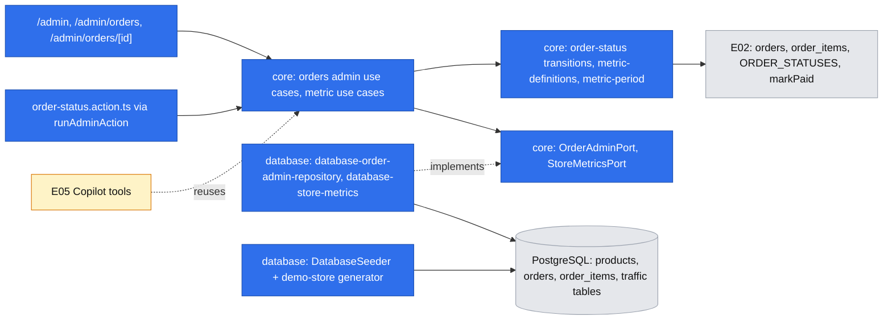
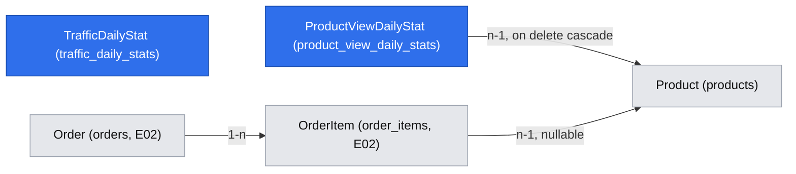

# Orders, dashboard and demo store

- Backlog: epic E04 ([#11](https://github.com/BOMateuszBialas/techleaders/issues/11)): E04-S01 ([#22](https://github.com/BOMateuszBialas/techleaders/issues/22)) orders list, detail and status workflow; E04-S02 ([#23](https://github.com/BOMateuszBialas/techleaders/issues/23)) dashboard of real metrics with visible definitions; E04-S03 ([#24](https://github.com/BOMateuszBialas/techleaders/issues/24)) populated, clearly labelled demo store on first run
- Status: **implemented** 2026-10-17 (Phase 1: PR #50, Phase 3: PR #51, Phase 2: run log `.ai/runs/2026-10-17-demo-store-phase-2.md`). Originally a draft written autonomously (`om-spec-writing --autonomous`) on 2026-10-16. The product owner accepted every default in "Resolved assumptions" on 2026-10-16; the three ⚠ items (A3, A8, A18) were confirmed by the product owner on 2026-10-16 with the stated defaults. Issue #22's acceptance criterion "pending payment → paid" is amended accordingly (A3: `paid` comes only from the payment flow).
- Design authority: `.ai/specs/product-brief.md` (R02, R03, R05, R07, N02, N04, D02, D06, D08, D10), `.ai/specs/2026-10-13-commerceos-mvp.md` §3, §6 "Analytics definitions", §7, §9, AGENTS.md "Database conventions", "Security and validation", "Commerce Copilot rules"
- **Depends on:** `.ai/specs/2026-10-15-cart-and-demo-checkout.md` (E02, being implemented now). Its **Data Model is the source of truth** for `orders` and `order_items` (columns, statuses, snapshots, check constraints, `paid_at`); this spec does not redefine them. **Entry gate for every phase: E02-S03 (#18) is merged** (it lands the orders schema, checkout and demo payment in one PR). Also uses E03-S01 (#19, admin auth, merged) and E03-S03 (#21, stock adjustment, merged).

## 📝 TLDR

Today the owner's `/admin` shows only system status: there is no order list, no metric and no demo order, so the MVP demo story ("an order is created and its status is visible in the admin dashboard", spec §2) stops after checkout. **Proposed (future behaviour):** the owner lists orders newest first, opens one to see its item snapshots, totals and shipping data, and moves it through an explicit transition table, where cancelling an unpaid order restores its stock in the same transaction and "refunded" is a recorded status only. The dashboard shows orders, revenue from paid orders, AOV, top products and low stock for a stated period, each with its definition printed next to the number. All of it comes from **one set of core metric use cases that the Copilot tools (E05) will call unchanged**. The seed fills a fictional, `DEMO-`-labelled order history and the fictional traffic data (D08) over a rolling 35-day window, and it stops overwriting the owner's edits to demo products.

## 📝 Resolved assumptions (autonomous defaults)

Each was an Open Question. The answer is the most reversible option with the least new surface. ⚠ marks the ones that change a product rule or existing behaviour and need the product owner.

| #   | Question | Default chosen | Rationale |
| --- | -------- | -------------- | --------- |
| A1  | One spec or three? (scope cohesion) | **One spec, three phases, three PRs**, one per story, shipped in order: Phase 1 and Phase 3 each need only #18; Phase 2 reuses Phase 1's Demo badge and note, so it ships after Phase 1 | The caller asked for one document; the stories share the order read model and the metric definitions. Splitting the file later is mechanical |
| A2  | Phase order | **#22 → #24 → #23.** The dashboard comes last so its e2e test and review run on a populated store | The backlog lists #23 after #22 only; #24 needs only #18. Reordering costs nothing |
| A3  | May the owner move `pending_payment → paid` by hand? | **No.** `paid` is set only by the payment flow (`ConfirmDemoPaymentUseCase`, through `PaymentGateway`). The admin cannot create a payment fact. **Confirmed by the product owner (2026-10-16).** | Issue #22 lists "pending payment → paid" in the workflow, but a manual "mark paid" would fake a payment state (R03) and inflate "revenue from paid orders" (spec §6 defines a paid order by its verified payment state). Alternative: allow it with a recorded `payment_provider = 'manual'`, which needs a check-constraint migration on E02's table |
| A4  | Transition table | `paid → processing`, `processing → shipped`, `pending_payment → cancelled` (restores stock), `paid`/`processing`/`shipped → refunded` (recorded only). `cancelled` and `refunded` are terminal. A paid order is never cancelled; it can only be marked refunded | Mirrors the requirement recorded in the checkout spec (cross-model review, GPT Q4): cancel is `UPDATE … WHERE status = 'pending_payment'`, the exact mirror of `markPaid`, so a cancelled order can never become paid and a paid one never restocks. N02: no money moves, no return of goods is modelled, so refunds do not restock |
| A5  | Does the cancel restock write a `stock_adjustments` row? | **No.** The table records manual changes only (catalog spec A6: no `source` column), like the checkout decrement. The stock panel copy says "Manual stock changes". AGENTS.md's single-writer rule is reworded to list the three writers | Keeps E03's table unchanged. A `source` column is a later additive migration if the owner wants one history |
| A6  | Order status history or audit table? | **No.** The detail page shows `created_at`, `paid_at` and `updated_at` | Not in the AC; one owner. Additive later |
| A7  | List shape | 25 orders per page, `?page=N`, newest first (`created_at desc, id desc`). No filter or search | AC asks for the list only; filters are additive |
| A8  | Metric definitions (R05) | **Paid order:** `paid_at` inside the period **and** status in (`paid`, `processing`, `shipped`). **Revenue:** sum of `total_minor` of paid orders (shipping included, it is always 0; no tax exists; cancelled and refunded excluded, also when they were once paid, so marking an order refunded lowers the revenue of the period it was paid in, and the definition text says so). **AOV:** revenue ÷ paid orders, rounded half up to a whole minor unit; "Not enough data" when there are no paid orders. **Orders placed:** orders with `created_at` in the period, any status, split by current status. **Top products:** paid-order line items in the period, ranked by units, then revenue, then name; top 5. **Low stock:** published products with `stock_quantity ≤ 5` now, out-of-stock included. **Confirmed by the product owner (2026-10-16).** | These match MVP §6 and the checkout spec's A10, but R05 is a protected rule and the Copilot inherits them: a later change rewrites the dashboard, the tools and the eval set. The two real choices are attribution by `paid_at` (not `created_at`) and excluding refunded orders from revenue entirely |
| A9  | Which period? | Presets **"Last 7 days"** (default) and **"Last 30 days"** via `?period=7d\|30d`: whole calendar days in the store time zone **`Europe/Warsaw`**, today included. No custom range, no comparison | Matches the Copilot question "this week" and the daily demo traffic. Date-range comparison is P1 |
| A10 | Mixed currencies | Metrics cover the **store currency `PLN`** only (`STORE_CURRENCY` constant in core). Orders in another currency are counted and shown as "N orders in other currencies are not included" | The store sells in PLN (D10); products allow EUR/USD, so the case exists but is rare. Per-currency breakdowns can come later |
| A11 | Low-stock threshold "configurable" | A `threshold` parameter on the use case (1–1000) with the default `LOW_STOCK_THRESHOLD = 5` in core. No env variable, no settings UI. The dashboard lists 10 and shows the total count | The Copilot tool passes its own threshold; no new config surface |
| A12 | Does the dashboard show demo traffic? | **No.** The traffic data is seeded in #24 for the Copilot (E05-S04, #28); the dashboard shows order and stock metrics only | Smallest scope that meets #23 |
| A13 | How are seeded orders marked? | `public_reference` `DEMO-0001` … (never the `CO-` shape that checkout generates), customer names `[DEMO] <first name> <surname>`, emails `demo.shopperNN@example.com` (reserved domain), and a "Demo" badge wherever orders are listed. No `is_demo` column | R07 without a schema change on E02's table. `isDemoOrderReference()` in core is the one discriminator |
| A14 | Do demo orders count in the metrics? | **Yes**: they are the demo store's order history. The dashboard says "Includes N seeded demo orders (fictional)" whenever the period contains any | R07: labelled, not hidden. Hiding them would leave the demo dashboard empty |
| A15 | Do seeded orders decrement stock? | **No.** The seeded stock values are the stock *after* the seeded history. The seed creates **no `pending_payment` orders**: an unpaid order holds stock, and cancelling a seeded one would add stock that a re-seed never takes back (stock would drift up on every cancel + re-seed cycle). The cancel flow is demonstrated with a live checkout | Keeps the catalog seed values (and the README) as they are, and makes cancel + re-seed safe |
| A16 | Order detail URL | `/admin/orders/<id>` with the order uuid, never the public reference | The reference is a shopper's bearer secret (checkout spec A8) and must not appear in admin URLs, logs or history |
| A17 | Seed window and volume | **35 days** ending on the seed date, about 3–6 orders a day (~150), generated by a deterministic PRNG with a fixed seed, so every run produces the same history relative to its date | Covers "Last 7 days" and the full "Last 30 days" view, with room for the P1 week-over-week comparison |
| A18 | Re-seed behaviour (the caveat deferred to #24 by the catalog spec) | **Catalog becomes insert-only**: categories and products missing by slug are created, existing rows are never updated (conflict target `slug` only), so owner edits (stock, Featured, price, status) survive a re-seed and the stock history stays consistent. **Demo orders and the traffic tables are regenerated** on every run: rows with a `DEMO-` reference and all traffic rows are deleted and re-inserted in one transaction, re-anchored to the new seed date. **Confirmed by the product owner (2026-10-16).** | Fixes the documented `featured`/stock/history caveat and keeps D08's "window ends on the seed date". Costs: seed changes to existing demo products no longer reach an existing database (reset it); status changes the owner made to demo orders are lost on a re-seed; the demo scenarios hold only on a fresh database, because owner stock edits survive. **This rewrites the AGENTS.md rule "Seeders are repeatable (upsert by unique key)"**; Phase 2 updates it |
| A19 | Traffic data in #24 or in #28? | **In #24 (Phase 2)**: the two demo tables, their migration, the generator and the seed-invariant test. No UI and no tool (the tool is E05) | D08 ties the traffic window to the seeded orders, and #28 depends on #24 |
| A20 | Auto-seed on first app start? | **No.** "First run" means after `npm run db:seed` (README quickstart). An empty dashboard and order list tell the owner to run it | No runtime write path for demo data |
| A21 | UI language | English, like the rest of the admin | Consistency |

## 📝 Problem Statement

- Spec §2 demo story step 2 and the Copilot (E05) both need orders the owner can see and a set of metrics the owner can trust. Today neither exists: `/admin` says "Store metrics and Commerce Copilot will appear here."
- An order created by checkout stays `pending_payment` forever if never paid, holding stock (checkout spec A5, confirmed). The checkout spec made **cancel-with-restock in #22 a requirement**.
- `npm run db:seed` overwrites owner edits to demo products, including stock and `featured`, without a history row (README; catalog spec, decision deferred to #24).
- Acceptance criteria to satisfy:
  - **#22** list shows reference, date, status, total, newest first; detail shows items, snapshots, totals and shipping data; only allowed transitions succeed (a disallowed one is refused); refund is a recorded status only, never a money movement (N02).
  - **#23** orders, revenue from paid orders, AOV, top products and low stock for a stated period; each metric shows its definition, matching the code; AOV with no paid orders shows "not enough data"; every figure comes from the database.
  - **#24** an empty database gets products, categories, stock and orders for the whole demo in a rolling window ending on the seed date (D08); running it twice creates no duplicates; demo data is visibly marked; seeded orders are never presented as real customer data.

## 📝 Proposed Solution

1. **Orders admin.** A pure transition table in `core` decides what is allowed; the repository applies a transition as a conditional `UPDATE … WHERE id = :id AND status = :from`, so a stale page or a concurrent payment can never be overwritten. Cancel runs the conditional update and the restock (`stock_quantity = stock_quantity + :q`, products in `id` order) in one `em.transactional`.
2. **Metrics as a reusable read model.** One `StoreMetricsPort` (database adapter with aggregate SQL) and four use cases named after the Copilot tools: `GetSalesSummaryUseCase`, `GetOrderSummaryUseCase`, `GetTopProductsUseCase`, `GetLowStockProductsUseCase`. Each returns a DTO that carries its period, currency and **definition id**; the definition text lives once in `core/domain/metrics/metric-definitions.ts` and is rendered by the dashboard and later quoted by the Copilot. The dashboard is a thin composition of the four.
3. **Demo store seed.** A pure, deterministic generator builds the demo order history and the traffic rows *from* those orders, so D08's invariants hold by construction; a seed test asserts them anyway. The seeder inserts the catalog only where missing and regenerates the demo orders and traffic in one transaction.

### Alternatives considered

| Option | Why it lost |
| ------ | ----------- |
| State machine library (XState) | One small table of six statuses; a library adds a dependency for a `Record<Status, Status[]>` |
| DB trigger enforcing transitions | Hides a business rule in SQL and duplicates the domain table; the conditional update already prevents lost updates |
| Precomputed daily metrics table | Stale data and a refresh job for a store with hundreds of orders; aggregate SQL on indexed columns is milliseconds |
| Metrics computed in TypeScript over loaded orders | Loads every order per request and would differ from what an SQL-backed Copilot tool returns; one SQL definition per metric is easier to keep consistent |
| `is_demo` column on `orders` | A migration on E02's fresh table for what a reference prefix already says (A13). Additive later if needed |
| Upsert-everything seed (today) | Overwrites owner edits and breaks the stock history (A18) |

### Market check

- **Shopify** separates financial status (paid, refunded) from fulfilment status (unfulfilled, fulfilled) and keeps a timeline. We keep a single status column (checkout spec A10) and skip the timeline (A6); the transition table encodes the same rule that a paid order is refunded, not cancelled.
- **Medusa / Saleor** restock on cancel and record inventory movements by reason. We restock on cancel and leave the reason column for later (A5).
- **Shopify Analytics** labels "Total sales" with an explicit formula (gross − discounts − returns + shipping + tax) next to the number. We copy the visible definition, with the much smaller formula A8 states.

## 📝 Architecture



Takeaway: the metric use cases are the only definition of each metric; the dashboard renders them and the Copilot will call them, so the two can never disagree.

### Modules (new unless noted)

| Package | Path | Content |
| ------- | ---- | ------- |
| `core` | `domain/orders/order-status.ts` | `ORDER_TRANSITIONS: Record<OrderStatus, readonly OrderStatus[]>` (A4), `canTransition(from, to)`, `allowedTransitions(from)`, `ORDER_STATUS_LABELS`, `restocksOnTransition(from, to)` (true only for `pending_payment → cancelled`). Reuses `ORDER_STATUSES` from E02's `domain/orders/order.ts` |
| `core` | `domain/orders/demo-order.ts` | `DEMO_ORDER_REFERENCE_PREFIX = "DEMO-"`, `isDemoOrderReference(ref)`, `DEMO_ORDER_REFERENCE_LIKE` (the SQL `like` pattern, built from the prefix, so SQL and TypeScript share one definition) |
| `core` | `domain/metrics/metric-definitions.ts` | `METRIC_DEFINITIONS`: `{ id, label, definition }` for `ordersPlaced`, `paidOrders`, `revenue`, `aov`, `topProducts`, `lowStock` (A8 wording, verbatim in the UI); `PAID_ORDER_STATUSES = ["paid","processing","shipped"]`; `STORE_CURRENCY`, `LOW_STOCK_THRESHOLD`, `TOP_PRODUCTS_LIMIT` |
| `core` | `domain/metrics/metric-period.ts` | `STORE_TIME_ZONE = "Europe/Warsaw"`, `resolvePeriod(preset, now)` → `{ preset, from, to, label }` (half-open `[from, to)` instants at local midnights, via `Intl.DateTimeFormat`; DST-safe), `averageOrderValue(revenueMinor, count)` → `number \| null` (half-up). The E05 tools add their own range validator when they need custom ranges |
| `core` | `validators/orders/order-status-change.schema.ts`, `validators/metrics/metric-query.schema.ts` | Zod: `{ orderId: uuid, from: status, to: status }`; `{ period: "7d" \| "30d" }` (default `7d`), `{ threshold: int 1–1000, limit: int 1–50 }` |
| `core` | `ports/order-admin.port.ts` | `listOrders({ offset, limit })` → `{ rows, total }`; `findOrderById(id)`; `changeStatus({ orderId, from, to, restock })` → `{ kind: "changed", order } \| { kind: "stale", currentStatus } \| { kind: "not_found" }` |
| `core` | `ports/store-metrics.port.ts` | `salesSummary(range, currency)`, `orderSummary(range)`, `topProducts(range, currency, limit)`, `lowStockProducts(threshold, limit)`: raw aggregates, no wording |
| `core` | `services/orders/list-admin-orders.use-case.ts`, `get-admin-order.use-case.ts`, `change-order-status.use-case.ts` | DTOs with `isDemo`, labels and `allowedTransitions`; `ChangeOrderStatus` validates with `canTransition` (`ValidationError` "This status change is not allowed.") and maps `stale` to `ConflictError` |
| `core` | `services/metrics/get-sales-summary.use-case.ts`, `get-order-summary.use-case.ts`, `get-top-products.use-case.ts`, `get-low-stock-products.use-case.ts`, `get-dashboard.use-case.ts` | Each result: `{ period, currency, definitionId, …values }`. `GetDashboard` takes `{ period }`, runs the four in parallel and adds the demo-order count. **The E05 tools call the first four directly** |
| `database` | `adapters/database-order-admin-repository.ts` | List, detail, conditional status update; cancel restock in one transaction (see below) |
| `database` | `adapters/database-store-metrics.ts` | The four aggregate queries (see Metric queries) |
| `database` | `entities/traffic/traffic-daily-stat.entity.ts`, `entities/traffic/product-view-daily-stat.entity.ts`, migration | Phase 2, see Data Model |
| `database` | `seeders/demo-store.ts` | Pure generator: `generateDemoStore({ seedDate, products, random })` → `{ orders, items, trafficRows, productViewRows }`; `mulberry32(seed)` PRNG |
| `database` | `seeders/DatabaseSeeder.ts` (existing) | Catalog insert-only (`onConflictAction: "ignore"`), then `seedDemoStore(em, seedDate)` in one transaction |
| `app` | `app/admin/(protected)/orders/page.tsx`, `orders/[id]/page.tsx`, colocated `load-orders.ts` | Pages call `requireAdminPage()` inside `<Suspense>`; loaders are unit-covered `.ts` modules |
| `app` | `server/orders/order-status.action.ts` | `changeOrderStatus` through `runAdminAction` (it already updates the `catalog` cache tag, which a restock needs) |
| `app` | `components/admin/orders/` | `OrderStatusBadge`, `OrderStatusFormView` (hook-free) + thin `"use client"` wrapper, `DemoBadge` |
| `app` | `app/admin/(protected)/page.tsx` (existing), `components/admin/dashboard/` | Metric cards with definitions, period links; system status card stays below |
| `app` | `app/admin/(protected)/layout.tsx` (existing) | Nav gets "Orders" between Dashboard and Products |
| `app` | `server/container.ts` (existing) | Scoped `orderAdminRepository`, `storeMetrics` and the use cases; a singleton `clock` (`() => new Date()`) so tests fix "now" |

### Status change (`DatabaseOrderAdminRepository.changeStatus`)

```text
changeStatus({ orderId, from, to, restock }):
  em.transactional(async (tx) => {
    updated = tx.execute(
      "update orders set status = :to, updated_at = now()
       where id = :id and status = :from returning id")       -- lost-update guard
    if updated is empty:
      row = select status from orders where id = :id
      return row ? { kind: "stale", currentStatus: row.status } : { kind: "not_found" }
    if restock:                                                 -- only pending_payment → cancelled
      for item of items(orderId) where product_id is not null, sorted by product_id:
        tx.execute("update products set stock_quantity = stock_quantity + :q,
                    updated_at = now() where id = :pid")
    return { kind: "changed", order: reload(orderId) }
  })
```

- The `paid_at` check constraints from E02 already forbid an inconsistent row (for example `refunded` without `paid_at`); a violation is a bug and surfaces as a 500, never silently.
- Cancel and the shopper's demo payment race on the same row: both are conditional on `status = 'pending_payment'`, so exactly one wins; the loser sees `stale` (owner) or `OrderNotPayableError` (shopper).
- A line whose product was deleted (`product_id` null) is skipped; the detail page already shows its snapshot name.
- The restock is not recorded in `stock_adjustments` (A5). The stock panel's history copy becomes "Manual stock changes, newest first …", and AGENTS.md's single-writer rule lists: `setStock` (manual, recorded), the checkout decrement (E02) and the cancel restock (this spec), plus the seeder only for products it creates.

### Metric queries (`DatabaseStoreMetrics`)

All take a half-open `[from, to)` range of instants and bind every value (no string-built SQL). Results are integers; the adapter checks `Number.isSafeInteger` on `sum(...)` (PostgreSQL returns `bigint` as a string).

- `salesSummary`: `count(*)`, `coalesce(sum(total_minor), 0)` from `orders` where `paid_at >= :from and paid_at < :to and status in PAID_ORDER_STATUSES and currency = :currency`; plus the count of the same set in other currencies (A10) and the count of demo references (A14).
- `orderSummary`: `status, count(*)` from `orders` where `created_at` in range, grouped by status (every status returned, zeros included).
- `topProducts`: `order_items` joined to paid orders in range (same filter as sales), grouped by `product_id` (deleted products grouped by snapshot name), `sum(quantity)`, `sum(line_total_minor)`, name = current product name or the latest snapshot; ordered by units desc, revenue desc, name asc; `limit`.
- `lowStockProducts`: `id, name, sku, stock_quantity` from `products` where `status = 'published' and stock_quantity <= :threshold`, ordered by stock asc, name asc, `limit`; plus `count(*)`.
- Indexes: E02 indexes `orders.status`, `orders.created_at`, `order_items.order_id`, `order_items.product_id`. No `paid_at` index at demo scale; add one (additive) if a query plan shows a scan over many rows.

## 📝 Data Model

**No change to `orders`, `order_items` or `products`.** Their columns, statuses and checks are E02's (`2026-10-15-cart-and-demo-checkout.md`, Data Model). This spec relies on: `status` with all six values, `paid_at` and its two checks, `public_reference` as `varchar(32) unique` **without a format check** (A13 needs `DEMO-0001`; if E02 adds a format check, demo references become `CO-DEMO…` and `isDemoOrderReference` follows), `order_items` snapshots and nullable `product_id`.

**New (Phase 2, one migration `…_demo_traffic`, both tables seeded only and fictional, D08):**

**`traffic_daily_stats`**

| Column | Type / constraint |
| ------ | ----------------- |
| `id` | uuid PK `gen_random_uuid()` |
| `date` | `date` not null (calendar day in `Europe/Warsaw`) |
| `source` | text not null, check in (`direct`, `organic`, `social`, `email`, `paid`) |
| `sessions`, `product_views`, `add_to_carts`, `checkouts_started` | int not null, each `check (>= 0)`; `check (sessions >= product_views and product_views >= add_to_carts and add_to_carts >= checkouts_started)` |
| unique | (`date`, `source`) |

**`product_view_daily_stats`**

| Column | Type / constraint |
| ------ | ----------------- |
| `id` | uuid PK |
| `date` | `date` not null |
| `product_id` | uuid not null FK → `products` **on delete cascade**, **index** |
| `views`, `add_to_carts` | int not null, `check (>= 0)`, `check (views >= add_to_carts)` |
| unique | (`date`, `product_id`) |

Notes:

- The per-row funnel check covers one source on one day. The cross-table invariants (per day: Σ sessions ≥ Σ views ≥ Σ add-to-cart ≥ Σ checkouts started ≥ seeded paid orders that day; per product and day: views ≥ units sold in seeded paid orders) are asserted by the seed test, as D08 and MVP §7 require.
- A product without rows has "no demo view data", not zero views (D08). Products the owner creates in the admin get none.
- No personal data. Demo customers are fictional (`[DEMO]` names, `example.com` emails, `ul. Demo` addresses); never real people.
- Rollback: `down()` drops both tables. Committed migrations are never edited (BACKWARD_COMPATIBILITY §5).



### Demo store seed (Phase 2)

- **Order:** catalog insert-only (conflict target `slug`; a demo product that is missing afterwards, for example because its SKU now collides with an owner edit, is skipped with a seed warning and its scenario lines are left out, never a crash) → `seedDemoStore` in one `em.transactional`: delete orders whose `public_reference like DEMO_ORDER_REFERENCE_LIKE` (items cascade), delete all rows of both traffic tables, then insert the generated rows. Re-running gives the same row counts (no duplicates) re-anchored to the new date (A18).
- **Generator** (`generateDemoStore`, pure, unit-tested with a fixed `seedDate` and seed): 35 days ending on `seedDate` (store time zone); timestamps between 08:00 and 22:00 local, never after the seed instant. Lines reference demo products by slug, priced from the seed catalog (snapshots `name`, `sku`, `unit_price_minor`; `line_total_minor = unit × qty`; `total = subtotal`, `shipping_minor = 0`, `PLN`). Each order gets a deterministic `idempotency_key` (a valid UUID v4 from PRNG bytes, version and variant bits set) and `request_fingerprint` = the SHA-256 hex of `"demo-seed:<reference>"`, keeping E02's column contract. Paid orders get `payment_provider = 'demo'`, `payment_reference = 'DEMO-PAY-<order id>'` and `paid_at` a few minutes after `created_at`, same day.
- **Status mix**, so every transition can be demonstrated: older than 7 days mostly `shipped`, the last 7 days `paid` and `processing`, two `cancelled` (never paid, `paid_at` null, no stock effect), one `refunded`. No `pending_payment` (A15).
- **Scenarios for the Copilot (E05, D09)**, chosen so the metrics tell a story without claiming causes. They hold on a freshly seeded database; after owner edits to demo stock they may not (A18):

| Demo product | Pattern | Visible as |
| ------------ | ------- | ---------- |
| Pulse Ultralight Mouse (stock 3) | Best seller of the last 7 days | top product **and** low stock |
| Titan MMO Mouse (stock 0) | Sold in weeks 1–2, none since; views continue | low stock (out of stock) with demo views |
| Drift Wireless Headset | Many views, few sales | views without sales (traffic data) |
| Vortex Wireless Mouse, Glide XL Mousepad | Steady sellers | top products over 30 days |
| Arena Fight Stick (stock 2) | Rare, expensive sales | low stock, high AOV contribution |

- **Traffic rows** are derived upward from the generated orders (checkouts started ≥ paid orders, add-to-cart ≥ checkouts, …, with source shares direct 30 %, organic 30 %, social 20 %, email 10 %, paid 10 % and a social share rising over the window), so the invariants hold by construction. Orders placed later through the live storefront have no traffic behind them; that drift is documented (D08).

## 📝 API Contracts

No Route Handlers. One admin Server Action (internal, not a protected contract), run through `runAdminAction`:

| Action | Input (Zod, `core/validators`) | Success | Expected failures |
| ------ | ------------------------------ | ------- | ----------------- |
| `changeOrderStatus` (`server/orders/order-status.action.ts`) | `{ orderId: uuid, from: OrderStatus, to: OrderStatus }` from hidden fields | message: "Order marked as shipped." / "Order cancelled. Stock was returned for N items." / "Order marked as refunded. This is a record only; no money was moved." | `ValidationError` disallowed transition; `ConflictError` "This order changed to *Paid* in the meantime. Review it and try again." (stale); `NotFoundError`; no session → sign-in redirect, no use case resolved |

Read models (Server Components call use cases directly):

- `ListAdminOrders({ page })` → `{ rows: [{ id, reference, createdAt, status, statusLabel, totalMinor, currency, itemCount, isDemo }], page, pageCount, total }`.
- `GetAdminOrder(id)` → the order with items (snapshot name, SKU, unit price, quantity, line total, `productId` or null), subtotal, shipping, total, customer name, email and shipping address, payment provider label, payment reference, `paidAt`, `createdAt`, `updatedAt`, `isDemo`, `allowedTransitions: [{ to, label, restocks, isRecordOnly }]`. Malformed or unknown id → `NotFoundError` → admin "Not found".
- `GetDashboard({ period })` → `{ period: { preset, from, to, label, timeZone }, sales: { paidOrders, revenueMinor, aovMinor \| null, otherCurrencyOrders }, orders: { total, byStatus }, topProducts: [{ productId \| null, name, units, revenueMinor }], lowStock: { threshold, total, rows: [{ id, name, sku, stockQuantity }] }, demoOrderCount, definitions }`.
- Copilot reuse (E05, not built here): each tool maps 1:1 to a use case, passes a validated range or threshold, and adds its own `source` label; the use cases return no customer fields, so no personal data can reach the model through them.

Protected surfaces to add to `BACKWARD_COMPATIBILITY.md` §1: `/admin/orders` (optional `page`), `/admin/orders/<id>`, `/admin?period=7d|30d` (unknown values fall back to `7d`).

## 📝 UI/UX

Pages follow the admin conventions: static shell, request-time work inside `<Suspense>` with `requireAdminPage()` first, data in a colocated `.ts` loader, rendering outside `try/catch`. Money via `formatMoney` (`pl-PL`), dates via one `formatDateTime` in the store time zone.

| Screen | Content and states |
| ------ | ------------------ |
| `/admin/orders` | Table: Reference (monospace, link to detail), Date, Status badge, Total, Items, "Demo" badge for `DEMO-` orders. Newest first; "Newer" / "Older" links and "Page 2 of 5". Empty: "No orders yet. Orders appear here after a checkout. To load the demo store, run `npm run db:seed`." Error: the admin error boundary |
| `/admin/orders/[id]` | Header: reference, status badge, created/paid/updated times. Demo order → a non-dismissible note "Seeded demo order: the customer is fictional and no real purchase happened." Items table with snapshot names (link to the product when it still exists, "(deleted product)" otherwise), SKU, unit price, quantity, line total; subtotal, "Shipping: free (demo store)", total. Customer: name, email, shipping address. Payment: "Demo payment (no money charged)" and its reference, or "Not paid". **Status actions**: one button per allowed transition only ("Mark as processing", "Mark as shipped", "Cancel order", "Mark as refunded (record only)"); terminal statuses show "No further status changes." |
| Cancel / refund confirmation | The button posts a form with a required checkbox: cancel → "Cancel this unpaid order and return N items to stock"; refund → "Record this order as refunded. No money is moved; refunds are not processed in this demo store." Pending state disables the button with its label kept; result in a `role="status"` message |
| `/admin` dashboard | Period switch (links, `aria-current`): "Last 7 days" / "Last 30 days", with the exact range "9–16 Oct 2026 (Europe/Warsaw)". Cards: **Orders placed** (total + small by-status list), **Paid orders**, **Revenue from paid orders**, **Average order value** ("Not enough data" when 0 paid orders), **Top products** (name, units, revenue; empty "No paid orders in this period"), **Low stock** (≤ 5 now; name, stock, link to the product; "Out of stock" badge at 0; empty "No published product is at or below 5 in stock"). **Every card prints its definition** under the value in muted text (always visible, not a tooltip), taken from `METRIC_DEFINITIONS`. Notes: "Includes N seeded demo orders (fictional)." when present; "N orders in other currencies are not included." when present. System status card stays at the bottom. Empty store: "No orders yet…" hint as on the list |

Wireframe (dashboard, illustrative):

```text
Dashboard                                   [Last 7 days] [Last 30 days]
9–16 Oct 2026 (Europe/Warsaw) · Includes 31 seeded demo orders (fictional)

┌ Orders placed ─┐ ┌ Paid orders ──┐ ┌ Revenue from paid orders ┐ ┌ Average order value ┐
│ 33             │ │ 29            │ │ 9 847,00 zł              │ │ 339,55 zł           │
│ Orders created │ │ Paid, process-│ │ Sum of totals of paid    │ │ Revenue ÷ paid      │
│ in the period, │ │ ing or shipped│ │ orders; shipping incl.,  │ │ orders; "Not enough │
│ any status     │ │ by payment    │ │ no tax; cancelled and    │ │ data" when none     │
│                │ │ date          │ │ refunded excluded        │ │                     │
└────────────────┘ └───────────────┘ └──────────────────────────┘ └─────────────────────┘
┌ Top products (units in paid orders) ───┐ ┌ Low stock (published, ≤ 5 now) ─────────┐
│ 1 Pulse Ultralight Mouse  9  1 701 zł  │ │ Titan MMO Mouse        0  Out of stock  │
│ 2 Glide XL Mousepad       7    903 zł  │ │ Arena Fight Stick      2                │
└────────────────────────────────────────┘ └─────────────────────────────────────────┘
```

Mockups: none rendered (no test-env descriptor for current-state screenshots); the wireframe above is illustrative only.

Accessibility: tables with `<caption>` and header cells; status conveyed by text, not colour only; confirmation checkbox labelled; period links keyboard reachable with visible focus.

## 📝 Edge Cases & Failure Scenarios

| Case | Behaviour |
| ---- | --------- |
| Owner cancels while the shopper confirms the demo payment | Both updates are conditional on `pending_payment`; one wins. Owner loses → "This order changed to *Paid* in the meantime" and the page re-renders with the refund option only |
| Two tabs change the same order | The second form's `from` is stale → `ConflictError`, nothing written |
| Forged form (`from` correct, `to` not allowed, or an unknown status) | Zod rejects unknown values; `canTransition` rejects the rest with `ValidationError`; nothing written |
| Cancel an order whose product was deleted | That line is skipped in the restock; the others are restocked; the message counts only restocked items |
| Cancel an order whose product is now a draft | Stock is restored anyway (stock belongs to the product, not to its visibility) |
| Restock would exceed `int` | Not reachable in practice (quantities ≤ 99 per line); the `int` column raises and the transaction rolls back to a generic error |
| Period with orders but none paid | Revenue 0,00 zł, AOV "Not enough data", top products empty state (#23 AC3) |
| Order paid on another day than it was placed | Counts in "Orders placed" by `created_at` and in revenue by `paid_at`; both definitions say so |
| Orders in EUR/USD | Excluded from revenue, AOV and top products; counted in the note (A10) and in "Orders placed" |
| DST change inside the period | `resolvePeriod` computes each local midnight separately; unit tests cover the October and March switches |
| `?period=abc` or `?page=-1` | Falls back to `7d` / page 1; never an error page |
| Page beyond the last | Shows the last page's empty state with a link to page 1 |
| Re-seed after the owner edited demo products | Edits survive (insert-only, A18); stock history stays consistent |
| Re-seed after the owner changed a demo order's status | The demo order history is regenerated; the change is lost (documented, A18) |
| Re-seed after the owner deleted a demo product | The product is created again with a new id and seed values; old order lines keep their snapshot with `product_id` null |
| Seed on a database with real (`CO-`) orders | They are never touched; only `DEMO-` orders and traffic rows are replaced |
| Cancel + re-seed cycle | No seeded order is `pending_payment` (A15), so a re-seed can never re-create an order whose cancel already returned stock. Live (`CO-`) pending orders are never touched by the seed |
| DB down | Pages show the admin error state; the action returns "Something went wrong. Try again."; transactions leave no partial writes |

## 📝 Risks & Impact Review

- **Metric definitions are a durable contract (A8, confirmed).** The Copilot, its eval set and the README will quote them. Changing one later means a coordinated change of `METRIC_DEFINITIONS`, the SQL and the eval cases; keeping one source makes that a single PR.
- **No manual "mark paid" (A3, confirmed).** If the owner expects it (for example bank transfers), the workflow looks incomplete in the demo. Adding it later needs a `manual` payment provider value (a check-constraint migration on `orders`).
- **Seed behaviour change (A18, confirmed).** Developers relying on a re-seed to refresh demo product text must reset the database instead; the README says so. Seed regeneration deletes rows by the `DEMO-` prefix, so a real order must never use that prefix: `generateOrderReference` (E02) produces `CO-` only, and a unit test pins it.
- **Stock writers multiply.** After E02 and this spec, three code paths write `products.stock_quantity`. Only the manual one is recorded. AGENTS.md is updated in Phase 1 so reviewers know all three; a `source` column (A5) is the upgrade path.
- **Cross-spec dependency.** If E02's final schema differs from its spec (column names, a reference format check), Phase 1 starts with a short reconciliation step and this spec is amended before code.
- **Personal data on the admin detail page.** Name, email and address are shown to the signed-in owner only (server-side guard); never logged (log `orderId` only), never in URLs, never returned by the metric use cases.
- **New protected URLs** (`/admin/orders`, `/admin/orders/<id>`, `/admin?period=`) go into `BACKWARD_COMPATIBILITY.md` §1. One additive migration (traffic tables) in Phase 2.
- Repository-rule check: money in minor units ✔, conditional updates in `em.transactional` ✔, DTOs not entities ✔, every admin entry point through `require-admin.ts` / `runAdminAction` ✔ (guard inventory test extended), no new env variable ✔, no new library ✔, `core` stays framework-free (`Intl` only) ✔, demo data labelled ✔.

## 📝 Decisions in play

| Id | How this spec relies on it |
| -- | -------------------------- |
| R02, N04, D02 | The owner, not the AI, changes order status; the Copilot later only reads the metric use cases |
| R03, D03 | Payment state is set only by the payment flow (A3); detail pages say "Demo payment (no money charged)" |
| N02 | Refund is a recorded status with explicit copy; no money moves, no restock on refund |
| R05 | One definition per metric in code (`METRIC_DEFINITIONS`) and printed in the UI; no causal wording |
| R07, D06 | `DEMO-` references, `[DEMO]` customers, Demo badges and dashboard note; traffic tables are fictional and seeded only |
| D08 | 35-day rolling window shared by seeded orders and traffic; invariants tested; traffic data in Phase 2 |
| D10 | Demo orders reference the gaming catalog |

No decision is superseded. Owner: product owner.

## 📋 Phasing

Entry gate for all phases: **E02-S03 (#18) merged** (orders schema, checkout, demo payment).

1. **Phase 1 — Orders admin (E04-S01, #22). PR 1.** The owner sees and works orders created through the storefront. Needs #18.
2. **Phase 2 — Demo store seed (E04-S03, #24). PR 2.** Populated history, traffic tables, insert-only catalog. Needs Phase 1 (Demo badge and note).
3. **Phase 3 — Dashboard (E04-S02, #23). PR 3.** Metric use cases (the Copilot's future tool layer) and the dashboard. Technically needs only #18; its e2e test asserts on the seeded store, so it ships after Phase 2.

Each PR: full gate green, 100 % unit coverage, docs updated. The traffic tables of Phase 2 have no reader until E05-S04 (#28); they land here because D08 ties their window to the seeded orders.

## 📋 Implementation Plan

### Phase 1: Orders admin (#22)

1. **Reconcile with E02.** Read the merged orders entities and `domain/orders/order.ts`; confirm the columns this spec relies on (Data Model) and amend the spec if anything differs. Add `domain/orders/order-status.ts` and `demo-order.ts` with unit tests: every allowed and every disallowed pair of the 6×6 matrix, `restocksOnTransition`, labels, `isDemoOrderReference`, and a test that E02's `generateOrderReference` never yields the `DEMO-` prefix.
2. **Port, repository and integration tests.** `ports/order-admin.port.ts`, `database/adapters/database-order-admin-repository.ts`. Unit tests with `createUnitTestOrm()` stubs for the branches. **Integration (Testcontainers):** list order and pagination; detail with snapshots after the product was renamed and after it was deleted; conditional update stale and not-found; **cancel restores stock for every line in one transaction** and leaves deleted-product lines alone; **cancel racing `markPaid` on separate EM forks via `Promise.allSettled` → exactly one wins**; refund from `shipped` keeps `paid_at` and stock unchanged; the E02 `paid_at` checks still hold.
3. **Use cases and container.** `list-admin-orders`, `get-admin-order`, `change-order-status` with fake ports (disallowed → `ValidationError`, stale → `ConflictError` naming the current status, restock flag only for cancel); validators; container registrations and `container.test.ts`.
4. **Admin pages, action and e2e.** Nav link; `/admin/orders`, `/admin/orders/[id]`; `order-status.action.ts` through `runAdminAction` with its no-session unit test; hook-free `OrderStatusFormView` rendered in every state by unit tests; guard inventory test updated; a unit test ties `isDemoOrderReference` to `DEMO_ORDER_REFERENCE_LIKE`. **E2E `admin-orders.e2e.test.ts`** (purchase through the storefront with E02's flow, then sign in): the order appears first with reference, date, status, total; detail shows snapshots, totals and shipping data; paid → processing → shipped works; a pending order (placed, not paid) is cancelled and the product's stock in `/admin/products/<id>` is back to its old value; a shipped order offers only "Mark as refunded (record only)"; without a session `/admin/orders` redirects to sign-in.
5. **Docs.** AGENTS.md: reword "Never write `products.stock_quantity` anywhere else" to list the three writers (manual `setStock`, recorded; checkout decrement; cancel restock) and the seeder for products it creates (A5), stock panel copy "Manual stock changes", `BACKWARD_COMPATIBILITY.md` §1, README (order workflow, refund is a record only, no manual "mark paid"). If the product owner confirms A3 as written, amend #22's AC ("pending payment → paid" happens only through the payment flow) so the issue is closable. Full gate.

### Phase 2: Demo store seed (#24)

6. **Traffic entities and migration.** `entities/traffic/*.entity.ts` registered in `entities/index.ts`; `npm run db:migration:create`, review the SQL against the Data Model; `entities.test.ts`; integration test: drift test passes, each check rejects a bad row, unique `(date, source)` and `(date, product_id)`, cascade on product delete.
7. **Generator.** `seeders/demo-store.ts` with `mulberry32`. Unit tests with a fixed `seedDate`: deterministic output; 35 days, nothing after the seed instant; no `pending_payment` order; valid UUID v4 keys and SHA-256 fingerprints; references `DEMO-0001…` unique; every order satisfies E02's money and `paid_at` rules; the status mix and the scenario table hold (Pulse top seller of the last 7 days, Titan no sales in the last 14 days, Drift views ≫ units); **D08 invariants** per day and per product; customers all `[DEMO]` with `example.com` emails.
8. **Seeder.** Catalog insert-only on `slug` (update the existing "upserts" test: an edited demo product keeps its stock, `featured` and price after a second run; a demo product missing after the insert is skipped with a message, not a crash); update AGENTS.md "Seeders are repeatable (upsert by unique key)" to the A18 rule; `seedDemoStore` delete-and-insert in one transaction, real `CO-` orders untouched. Integration test: seed twice on one database → same counts, no duplicates, window re-anchored when the seed date moves; the stock history of an adjusted demo product is unchanged by a re-seed; seed → cancel a live pending order → re-seed leaves stock at the post-cancel value; `database.int.test.ts` seeds the full store.
9. **Labels in the admin and e2e.** Demo badge and demo note are already built in Phase 1; e2e on the seeded store: the orders list shows `DEMO-` orders with the "Demo" badge, a demo order's detail shows the fictional-customer note. Docs: README (what the demo store contains, re-seed behaviour A18, demo traffic is fictional, live orders have no traffic behind them), remove the old seed caveat, D08/D10 cross-references. Full gate.

### Phase 3: Dashboard (#23)

10. **Metric domain.** `metric-definitions.ts`, `metric-period.ts`, validators. Unit tests: `resolvePeriod` for both presets around both DST switches and at local midnight; AOV rounding and `null` at zero; definitions exist for every metric and their text mentions the included statuses.
11. **Metrics port, adapter and integration tests.** `ports/store-metrics.port.ts`, `database/adapters/database-store-metrics.ts`. **Integration:** a hand-built fixture (not the generator) with paid, processing, shipped, pending, cancelled, refunded, a once-paid-then-refunded order, a PLN and an EUR order, an order placed before and paid inside the period, and a deleted product: every aggregate equals the hand-computed value; empty database → zeros; low stock includes 0, excludes drafts.
12. **Use cases and container.** The four tool-shaped use cases and `GetDashboard` with a fake port and a fixed clock; DTOs carry period, currency and `definitionId`; no customer fields (asserted). Container registrations and test.
13. **Dashboard UI and e2e.** Cards, definitions, period links, notes, empty states; view components unit-tested in every state (including "Not enough data"). **E2E `admin-dashboard.e2e.test.ts`** on the seeded store: every card shows a value and its definition; "Last 30 days" changes the range label; the demo-orders note is present; after placing and paying one order through the storefront, "Paid orders" rises by one (asserts a property, not a seeded number). Docs: README (metric definitions, mirroring `METRIC_DEFINITIONS`), `BACKWARD_COMPATIBILITY.md` (`?period`), `.ai/lessons.md` for anything learned. Move this spec to `.ai/specs/implemented/` after the last phase. Full gate.

## 📝 Review log

- Fresh-context review (2026-10-16), all applied: seeded `pending_payment` orders would let stock drift up on cancel + re-seed (seed none, A15; regression test in step 8); Phase 2 depends on Phase 1 (A1, Phasing); the AGENTS.md seeder and stock-writer rules are named for rewording (A18, steps 5 and 8); the window grew to 35 days so "Last 30 days" is covered (A17); the stray 90-day validator claim was dropped; the revenue definition states that a refund restates the paid period; insert-only targets `slug` and skips a missing demo product; scenarios are guaranteed only on a fresh database; one source for the `DEMO-` SQL pattern; valid UUID v4 keys and SHA-256 fingerprints for seeded orders; an untested concurrent-seed claim was removed; #22's AC must be amended if A3 stands. Canonical mechanisms reused: `runAdminAction`, `requireAdminPage`, hook-free form views, `money.ts`, `AppError` codes, `createUnitTestOrm`, Testcontainers, agent-browser, `defineEntity`. New primitives: a `clock` registration (justified by testable periods) and the PRNG helper (seed only).
- Not verified while writing: the final shape of E02's entities (step 1 reconciles), MikroORM 7's `onConflictAction: "ignore"` on `em.upsert` versus `em.insert` with `onConflict().ignore()` (step 8 picks the one that works and records it), and `bigint` aggregate typing from `em.execute` (step 11).
