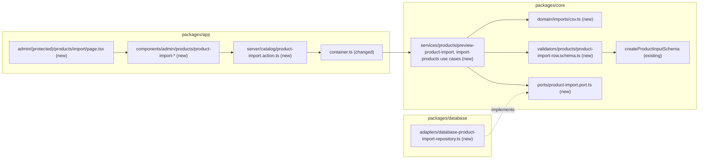

# CSV product import

- Source: MVP spec `.ai/specs/2026-10-13-commerceos-mvp.md` §3 P1 "CSV product import"; AGENTS.md scope (P1)
- Depends on: admin catalog management (`.ai/specs/implemented/2026-10-15-admin-catalog-management.md`): `createProductInputSchema`, `runAdminAction`, `toCatalogWriteError`, the view + wrapper form pattern
- Status: implemented 2026-10-23 (PR #85; spec PR #84). Written in autonomous mode (2026-10-19). A3 is implemented as its default (optional `stock` column, initial value only) pending the product owner's confirmation. The defaults in "Resolved assumptions" need the product owner's review; ⚠ marks the ones that need explicit confirmation
- Design authority: `.ai/specs/product-brief.md` (D05, R04, R07), AGENTS.md (stock writers, admin entry points, security and validation)

## 📝 TLDR

Today the owner can add products only one at a time through the product form. **Proposed (future behaviour):** on `/admin/products/import` the owner uploads a CSV file, sees a checked preview (every row with its line number and what will happen: created, skipped because it already exists, or the errors to fix), and then confirms. The import only creates products: an existing product (same slug or SKU) is skipped and never changed. It is all-or-nothing: one invalid row blocks the whole import, and the confirmed import runs in one transaction. Every row goes through the same validation as the product form, so an imported product could also have been typed in by hand.

## 📝 Resolved assumptions (autonomous defaults)

| #   | Question | Default chosen | Why |
| --- | -------- | -------------- | --- |
| A1  | Create only, or also update existing products? | **Create only.** A row whose slug or SKU is already used by a product is **skipped** and shown as "Already in the catalog: <name>", never updated | No update path means no new writer of `products.stock_quantity`, price or status, and nothing the owner already edited can be overwritten by a stale spreadsheet. Re-running a file is safe (idempotent): what was imported before is skipped. An update mode is a later, additive decision |
| A2  | All-or-nothing or per-row? | **All-or-nothing.** Any row with an error disables "Import"; the confirmed import creates every "create" row in **one transaction** or none | A half-imported file is hard to reason about ("which rows got in?"). With A1, fixing the file and running it again is cheap and safe. One transaction also means one rollback on a race (Edge Cases) |
| A3  | ⚠ NEEDS HUMAN CONFIRMATION: may an import set the initial stock? | **Yes**, through an optional `stock` column (blank = 0), exactly like the stock field of the new-product form. It is the **initial value at product creation**, not recorded in `stock_adjustments`, and never applied to an existing product (A1) | AGENTS.md: product creation sets only the initial value and is not one of the three writers after creation. Import is product creation through the same `ProductCreate` shape, so no fourth writer appears. Confirm that bulk creation counts as "product creation"; the alternative is to force stock 0 and make the owner set each stock through the recorded panel |
| A4  | Status of imported products | **Draft** unless the `status` column says `published` (case-insensitive). A `published` row must have a price above 0.00 (the existing #41 rule) | Matches the brief. Drafts are hidden from shoppers, so a careless import changes nothing in the store until the owner publishes |
| A5  | Unknown category | **A row error**: "Unknown category "X". Use the slug or name of an existing category, or leave it blank." Categories are never created by an import. Blank = no category. Matching: the trimmed value equals a category slug (case-insensitive), else a category name (case-insensitive); a name shared by two categories is an error asking for the slug | Categories are the storefront's main navigation (catalog spec A3). A typo must not create a new menu entry |
| A6  | Transport and state between preview and confirm | **Server actions only, stateless.** One action, `submitProductImport`, with `intent=preview` (the uploaded file) or `intent=import` (the CSV text the preview returned, posted back in a hidden field). Import **re-parses and re-validates everything** and compares a **fingerprint of the rows it would create** (line, slug, SKU, category id, price, status, stock, featured, name, description, image) with the one the preview returned; any difference returns the new preview and writes nothing. Nothing is stored between the two steps | No new HTTP endpoint (BACKWARD_COMPATIBILITY §2), no new table, nothing to clean up. The server never trusts the preview |
| A7  | Limits | File at most **256 KB** and **500 data rows**; a cell at most the form's limit for its field (description 5,000 characters) | 256 KB plus the posted-back text stays well under Next.js's 1 MB server-action body limit without touching `next.config.ts` (protected config). 500 rows is far above a small store's catalog and keeps one transaction short |
| A8  | Columns | Header row required, names case-insensitive, any order: `name` and `price` required; `slug`, `description`, `sku`, `category`, `image_url`, `status`, `stock`, `featured` optional. An **unknown or repeated column is a file error** (a typo such as `prcie` must not silently drop data). No currency column: prices are PLN (catalog A9) | Same fields as the product form; strict headers catch mistakes before anything is checked row by row |
| A9  | Encoding, BOM, delimiter, quoting | **UTF-8 only**, with or without a BOM (the BOM is removed); invalid UTF-8 is a file error ("Save the file as CSV UTF-8"). Delimiter **comma or semicolon**, detected from the header line (semicolon when it has more semicolons than commas outside quotes). RFC 4180 quoting: `"` around a field, `""` inside it, quoted fields may contain the delimiter and line breaks. CRLF and LF line ends. Blank lines are ignored | Excel in Polish locales saves `;`-separated "CSV UTF-8" (comma is the decimal separator there), so `249,90` works unquoted with `;` |
| A18 | Precedence of row outcomes | 1) a row with any error (cell count, A10, A11, values, the form rules) is **error**, even if its slug or SKU exists; 2) a valid row whose normalised slug or SKU (the values the form rules produce) is used by an existing product is **skip**; 3) a valid row repeating the slug or SKU of an earlier valid row of the file (create or skip) is **error** (A12); 4) otherwise **create** | A row is judged only after it is valid, because its slug may be derived and its SKU normalised; an error must never hide behind a skip |
| A10 | Formula injection | A **text** cell (`name`, `description`, `sku`, `category`), **after trimming**, that starts with `=`, `+`, `-`, `@`, a tab or a carriage return is a row error: "Starts with "=" … which spreadsheets run as a formula. Remove it." Control characters other than a line break (description only) are refused too | Imported text can flow back into a spreadsheet later and into the Copilot as untrusted content. Refusing (not silently stripping) keeps the owner's data exactly what they see. A description cannot start with "- " as a bullet; the owner can reword it |
| A11 | Demo markers (R07) | A row whose SKU starts with `DEMO-` or whose name or description contains `[DEMO]` is a row error: "DEMO- SKUs and [DEMO] mark the seeded demo data. Use your own SKU and text." | Imported products are the owner's real products. Demo markers must keep meaning "seeded, fictional data" for the owner, the seeder and the Copilot |
| A12 | Duplicates inside the file | A second row with the same slug (after deriving) or SKU (after normalising) is an error naming the first line: "Same slug as line 4." | Otherwise the transaction would fail on the unique constraint with no useful message |
| A13 | Line numbers | The physical line where the record starts, header = line 1, so a quoted multi-line description does not shift later numbers | The owner finds the row in a text editor or spreadsheet |
| A14 | After a successful import | Stay on the page (catalog G12) with "Imported N products as drafts (M published). K rows skipped because they are already in the catalog." and a list of links to the new products. The `catalog` cache tag is updated | The owner sees the effect (D05) and can open each product |
| A15 | Template | A "Download template" link built in the page (`data:text/csv` with the header and two example rows), plus a column table on the page | No new route or public file |
| A16 | CSV parser library | **None.** A small RFC 4180 parser in `packages/core` (≈80 lines, 100% unit-tested) | `core` may depend only on `zod` (ESLint boundary). The subset needed (two delimiters, quotes, CRLF/LF, line numbers, limits) is small; a library would still need our own limits, line numbers and BOM handling around it |
| A17 | Rate limit | None | Owner-only, bounded size; no external call |

## 📝 Problem Statement

- D05: store management is part of the value. An owner moving an existing assortment (dozens of products) into the store has to type every product into the form.
- The MVP spec lists CSV product import as P1; P0 is done (2026-10-18).
- Constraints from the code and rules:
  - `products.slug` and `products.sku` are unique in the DB; `toCatalogWriteError` maps the violations.
  - `createProductInputSchema` already holds every field rule (name, slug derivation, price parsing into minor units with `parsePriceInput`, SKU normalising, `https`/demo image rule, publishable price, stock bounds).
  - `products.stock_quantity` has exactly three writers after creation (AGENTS.md); the import must not add a fourth (A1, A3).
  - Imported files are untrusted input (ENGINEERING_STANDARDS §7, MVP spec §8).

## 📝 Proposed Solution

1. **Parse** (core, pure): `decodeCsvFile(bytes)` (UTF-8 with `TextDecoder({ fatal: true })`, BOM removed, size limit) and `parseCsv(text)` (delimiter detection, quotes, line numbers, row and column limits). File-level problems (empty, too large, not UTF-8, unclosed quote, missing `name`/`price`, unknown or repeated column, too many rows) stop here with one message.
2. **Check each row** (core, pure): map the row's cells onto the product form's fields, then run `createProductInputSchema`, the same schema the new-product form uses. Before that, the import-only checks: formula prefixes and control characters (A10), demo markers (A11), `status`, `featured` and `category` values (A4, A5). Field errors are reported with the CSV column name, for example "price: Enter a price such as 249.90 or 249,90 …".
3. **Plan** (core use case): with the categories and the products that already use any slug or SKU of the file, each row becomes `create`, `skip` (A1) or `error` (A12 duplicates included). The plan is the preview.
4. **Import** (core use case): build the plan again from the posted text; refuse with the fresh preview if it has errors or its create fingerprint differs from the one the owner confirmed (A6); otherwise `createMany` in one transaction. A unique or foreign-key violation inside the transaction (a race) rolls everything back and asks the owner to check the file again.

**Alternatives rejected:**

- **Upsert by SKU/slug:** would add a writer of price, status and possibly stock, and overwrite the owner's edits from a stale file (A1).
- **Per-row commit:** leaves a partly imported file; the owner must work out which rows got in (A2).
- **Storing the parsed preview server-side (an `imports` table or cache):** a schema change and cleanup for a two-click flow; posting the text back is simpler and the server re-validates anyway (A6).
- **A CSV library (`papaparse`, `csv-parse`):** cannot live in `core`, and we would still wrap it for limits, line numbers and errors (A16).
- **An API route with client `fetch`:** a new public contract and client helper with no other consumer (catalog spec A2).

### Research (market leaders)

- **Shopify** product CSV import: a fixed template, a preview of the first rows, an "Overwrite products with matching handles" checkbox (off by default), and errors reported after the run. We keep the template and the default of not overwriting, drop the overwrite option (A1), and validate every row before anything is written, which Shopify does not.
- **WooCommerce** importer: column mapping UI, an "Update existing products" option, and per-row results (created, updated, skipped, failed) where failures do not roll back. We keep the per-row result vocabulary but fix the columns (A8) and make the run all-or-nothing (A2).
- **Saleor / Medusa** import products through bulk APIs or background jobs with job status. A background job is unnecessary at 500 rows (A7).
- OWASP "CSV Injection": cells starting with `=`, `+`, `-`, `@`, tab or CR. We refuse them on import (A10).

## 📝 Architecture

**Takeaway:** the same layering as the product form. The action runs through `runAdminAction` (session check first), resolves the use case from a request scope, and the adapter is the only code that writes. No ORM or DB import outside `database` and `container.ts`.

- **`packages/core`**
  - `domain/imports/csv.ts`: `decodeCsvFile(bytes: Uint8Array)`, `parseCsvText(text)` → `{ header, records: { line, cells }[] }`; a file problem throws `ValidationError(message)`. The size limit is measured in UTF-8 bytes for both the uploaded file and the posted-back text. `MAX_IMPORT_FILE_BYTES = 262_144`, `MAX_IMPORT_ROWS = 500`.
  - `validators/products/product-import-row.schema.ts`: `PRODUCT_IMPORT_COLUMNS` (name → required, the product form field it fills), `checkImportHeader(header)`, `toProductImportRow(record, categories)` → `{ input: CreateProductInput } | { errors: string[] }`. It maps `image_url` → `imageUrl`, `stock` → `stockQuantity` (blank → "0"), `featured` (`yes`/`no`/`true`/`false`/`1`/`0`/blank) → the checkbox value, `status` (blank → draft), `category` → `categoryId` (A5), then runs `createProductInputSchema` and renames field errors to column names.
  - `services/products/product-import-plan.ts`: `planProductImport(records, categories, existing)` (pure) → `ProductImportPlan` (`rows: { line, name, slug, sku, outcome: "create" | "skip" | "error", reason?, errors[] , input? }[]`, counts). DTO without `input` for the page: `ProductImportPreview`.
  - `services/products/preview-product-import.use-case.ts` (`deps: { categoryRepository, productImportRepository }`): text → preview. `import-products.use-case.ts`: text + the confirmed create lines → `{ kind: "imported", created: { id, name }[], skipped, published }` or `{ kind: "changed", preview }`; a write conflict becomes `ProductImportConflictError` (a `ConflictError`).
  - `ports/product-import.port.ts`: `ProductImportRepositoryPort { findExisting({ slugs, skus }): Promise<{ id, name, slug, sku }[]>; createMany(products: ProductCreate[]): Promise<{ id, name, status }[]> }`.
- **`packages/database`**
  - `adapters/database-product-import-repository.ts`: `findExisting` is one query (`slug in (…) or sku in (…)`); `createMany` runs `em.transactional`, creates every entity and flushes once; errors go through `toCatalogWriteError` (field-level `UniqueFieldConflictError` / `ValidationError`, never a raw constraint name). `ImportProductsUseCase` turns any `CONFLICT` or `VALIDATION_FAILED` from `createMany` into `ProductImportConflictError`, so the owner sees one import-level message, not a form-field error. It sets `stock_quantity` only on the rows it inserts (A3) and never updates a row.
- **`packages/app`**
  - `server/catalog/product-import.action.ts` (`"use server"`): `submitProductImport(previous, formData)` through `runAdminAction` (the guard inventory accepts it). The preview, result and refusal payloads travel in closure variables merged into the returned state, as `changeRecommendationStatus` does. `runAdminAction` gets two **additive, optional** fields on `AdminActionSuccess`: `unchanged: true` (no `updateTag`/`refresh`, used by the preview and the refused import) and `details` (numbers logged next to the id, used for row counts). Existing actions do not set them and behave as today. `intent` is `preview` or `import`; the file is read with `decodeCsvFile(new Uint8Array(await file.arrayBuffer()))` after checking `file.size`. Logs `catalog.product.import.previewed` / `catalog.product.imported` with counts only, never cell content.
  - `components/admin/products/product-import-view.tsx` (hook-free view: upload form, file error, preview table, confirm form, result), `product-import-form.tsx` (`"use client"` wrapper, only `useActionState`), `product-import-copy.ts` (messages, the template CSV).
  - `app/admin/(protected)/products/import/page.tsx` (`requireAdminPage()` inside `<Suspense>`), and an "Import CSV" link on `/admin/products`.
  - `container.ts`: `productImportRepository`, `previewProductImportUseCase`, `importProductsUseCase`, all **scoped**.

## 📝 Data Model

No schema change and no migration. Rows are inserted into the existing `products` table through the same values a new-product form writes (`ProductCreate`). Nothing about the import itself is stored (no history table): the created products and the log line with counts are the record. Imported files may contain only catalog data; nothing personal is read or logged.

## 📝 API Contracts

No HTTP endpoint is added. New protected admin URL: `/admin/products/import` (BACKWARD_COMPATIBILITY §1 once merged). New admin server action `submitProductImport` (POST, guarded):

| `intent` | Fields | Result state (`ProductImportState`, extends `ActionState`) |
| -------- | ------ | -------------------------------------------------------- |
| `preview` | `file` (a `File`) | `{ status: "success", preview }`, or `{ status: "error", message }` for a file problem |
| `import` | `csv` (the text from the preview), `fingerprint` (of the confirmed create rows, from the preview) | `{ status: "success", message, imported: { created: { id, name }[] } }`; `{ status: "error", message, preview, csv }` when the file now has errors or differs from the preview, or on a write conflict |

`preview` = `{ fileName, rows: { line, name, slug, sku, category, price, status, stock, outcome, reason?, errors[] }[], counts: { create, skip, error }, publishedCount, csv, fingerprint }`. Values are shown as text, never as HTML.

## 📝 UI/UX

- **Page** `/admin/products/import`, linked from `/admin/products` ("Import CSV" next to "New product"). Intro: "Add many products at once from a CSV file. Existing products are never changed." Column table (name, required, example, rule) and "Download template".
- **Step 1:** file input (`accept=".csv,text/csv"`, label "CSV file"), button "Check file". Pending: "Checking…", button disabled.
- **File problem:** `role="alert"` with one message, for example "The file has no "price" column." or "The file is larger than 256 KB."
- **Step 2, preview:** summary "12 rows: 10 will be created, 1 skipped, 1 with errors." Table: Line, Name, SKU, Category, Price, Status, Stock, Result. Result is a badge ("Create", "Skip", "Error") plus the reason or the error list ("price: Enter a price …"). Rows stay in file order, so line numbers read top to bottom.
  - With errors: "Fix the rows with errors and check the file again. Nothing has been imported." No import button.
  - Nothing to create: "Every row is already in the catalog. Nothing to import."
  - Otherwise: "Import 10 products" (with "2 of them published" when any). Pending: "Importing…".
- **Step 3, result:** `role="status"` "Imported 10 products: 8 drafts, 2 published. 1 row skipped because it is already in the catalog." and links to each new product. "Import another file" resets the page.
- **Narrow viewport:** the table scrolls inside its container; text cells wrap (lesson 2026-10-19).

## 📝 Edge Cases & Failure Scenarios

| Case | Behaviour |
| ---- | --------- |
| Empty file, header only, only blank lines | File error "The file has no product rows." |
| More than 256 KB / 500 rows | File error with the limit; nothing parsed further |
| Not UTF-8 (e.g. Windows-1250 export) | File error "The file is not UTF-8 text. In Excel use Save as → CSV UTF-8." |
| Unclosed quote | File error "Line N: a quoted value is not closed." |
| A row with more or fewer cells than the header | Row error "Has X values; the header has Y." |
| Price `1e3`, `-5`, `12.345`, `1 299,00` | Row error (the form's price rule) |
| `249,90` in a comma-separated file without quotes | The row has one cell too many: row error (cell count). The template uses `;` for this reason; the help text says to quote or use `;` |
| Category deleted between preview and import | Import re-plans: the row is now an error; the new preview is returned, nothing written |
| A product with the same slug created between preview and import | Import re-plans: that row becomes "skip", the fingerprint differs → the new preview is returned, nothing written. If it lands during the transaction, the unique violation rolls back everything: "The catalog changed while importing, so this import was stopped and rolled back. Check the file again." |
| Double click on "Import" | The second request re-plans: every row is now "skip", the fingerprint differs → "changed" preview, nothing written (and the button is disabled while pending) |
| Tampered hidden `csv` field | Treated like any upload: parsed, validated and limited again. Only the owner can post it |
| No session (expired tab, direct POST) | `runAdminAction` redirects to sign-in; no use case resolved (unit-tested) |
| DB unavailable | Generic "Something went wrong. Try again." and a log line; nothing written (one transaction) |
| `db:seed` after an import | The seeder skips demo slugs that exist; imported products are untouched (insert-only seed, orders spec A18) |

## 📝 Risks & Impact Review

- **Stock rule (A3, ⚠):** import creates products with an initial stock, which AGENTS.md permits for product creation. The adapter never updates an existing row. If the owner rejects A3, the `stock` column is dropped and every import creates stock 0.
- **Schema:** none. **New contract surface:** one admin URL and one guarded server action.
- **Bulk insert:** 500 rows in one transaction is small for PostgreSQL; the risk is a long request on a slow DB, bounded by A7.
- **Body size:** the `import` post carries the text again; at 256 KB it stays under the 1 MB server-action default, so `next.config.ts` is unchanged.
- **Product direction:** no decision superseded. Create-only (A1) and all-or-nothing (A2) are reversible: an update mode or partial import would be additive.

## 📝 Decisions in play

- **D05:** the owner sees cause and effect: preview before write, per-row outcome, result with links.
- **R04:** stock cannot be oversold or silently changed: no update path, initial stock only (A1, A3).
- **R07:** demo markers stay meaningful (A11).
- **N04 / R02:** no AI involvement; the Copilot cannot trigger an import.
- Superseded: none. A3 needs the product owner's confirmation. Owner: product owner.

## 📋 Phasing

One phase, one PR: the import page, preview and confirmed import. It ships behind no flag; the page is reachable only by the signed-in owner.

## 📋 Implementation Plan

Every step keeps unit coverage at 100% with no new exclusion.

1. **Core: CSV decoding and parsing** (`domain/imports/csv.ts`).
   - *Unit tests:* BOM removed; invalid UTF-8 refused; size limit; comma and semicolon detection; quoted delimiter, `""`, quoted CRLF line break; LF and CRLF; blank lines skipped; line numbers after a multi-line field; unclosed quote; row and column limits; empty file.
2. **Core: row schema** (`validators/products/product-import-row.schema.ts`).
   - *Unit tests:* header rules (required, unknown, repeated, case-insensitive); each column mapped; blank stock → 0; `featured` and `status` values; category by slug, by name, ambiguous name, unknown; formula prefixes per text column; control characters; demo markers; form-rule errors renamed to column names; published at 0.00 refused.
3. **Core: plan, port, use cases.** `planProductImport`, `ProductImportRepositoryPort`, `PreviewProductImportUseCase`, `ImportProductsUseCase`, `ProductImportConflictError`.
   - *Unit tests* with in-memory fakes: create / skip by slug / skip by SKU / duplicate in file; counts; import refuses errors, refuses a changed fingerprint (also a renamed or re-pointed category on the same line), maps a write conflict, returns created ids; the port is not called when nothing is to be created.
4. **Database adapter** `database-product-import-repository.ts` and container wiring.
   - *Unit tests* (`createUnitTestOrm()` stubs): error mapping and query shape. *Container test:* both use cases resolve from a request scope.
   - *Integration tests:* `findExisting` by slug and by SKU; `createMany` inserts all rows with status, stock and category; a duplicate slug in the batch rolls back every row (none left); a missing category id rolls back; no `stock_adjustments` row is written; existing products are unchanged.
5. **Action** `product-import.action.ts`.
   - *Unit tests:* no session → redirect, no use case resolved (both intents); unknown intent; missing file; oversized file refused before reading; preview state; import success state with the cache tag updated; changed and conflict states; logs carry counts only.
6. **Page and components.** View + wrapper, copy, page, "Import CSV" link.
   - *Unit tests:* the view rendered idle, pending, file error, preview with errors, preview ready, nothing to create, import result; template content.
   - *E2E* (`admin-product-import.e2e.test.ts`, owner session shared): without a session the page redirects; upload a file with one bad row → the preview shows the line number and error and no import button; upload the fixed file (`;`, BOM, a quoted multi-line description) → "Import 2 products" → result links; the products list shows them as Hidden with their SKU; upload the same file again → every row "Skip" and nothing to import.
7. **Docs.** README (import section and limits), BACKWARD_COMPATIBILITY §1 (`/admin/products/import`, `submitProductImport`), AGENTS.md (import creates products only; no new stock writer), `.ai/lessons.md` if needed. Move this spec to `implemented/`.

## 📝 Spec review (fresh-context reviewer, 2026-10-19)

Applied: the confirmation compares a fingerprint of the create rows, not line numbers (a renamed category on the same line is caught); row-outcome precedence (A18); the layer that turns write conflicts into one import-level error; prefixes checked after trimming and size limits in UTF-8 bytes; neutral wording when a concurrent import wins; the redundant column limit removed; the additive `runAdminAction` options (`unchanged`, `details`) named. Kept: A3 stays a ⚠ default; the implementation PR is labelled so it cannot merge before this spec.
