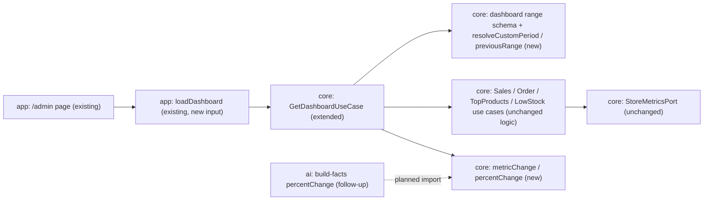

# Dashboard date-range comparison

- Status: implemented (spec PR #78, implementation PR #79)
- Date: 2026-10-19
- Scope: P1 "Basic sales trend comparison across two date ranges" (`.ai/specs/2026-10-13-commerceos-mvp.md` §P1)
- Design authority: `.ai/specs/product-brief.md` (R05, R07, D08), `.ai/specs/implemented/2026-10-16-orders-dashboard-demo-store.md` (A8 definitions, A9 periods, A14 demo orders), `.ai/specs/implemented/2026-10-17-commerce-copilot.md` (A8 previous period), AGENTS.md "Commerce Copilot rules" (one source for metrics)

## 📝 TLDR

Today the owner's `/admin` dashboard shows its metrics for exactly two presets, "Last 7 days" and "Last 30 days", with no way to pick other days and no comparison: to see whether sales went up, the owner has to ask the Copilot (`sales_change`) or switch presets and remember numbers. **Proposed (future behaviour):** the owner can also pick any range of whole days (`/admin?from=2026-10-01&to=2026-10-14`, native date inputs), and every period, preset or custom, shows Orders placed, Paid orders, Revenue and AOV next to the **previous period of the same number of days**, with the absolute and percentage change and honest wording when a change cannot be computed (previous value 0, AOV without paid orders, comparison period before the store's first order). All figures still come from the existing metric use cases; the Copilot is unchanged.

## 📝 Resolved assumptions (autonomous defaults)

Open questions resolved with the most reversible, smallest-scope answer. Any of them can be overridden on the spec PR before the implementation merges.

| # | Question | Applied default | Why | Confirm? |
|---|---|---|---|---|
| A1 | Does the Copilot gain a period or custom-range parameter now? | **No, later.** Copilot keeps its routed presets (7 d / 30 d), its own `sales_change` comparison and its exact types; **no file in `packages/ai` changes**. Core gets `percentChange` with the Copilot's rounding rule; a follow-up issue moves `build-facts.ts` onto that import (behaviour-identical), so the rule ends up in one place | Smallest scope that keeps P0 behaviour unchanged; a period argument touches routing, prompts, grounding (the period length is an allowed number) and the eval set, and two other lanes are working in `packages/ai` right now | reversible |
| A2 | What is "the previous equivalent period"? | The **same number of calendar days ending the day before the selected period starts** (store time zone Europe/Warsaw). For the presets it equals the Copilot's existing `previousPeriod()` | One definition for dashboard and Copilot; calendar-day arithmetic stays exact across DST | reversible |
| A3 | Is the comparison always shown, or behind a toggle? | **Always shown**, for presets and custom ranges | No extra control or URL parameter; the comparison lines are additive below each value, so the current numbers (and their e2e selectors) do not move | reversible |
| A4 | Which metrics are compared? | **Orders placed, Paid orders, Revenue from paid orders, Average order value.** Not compared: **Top products** (a ranking of the top 5; a product outside one period's top 5 has no comparable figure without a new query) and **Low stock** (a state "now", it has no period). Both cards say "Not compared with the previous period" with the reason in the comparison definition | Keeps the comparison to numbers the existing use cases return for both periods | reversible |
| A5 | How is the percentage rounded, and what if the base is 0? | Whole percent, `Math.round(((current − previous) / previous) × 100)`: **the Copilot's existing rule**, moved to core. Previous 0 and current > 0: absolute change only, "no % change (previous period: 0)". Both 0: "No change". AOV: "Not enough data to compare" when either period has no paid orders | Matches what the Copilot already tells the owner for the same 7-day period; no new rounding rule to document | reversible |
| A6 | Custom range limits | Whole days `YYYY-MM-DD`, both required, `from ≤ to`, `to ≤ today` (store time zone), at most **366 days**, `from ≥ 2000-01-01`. The comparison period may reach further back; it is not limited | 366 days covers "this year vs last year"-length ranges while bounding the aggregate queries (indexed by `created_at` / `paid_at`); a future end date would show days with no data as if they were a slump | reversible |
| A7 | What happens with an invalid range? | Never an error page (as `?period=abc` today). The dashboard shows the **last 7 days** (or the valid `period` preset when one is also in the URL), an alert naming the problem ("The end date must not be before the start date.") and the form refilled with the submitted values | Same fallback contract as the existing `period` parameter (`BACKWARD_COMPATIBILITY.md` §1); the alert keeps the fallback honest | reversible |
| A8 | `period` and `from`/`to` together | `from`/`to` win when they are valid; `period` is ignored then. Only one of `from`/`to` present = invalid ("Choose both a start date and an end date.") | One unambiguous rule; preset links drop `from`/`to` | reversible |
| A9 | "Insufficient data" beyond zeros | **Partial history:** when no order at all (any status, any currency, demo included) was placed before the comparison period starts, while the store has orders, the previous period may include days before the store started selling. Then **no percentage is shown** (absolute change only) and a note says "No order was placed before 6 Oct 2026, so the previous period may include days before the store started selling; percentages are not shown." Detected with the existing `GetOrderSummaryUseCase` over `[2000-01-01, comparison start)`: **no new query and no port change** | The seeded demo history covers 35 days, so "Last 30 days" vs the 30 days before compares against a mostly empty period; a "+900%" would read as growth (R05). Reusing the use case keeps one metric path and leaves every port fake (also in `packages/ai`) untouched | reversible |
| A13 | Today is not over | Periods include today (A9 of the orders spec), the previous period is whole days. When the selected period ends today, a note says "Today is not over yet, so this period has fewer hours of sales than the previous one." and the comparison definition says so. No time-of-day truncation | Truncating the previous period to the same hour would make it differ from the Copilot's `previousPeriod` and from its label; the note keeps the reading honest at no cost | reversible |
| A10 | Date-picker component | **Native `<input type="date">`** in a GET `<Form>` (`next/form`, part of Next.js) | No new library; URL state, back/forward and bookmarking for free; accessible labels; works at 390 px | reversible |
| A11 | Demo and other-currency orders in the comparison period | The notes "Includes N seeded demo orders (fictional)." (A14) and "N orders in other currencies are not included." (A10) are shown **for both periods** when present (existing `demoOrderCount` query and `otherCurrencyOrders` field, for the previous range too) | R07: demo data labelled wherever it is counted; the revenue comparison must not silently leave orders out | reversible |
| A12 | Does the comparison need its own definition text? | Yes: one `PERIOD_COMPARISON_DEFINITION` constant beside `METRIC_DEFINITIONS` (the six metric definitions are **unchanged**), printed once on the dashboard and mirrored in the README | R05: everything the dashboard computes states how; the metric definitions stay the single source and the README mirror only gains a paragraph | reversible |

## 📝 Problem Statement

- MVP spec §P1 lists "basic sales trend comparison across two date ranges". The orders spec deferred it explicitly (A9: "No custom range, no comparison … Date-range comparison is P1"), and the seed window was sized for it (A17).
- The only comparison today lives in the Copilot (`sales_change`), for the routed preset, paid orders and revenue only. The owner cannot check a specific week (e.g. a promotion week) or see the change on the dashboard itself.
- Risk the design must handle: a comparison invites causal readings (R05) and misleading percentages when the earlier period has little or no data (the seed covers 35 days). Hence A5, A9 and the definition text, which says that a change is not a cause.

## 📝 Proposed Solution

1. **Periods from days, not only presets.** `metric-period.ts` gains `resolveCustomPeriod(firstDay, lastDay)` and a `previousRange()` that derives the length from the period's own calendar days instead of `PRESET_DAYS`. `previousPeriod()` (Copilot) keeps its signature and results.
2. **One change rule.** `domain/metrics/metric-change.ts`: `percentChange(current, previous)` (the Copilot's rule, A5) and `metricChange(current, previous)` → `{ current, previous, delta, percent: number | null, direction: "up" | "down" | "same" }`; AOV uses `aovChange(current | null, previous | null)` → the same or `null` ("Not enough data to compare"). The Copilot switches to this `percentChange` in a follow-up (A1).
3. **Dashboard use case composes the existing use cases twice.** `GetDashboardUseCase.execute({ period, from, to })` resolves the selection (A6–A8), then runs Sales and Order summaries for both periods, Top products and Low stock once, `demoOrderCount` for both, and one Order summary over `[2000-01-01, comparison start)` for the partial-history check (A9). No metric is computed anywhere else; the changes are derived from the two DTOs.
4. **UI.** A date-range form beside the preset links; each compared card gets one comparison line below its value; one comparison header with the previous range, the definition and the notes.

### Alternatives considered

- **Comparison against the same period last year** (Shopify's second option): the demo store has 35 days of history, so it would always say "no data". Later, as an option.
- **Arbitrary second range** (two pickers, as in GA): doubles the form and the validation for little gain; "previous period" is what the MVP spec and the Copilot already use.
- **A charting library for a trend line**: new dependency, and a daily series needs a new query; the four numbers with their change answer "did it go up?". Out of scope.
- **A client date-picker (shadcn Calendar + react-day-picker)**: a new dependency and client JS for what the native input does; rejected (A10).

### Market check

Shopify Analytics and WooCommerce Analytics both default to "compare to previous period" with the same length, show the percentage next to each KPI and print "—" or no percentage when the base is zero. Both let a user pick a custom range with a preset list. WooCommerce also offers "previous year". We take the default behaviour and the zero handling; we skip the per-day chart and the second comparison mode.

## 📝 Architecture



Takeaway: everything new sits in `core` (pure) and `app`; no query, port, schema or `packages/ai` file changes.

### Modules

| Package | File | Change |
|---|---|---|
| `core` | `domain/metrics/metric-period.ts` | `resolveCustomPeriod(firstDay, lastDay)`, `previousRange(period)` (length from the period's own calendar days), `periodDays(period)`, `storeToday(now)`; `DashboardPeriod = Omit<MetricPeriod, "preset"> & { preset: MetricPeriodPreset \| "custom" }`. `MetricPeriod` (preset only) and `previousPeriod()` keep their types and results for the Copilot |
| `core` | `domain/metrics/metric-change.ts` (new) | `percentChange`, `metricChange`, `aovChange` |
| `core` | `domain/metrics/metric-definitions.ts` | `PERIOD_COMPARISON_DEFINITION` (A12); `METRIC_DEFINITIONS` unchanged |
| `core` | `validators/metrics/dashboard-range.schema.ts` (new) | Zod: `from`/`to` as ISO dates, both or neither; the cross-field rules need "today", so one `parseDashboardRange(raw, today)` returns `{ kind: "preset", preset } \| { kind: "custom", firstDay, lastDay } \| { kind: "invalid", message, fallback, submitted }` |
| `core` | `services/metrics/get-sales-summary`, `get-order-summary`, `get-top-products` use cases | Types only: generic over the period (`P extends` a labelled range), returned unchanged, so the Copilot still infers `MetricPeriod` (a type test asserts it) and only the dashboard passes a `"custom"` period. No logic change |
| `core` | `services/metrics/get-dashboard.use-case.ts` | Selection, both periods, changes, notes (below) |
| `app` | `app/admin/(protected)/page.tsx`, `load-dashboard.ts` | Pass `period`, `from`, `to` search params |
| `app` | `components/admin/dashboard/` | Range form view, comparison lines, notes, alert; all copy in `dashboard-copy.ts`, which is the only consumer of `"custom"` (label "Custom range"; preset links never current) |

## 📝 Data Model

No schema change, no migration, no new query.

## 📝 API Contracts

No HTTP API. Contracts that change:

- **URL (protected, `BACKWARD_COMPATIBILITY.md` §1, additive):** `/admin` accepts optional `from` and `to` (`YYYY-MM-DD`, store time zone, both inclusive). Existing `period=7d|30d` behaviour is unchanged when they are absent. Invalid values never produce an error page (A7).
- **`GetDashboardUseCase.execute({ period?, from?, to? })`** (all `unknown`, untrusted) → the existing `Dashboard` fields, with `period: DashboardPeriod`, plus:
  - `comparison: { period: DashboardPeriod; sales: SalesSummary; orders: OrderSummary; demoOrderCount: number; changes: { ordersPlaced: MetricChange; paidOrders: MetricChange; revenue: MetricChange; aov: MetricChange \| null }; partialHistory: boolean; includesToday: boolean }` (with `partialHistory`, every `percent` is `null`)
  - `rangeError: { message: string; from: string; to: string } \| null` (the submitted values, to refill the form)
  - `range: { firstDay: string; lastDay: string; maxDay: string }` (the form's values and its `max`)

## 📝 UI/UX

```
Dashboard
[Last 7 days] [Last 30 days]        From [2026-10-13] To [2026-10-19] [Show range]
13–19 Oct 2026 (Europe/Warsaw)
Compared with 6–12 Oct 2026, the previous 7 days. <definition text>
Includes 12 seeded demo orders (fictional). The previous period includes 15 seeded demo orders (fictional).

┌ Paid orders ─────────────┐
│ 14                       │
│ Up 2 (+17%) from 12      │  ← data-testid="metric-change"
│ <definition>             │
└──────────────────────────┘
```

- **Range form**: `<Form action="/admin">` (GET) with labelled `From` / `To` date inputs (`min` 2000-01-01, `max` today, prefilled with the shown period) and a "Show range" submit button. No client state. Errors: `role="alert"` paragraph linked by `aria-describedby` to both inputs, which get `aria-invalid`. When a custom range is active, no preset link has `aria-current`, and the range label says "Custom range".
- **Comparison line** per compared card, text not colour: "Up 2 (+17%) from 12", "Down 1,20 zł (−4%) from 30,00 zł", "No change from 12", "Up 3 from 0 (no % change: the previous period had none)", "Not enough data to compare" (AOV). The `metric-value` element is unchanged, so its text stays a bare number or amount.
- **Not compared** (Top products, Low stock): a muted line "Not compared with the previous period."
- **Partial history note** (A9) and **today note** (A13) under the comparison header; with partial history the comparison lines omit the percentage.
- **States**: loading (existing Suspense fallback), error (existing alert), empty period (existing hint; the comparison still shows the previous period's values), invalid range (alert + fallback).
- **390 px**: preset links and the form wrap onto separate lines; inputs take the full width; no horizontal scroll and no table container overflow (lessons 2026-10-19).

## 📝 Edge Cases & Failure Scenarios

| Case | Behaviour |
|---|---|
| `from` > `to`, `to` in the future, more than 366 days, before 2000-01-01, malformed (`2026-13-01`, `abc`), only one of the two, repeated params (`?from=a&from=b`) | Fallback period + alert naming the first problem; first value of a repeated param is used, as for `period` |
| Single-day range (`from = to`) | Valid; previous period is the day before |
| Range across a DST switch | Midnights computed per day (existing `localMidnight`); unit tests on both October and March switches |
| Previous period entirely or partly before the first order | Partial-history note, absolute changes only (A9) |
| Period ends today | Today note (A13); a single-day "today" range compares a partial day with yesterday, and the note says so |
| Empty store (no orders at all) | No partial note, existing empty-period hint, every change "No change" |
| Refund/cancellation after the fact | Restates the period it was paid in (existing definition); the comparison inherits it |
| Database failure | The whole dashboard load fails as today: the existing "Store metrics are unavailable" alert |

## 📝 Risks & Impact Review

- **Copilot drift**: none in this PR (no `packages/ai` file changes). Until the follow-up lands, the percentage rule exists in core and in `build-facts.ts` with identical code; a core unit test pins the same cases the Copilot's tests use.
- **Generic use-case types**: compile-time only; the Copilot's inferred types stay `MetricPeriod`.
- **Query load**: one dashboard view runs 4 more aggregate queries (sales, orders, demo count for the previous range, and the partial-history order count), all on indexed columns, bounded by the 366-day limit.
- **Protected URL**: additive parameters only; `period` keeps its meaning.
- Reversible: no schema, no stored data; reverting the PR restores today's dashboard.

## 📝 Decisions in play

| Id | How this spec relies on it |
|---|---|
| R05 | Definitions unchanged and printed; the comparison has its own printed definition and says a change is not a cause |
| R07 | Demo orders labelled for both periods |
| D08 | Fictional traffic data stays out of the dashboard; no comparison of traffic |
| Copilot spec A8 | Same "previous period of the same length" and the same percentage rule |

No product decision is superseded.

## 📋 Phasing

One phase, one implementation PR (8 steps): the feature is small and each step keeps the app working. Follow-up (separate issue): `build-facts.ts` imports core `percentChange`; optionally a Copilot period argument (A1).

## 📋 Implementation Plan

### Phase 1: Date range and comparison on the dashboard

1. **Periods from days.** `resolveCustomPeriod`, `previousRange`, `periodDays`, `storeToday`, `DashboardPeriod`; `previousPeriod` built on `previousRange` with identical results. Unit tests: custom ranges across both DST switches, single day, year boundary, label formats, previous of a custom range, presets unchanged.
2. **Change rule and definition.** `metric-change.ts` with tests (up, down, same, zero base, both zero, AOV null either side, the Copilot's rounding cases); `PERIOD_COMPARISON_DEFINITION`.
3. **Range validation.** `dashboard-range.schema.ts` + `parseDashboardRange` with tests for every A6–A8 case.
4. **Use case.** Generic use-case types (with a type-level test that the Copilot's calls still infer `MetricPeriod`); `GetDashboardUseCase` with the selection, both periods, changes, notes data, partial-history and today flags and `rangeError`. Unit tests with the fake port and a fixed clock (preset, custom, invalid + fallback, partial history hides %, today flag). Integration test: the dashboard use case on the real adapter with a custom range whose orders sit exactly on both boundaries of the current and previous periods.
5. **UI.** Range form, comparison header and lines, notes, alert; page and loader pass the params. View unit tests in every state, including that `metric-value` still holds only the bare value.
6. **E2E.** `admin-dashboard.e2e.test.ts`: a custom range via the form updates the URL and the range label; every compared card shows a comparison line and the previous range; an invalid range shows the alert and the 7-day fallback; at 390 px no horizontal overflow and the form is usable.
7. **Docs.** README (dashboard section and comparison definition), `BACKWARD_COMPATIBILITY.md` (`from`/`to`), lessons if any; move this spec to `implemented/`.
8. **Full gate** (lint, format, typecheck, 100 % unit coverage, build, integration, e2e).

## 📝 Review log

- Fresh-context review (2026-10-19), all applied: today is a partial day (A13 note); partial history now hides the percentage instead of only adding a note (A9); the Copilot import moved to a follow-up so no `packages/ai` file changes (A1); other-currency note for both periods (A11); `"custom"` is consumed only by the dashboard copy, with a type test for the Copilot; the new `earliestOrderAt` query was replaced by the existing order-summary use case; a view test pins `metric-value`; the last step was split.
- Self-review (2026-10-19): the comparison reuses the use cases (no second metric path), the percentage rule is moved rather than duplicated, the Copilot keeps its contract, the URL change is additive, and every step has a test. Mockups: none rendered; the ASCII layout above is the design, and the implementation PR carries real screenshots from QA.
- Implementation notes (2026-10-19, PR #79):
  - The range form is a plain `<form method="get" action="/admin">` instead of `next/form`. Each submit is a full navigation, but the form stays a server-rendered view with no client code, and every other contract in A10 holds.
  - The native `required`/`min`/`max` attributes block an empty or out-of-bounds submit in the browser, so the server messages are reached through the URL (the e2e test does this).
  - The comparison card line is always present: compared cards show the change, and the other two say "Not compared with the previous period."
  - Follow-up: `build-facts.ts` should import core `percentChange`.
